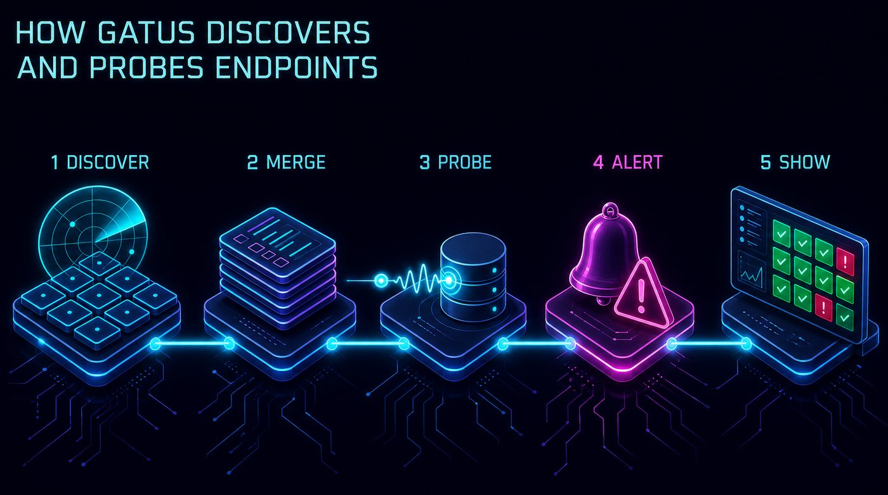
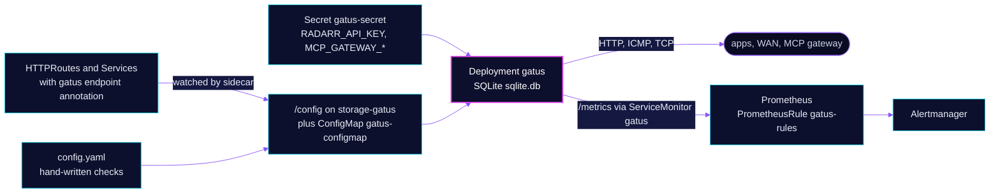

<p align="center">
  
</p>

> **Every route is a check, and a few checks are written by hand.** Gatus polls each endpoint on its own interval,
> records the results in SQLite, and exposes them to Prometheus. Two alerts page on them: an external endpoint going
> down is critical, and any other endpoint going down is a warning. Nobody maintains a list of routes.

## At a glance

<!-- glance:start -->
<!-- Generated by `readme.py sync`; edit the manifests, not this table. -->
| | |
|---|---|
| **Namespace** | `monitoring` |
| **Deployed by** | [`gatus`](../../../main/monitoring/gatus.yaml) (Flux Kustomization) |
| **Helm chart** | `app-template`, values in [`helmrelease.yaml`](app/helmrelease.yaml) |
| **Images** | `ghcr.io/home-operations/gatus-sidecar`, `ghcr.io/twin/gatus` |
| **Depends on** | `rook-ceph/rook-ceph-cluster`, `security/onepassword-store` |
| **Secret** | `gatus-secret` from onepassword item `mcp-gateway`, `radarr` |
| **Volume** | `storage-gatus` 512Mi on `ceph-block` |
| **Alerts** | 4: `GatusEndpointDown`, `GatusServiceDown`, `RadarrImportQueueBlocked`, `HermesGatewayDown` |
<!-- glance:end -->

## What it does

- **Discovers** every HTTPRoute and Service that carries a `gatus.home-operations.com/endpoint` annotation. The
  `gatus-sidecar` init container (`--auto-httproute`, `--enable-httproute`, `--enable-service`) writes them into the
  shared `/config` volume, which is the `storage-gatus` claim.
- **Checks** what no route shows, from [`resources/config.yaml`](app/resources/config.yaml): the household WAN over ICMP
  to three resolvers, the Radarr import queue, the Hermes gateway health body, the ToolHive MCP session, Home
  Assistant's `manifest.json`, the Tdarr node port and the in-cluster Echo and Kromgo health bodies.
- **Stores** results in SQLite at `/config/sqlite.db`, with caching on, on a 512 MiB `ceph-block` claim.
- **Alerts** through [`app/prometheusrule.yaml`](app/prometheusrule.yaml): `GatusEndpointDown` for the `external`
  group, `GatusServiceDown` for every group except `external` and `connectivity`, plus two alerts for endpoints that
  need their own wording.
- **Serves** the status page and its API on the internal Gateway, and exposes `/metrics` through a ServiceMonitor.

## Why it is built this way

| Choice | Why |
|---|---|
| **Annotate the route, not the Gatus config** | The check is written next to the thing it checks, so a new app is covered when its route is. The `gatus.io/enabled` ConfigMap label does nothing, because the sidecar's RBAC watches Services, Gateways and HTTPRoutes only. |
| **Hand-written checks where a status code lies** | An ext_authz SecurityPolicy answers 200 or 302 before the backend, so a status-only check on that route stays green through an outage. Those checks match a body field instead (Home Assistant's `manifest.json`, Kromgo's `OK`, the MCP `serverInfo` name). |
| **MCP check posts `initialize`, not `/health`** | `/health` stays 200 while the handshake hangs. The 25 s client timeout sits under the Hermes connect timeout (skill `observability`), and the 5 m interval is there because each probe embeds the catalog. |
| **Two alert tiers** | `external` endpoints are the public face, so they page at critical after 5 minutes. Internal groups are a warning after 10 minutes, so a restart of one app does not wake anyone. The exclusions for Radarr and Hermes exist because those have their own alerts. |
| **SQLite on a Ceph block claim** | One writer, a small file. A PVC cannot shrink in place, so the 512 MiB size is permanent once created. |
| **Gatus is not the only signal** | The stock `KubePodNotReady`, `KubePodCrashLooping` and `OOMKilled` rules already cover "is it down" for any app that has probes. Gatus adds reachability and body checks those cannot see. |

## How it works

<p align="center">
  
</p>

<p align="center">
  
</p>

<details>
<summary><b>Resource graph</b>: every object involved, by name</summary>



</details>

In more detail:

1. Flux applies the ExternalSecret, the PVC, the ConfigMap generated from `resources/config.yaml` (with substitution
   disabled, so Gatus reads its own `${RADARR_API_KEY}` and `${MCP_GATEWAY_TOKEN}` at runtime), the PrometheusRule and
   the HelmRelease.
2. The pod starts with the sidecar and Gatus sharing `/config`. The sidecar writes the discovered endpoints into the
   same directory that Gatus reads its config from.
3. Each endpoint runs on its own interval. Results go to SQLite and to the `gatus_results_endpoint_success` metric,
   labelled by `group` and `name`.
4. Prometheus evaluates `gatus-rules`. Critical and warning alerts route through Alertmanager.

## Settings that matter

All values are in [`app/helmrelease.yaml`](app/helmrelease.yaml) unless noted.

| Setting | Value | Why |
|---|---|---|
| `initContainers.gatus-sidecar.args` | `--auto-httproute --enable-httproute --enable-service` | Discovery. Without it only the static checks run, and nothing reports a missing route. |
| `defaultPodOptions.securityContext.fsGroup` | `65532` | Load-bearing. The sidecar runs as non-root 65532 and shares the config volume with Gatus. Without this group the sidecar cannot write, discovery stops, and Gatus silently keeps only static endpoints (skill `observability`). |
| `defaultPodOptions.automountServiceAccountToken` | `true` | app-template turns automount off by default. The sidecar watches the Kubernetes API, so it needs the token. |
| `rbac` ClusterRole `gatus` | `get`, `watch`, `list` on Services, Gateways and HTTPRoutes | The least that discovery needs. Nothing here writes to the cluster. |
| `containers.app.securityContext` | read-only root filesystem, no privilege escalation, drop `ALL`, add `NET_RAW` | `NET_RAW` is for the ICMP checks on the WAN. Everything else is dropped. |
| `containers.app.resources` | requests 100m CPU and 128Mi; memory limit 256Mi | Every memory limit has a request. The 128Mi request is about 2.7 times the 14-day peak, with headroom for discovered endpoints. |
| `persistence.config` | existing claim `storage-gatus`, mounted at `/config` | Holds the SQLite history and the discovered config. The claim is in [`app/pvc.yaml`](app/pvc.yaml), and it cannot shrink in place. |
| `route.app.hostnames` | `gatus.${SECRET_DOMAIN}` and `status.${SECRET_DOMAIN}` on `envoy-internal` | The status page is internal only. |
| `route.app.annotations.external-dns.kubernetes.io/target` | `internal.${SECRET_DOMAIN}` | See Known gaps: the Gateway decides the DNS target, not this route. |
| `probes` | `/health` on port 80, liveness and readiness | Gatus's own health endpoint. |

## Alerts

From [`app/prometheusrule.yaml`](app/prometheusrule.yaml), routed by the `alerts` component.

| Alert | Fires when | First look |
|---|---|---|
| `GatusEndpointDown` | an `external` endpoint fails for 5 min (critical) | The endpoint's name in the status page. Its body check is the first thing to read. |
| `GatusServiceDown` | a non-external endpoint fails for 10 min (warning), except `connectivity`, Radarr and Hermes | The `group` and `name` labels say which app. A `KubePodNotReady` on the same app is usually the cause. |
| `RadarrImportQueueBlocked` | Radarr's queue has a stuck or warning item for 30 min | Open Activity, then Queue, in Radarr and Manual Import the item. |
| `HermesGatewayDown` | the Hermes gateway check fails for 10 min (critical) | The dashboard can stay green through this. Check the gateway itself, as the alert annotation says. |

## Operate it

```bash
flux -n monitoring get ks gatus
flux -n monitoring get hr gatus
kubectl -n monitoring get httproute                    # the routes the sidecar will discover
kubectl -n monitoring port-forward deploy/gatus 8080:80   # in one shell
curl -s localhost:8080/api/v1/endpoints/statuses | head -c 2000   # in another
```

The endpoint and route rules, the Hermes and MCP checks, and the empty-token trap are in skill `observability`
([gatus.md](../../../../../.agents/skills/observability/references/gatus.md)). Read it before adding a check.

## Known gaps

- **The route's `external-dns.kubernetes.io/target` annotation is probably inert.** Per skill `networking` and the
  repo conventions, the parent Gateway's `external-dns.kubernetes.io/target` decides the DNS record, not a route
  annotation. Check `envoy-internal` before relying on this line or removing it. Found while writing; not changed here.

## Files

| File | Holds |
|---|---|
| [`app/helmrelease.yaml`](app/helmrelease.yaml) | Pod, sidecar, RBAC, route, ServiceMonitor |
| [`app/resources/config.yaml`](app/resources/config.yaml) | Hand-written checks and UI settings |
| [`app/prometheusrule.yaml`](app/prometheusrule.yaml) | `GatusEndpointDown`, `GatusServiceDown`, `RadarrImportQueueBlocked`, `HermesGatewayDown` |
| [`app/externalsecret.yaml`](app/externalsecret.yaml) | Radarr API key and MCP gateway token, from 1Password items `radarr` and `mcp-gateway` |
| [`app/pvc.yaml`](app/pvc.yaml) | The SQLite claim |
| [`../../../main/monitoring/gatus.yaml`](../../../main/monitoring/gatus.yaml) | Flux Kustomization, `dependsOn` `rook-ceph-cluster` |

Upstream: [Gatus docs](https://github.com/TwiN/gatus) •
[Gatus endpoint conditions](https://github.com/TwiN/gatus#conditions)

<!-- branded-readme v1 sources=354944850a54 -->
