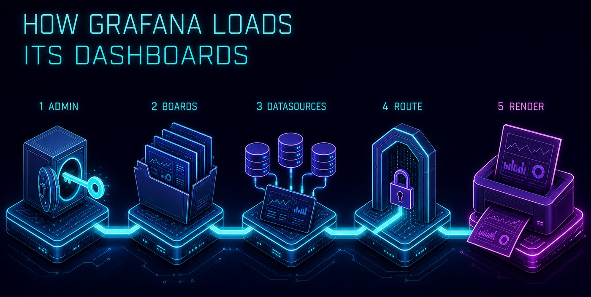
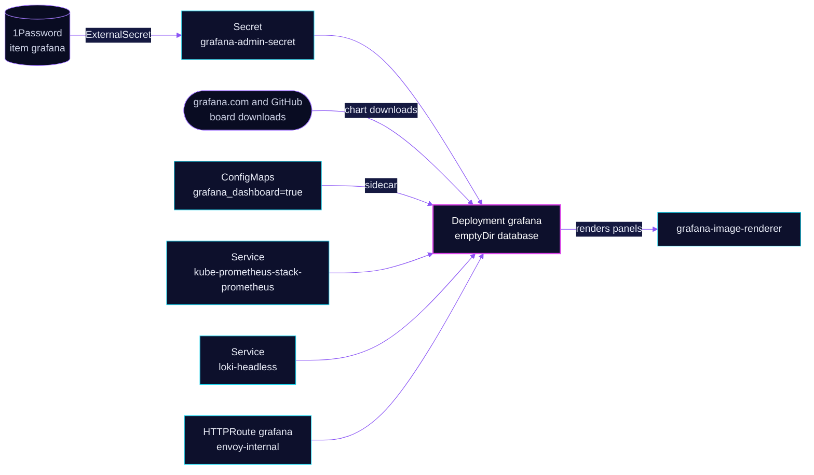

<p align="center">
  
</p>

> **Dashboards are code, not state.** Grafana loads its boards from the chart's grafana.com list and from labelled
> ConfigMaps in Git, and it reads Prometheus and Loki as provisioned datasources. Its database lives in an emptyDir,
> so a restart returns it to what Git says. Anything made by hand in the UI is gone after the next restart.

## At a glance

<!-- glance:start -->
<!-- Generated by `readme.py sync`; edit the manifests, not this table. -->
| | |
|---|---|
| **Namespace** | `monitoring` |
| **Deployed by** | [`grafana`](../../../main/monitoring/grafana.yaml) (Flux Kustomization) |
| **Helm chart** | `grafana` from `oci://ghcr.io/grafana/helm-charts/grafana`, values in [`helmrelease.yaml`](app/helmrelease.yaml) |
| **Depends on** | `security/onepassword-store` |
| **Needed by** | `monitoring/grafana-sa-provisioner` |
| **Secret** | `grafana-admin-secret` from onepassword item `grafana` |
<!-- glance:end -->

## What it does

- **Serves** the Grafana UI on `grafana.${SECRET_DOMAIN}` through the `envoy-internal` Gateway. Anonymous access is off.
- **Loads** boards in two ways. The chart downloads grafana.com boards and URL boards into folders such as Infrastructure,
  Database, AI/ML, Monitoring and Storage. Only the `gnetId` plus `revision` boards are pinned. The sidecar loads every ConfigMap labelled `grafana_dashboard: "true"` from
  any namespace, into the folder named by its `grafana_folder` annotation. The Ceph and LiteLLM boards in this
  directory use the second path.
- **Provisions** three datasources: `Prometheus` (default, the `kube-prometheus-stack-prometheus` Service), `Loki`
  (`loki-headless`) and `Alertmanager` (the `alertmanager` Service in this namespace).
- **Sets** the landing page, `Home - Homelab Overview`, as the home dashboard. It is written by the chart into the
  dashboards directory and named in `grafana.ini`.
- **Renders** panels to images through the `grafana-image-renderer` subchart, which is allowed to resolve names through
  CoreDNS.
- **Hosts** the Viewer service account that `ai/grafana-mcp` uses. The [grafana-sa-provisioner](../grafana-sa-provisioner/README.md)
  CronJob, a separate app, heals that token when it is lost to a restart.

## Why it is built this way

| Choice | Why |
|---|---|
| **No persistent volume** | `persistence.enabled: false`. The database is rebuilt from Git on each boot, so the repo is the only source of truth for boards and datasources. The cost is that UI edits and hand-made service-account tokens disappear on restart. Skill `observability` covers that in [grafana.md](../../../../../.agents/skills/observability/references/grafana.md). |
| **Dashboards as ConfigMaps, not a Grafana operator** | A labelled ConfigMap is loaded by the sidecar, and it works in any namespace. The grafana-operator is gone, though its CRDs may still exist in the cluster. Do not add a `GrafanaDashboard` kind. |
| **grafana.com boards pinned by revision** | `gnetId` plus `revision` makes each board reproducible, and the `renovate:` comments let Renovate bump them. Boards loaded by `url` are not pinned: the flux, emqx, envoy and toolhive boards come from GitHub `main`. |
| **Prometheus `timeInterval: 1m`** | It matches the scrape interval. Without it Grafana assumes 15 s, `$__rate_interval` resolves to one scrape, and every `rate()` panel is empty on wide time ranges. |
| **Landing page set in `grafana.ini`, not by env** | `dashboards.default_home_dashboard_path` is the working setting. The env var `GF_DASHBOARDS_DEFAULT_HOME_DASHBOARD_PATH` overrides it and points at a directory with no `home.json`, so every visit to the home page returns 500. |
| **Some boards are not imported** | The Cilium board comes from the Cilium HelmRelease. gnetId 16611 has the same UID as that board, and a UID collision locks the sidecar out of writes. Several database boards come from their operators, and the PDU board queries series this Prometheus does not publish. |
| **Spread without excluding talos-3** | `nodeTaintsPolicy: Honor` does not remove talos-3 from the spread domains, because the pod has no toleration for its `PreferNoSchedule` taint. The TaintToleration score keeps the pod off talos-3 instead (skill `node-scheduling`). |

## How it works

<p align="center">
  
</p>

<p align="center">
  
</p>

<details>
<summary><b>Resource graph</b>: every object involved, by name</summary>



</details>

In more detail:

1. Flux applies the OCIRepository (the chart, pinned by tag), the HelmRelease, the ExternalSecret, the image renderer
   NetworkPolicy, and the two dashboard kustomizations for Ceph and LiteLLM.
2. The chart renders a Deployment with one replica, and the ConfigMaps for `grafana.ini` and the dashboard provider
   list. The `dashboardProviders` entries decide which folders exist.
3. The chart downloads the grafana.com and URL boards in every `dashboards.*` group, and writes the
   home dashboard JSON inline in the HelmRelease.
4. The sidecar watches every namespace for ConfigMaps labelled `grafana_dashboard: "true"` and copies them into the
   folder named by `grafana_folder`.
5. Grafana queries `kube-prometheus-stack-prometheus:9090` and `loki-headless:3100` for panels, and the renderer sends
   back images for alert notifications and shares.

## Settings that matter

All values are in [`app/helmrelease.yaml`](app/helmrelease.yaml) unless noted.

| Setting | Value | Why |
|---|---|---|
| `persistence.enabled` | `false` | Boards and datasources come from Git. See the note on emptyDir in *Why*. |
| `replicas` | `1` | Each replica would have its own emptyDir database, so a second one would show different state. |
| `admin.existingSecret` | `grafana-admin-secret` | Admin credentials come from the ExternalSecret. Changing them in the UI is lost on restart. |
| `env.GF_AUTH_ANONYMOUS_ENABLED` | `false` | Overrides `grafana.ini`. See Known gaps: the ini block still says `true`. |
| `env.GF_SERVER_ROOT_URL` | `https://grafana.${SECRET_DOMAIN}` (templated from the release name) | Links, share URLs and rendered images point at the internal name. |
| `grafana.ini.dashboards.default_home_dashboard_path` | `/var/lib/grafana/dashboards/default/home-dashboard.json` | The landing page. Use this key, not the env var, which overrides it and breaks the home page. |
| `datasources` Prometheus `timeInterval` | `1m` | Must match the scrape interval, or `rate()` panels are empty on wide ranges. |
| `sidecar.dashboards.label` and `folderAnnotation` | `grafana_dashboard`, `grafana_folder`, `searchNamespace: ALL` | The contract any app uses to ship a board. Any namespace can add one. |
| `imageRenderer.enabled` | `true` | Enables the renderer subchart. Its NetworkPolicy is in [`app/networkpolicy-image-renderer-dns.yaml`](app/networkpolicy-image-renderer-dns.yaml). That policy has no `ports` on purpose: a DNS reply arrives on an ephemeral port, so `port: 53` would drop it (skill `networking`). |
| `resources` | requests 50m CPU and 128Mi; memory limit 512Mi | Every memory limit has a request. |
| `topologySpreadConstraints` | `kubernetes.io/hostname`, `DoNotSchedule`, `nodeTaintsPolicy: Honor` | Spread across nodes. `Honor` does not exclude talos-3 here; the TaintToleration score keeps the pod off it (skill `node-scheduling`). |
| `route.main.hostnames` | `grafana.${SECRET_DOMAIN}` on `envoy-internal` | Internal only. |

## Operate it

```bash
flux -n monitoring get hr grafana
kubectl -n monitoring get pods -l app.kubernetes.io/name=grafana
kubectl get configmaps -A -l grafana_dashboard=true -o name     # every board the sidecar loads
```

The admin password is a 1Password item (`grafana`), not a value to read here. `SecretSynced` on the ExternalSecret does
not prove the values are non-empty (skill `secrets-1password`).

## Known gaps

- **Two settings disagree about anonymous access.** The HelmRelease sets `GF_AUTH_ANONYMOUS_ENABLED: "false"`, and
  `grafana.ini` sets `auth.anonymous.enabled: true` with the Viewer role. The environment variable wins, so anonymous
  access is off, but the ini block reads as though it is on. One of the two should go. Found while writing; not changed
  here.

## Files

| File | Holds |
|---|---|
| [`app/helmrelease.yaml`](app/helmrelease.yaml) | Chart values: datasources, dashboards, sidecar, route, renderer |
| [`app/ocirepository.yaml`](app/ocirepository.yaml) | Chart source and pinned tag |
| [`app/externalsecret.yaml`](app/externalsecret.yaml) | Admin user and password, from 1Password item `grafana` |
| [`app/networkpolicy-image-renderer-dns.yaml`](app/networkpolicy-image-renderer-dns.yaml) | Lets the renderer receive CoreDNS replies |
| [`app/dashboards/ceph/`](app/dashboards/ceph/) | Ceph Usage and Ceph Hosts Overview, as labelled ConfigMaps in the Storage folder |
| [`app/dashboards/litellm/`](app/dashboards/litellm/) | LiteLLM and LiteLLM Routing, as labelled ConfigMaps in the AI/ML folder |
| [`../grafana-sa-provisioner/README.md`](../grafana-sa-provisioner/README.md) | The Viewer token healer for `ai/grafana-mcp` (legacy README) |
| [`../../../main/monitoring/grafana.yaml`](../../../main/monitoring/grafana.yaml) | Flux Kustomization |

Upstream: [Grafana docs](https://grafana.com/docs/grafana/latest/) •
[provisioning](https://grafana.com/docs/grafana/latest/administration/provisioning/) •
[Grafana Helm chart](https://github.com/grafana/helm-charts/tree/main/charts/grafana)

<!-- branded-readme v1 sources=d069d74e28b3 -->
