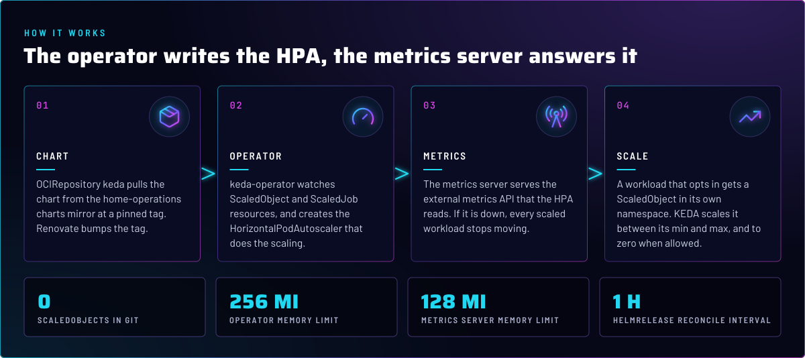
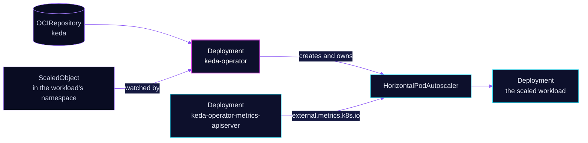

<p align="center">
  
</p>

> **Scaling on events, not only on CPU.** KEDA turns an event source into a scaler: a workload declares a
> `ScaledObject`, and KEDA creates and feeds the HorizontalPodAutoscaler that does the work. This directory installs the
> operator and its metrics server. No app in Git uses it yet.

## At a glance

<!-- glance:start -->
<!-- Generated by `readme.py sync`; edit the manifests, not this table. -->
| | |
|---|---|
| **Namespace** | `monitoring` |
| **Deployed by** | [`keda`](../../../main/monitoring/keda.yaml) (Flux Kustomization) |
| **Helm chart** | `keda` from `oci://ghcr.io/home-operations/charts-mirror/keda`, values in [`helmrelease.yaml`](app/helmrelease.yaml) |
<!-- glance:end -->

## What it does

- **Installs** the KEDA chart into `monitoring`: the operator (`keda-operator`), the metrics API server
  (`keda-operator-metrics-apiserver`) that serves `external.metrics.k8s.io`, and the chart's CRDs.
- **Reconciles** `ScaledObject` and `ScaledJob` resources in any namespace. The operator creates and owns the HPA.
- **Serves** the external metrics that the HPA reads. Without the metrics server, every scaled workload stops scaling.
- **Pauses** scaling by annotation. `kubernetes/mod.just` has a recipe that sets or removes
  `autoscaling.keda.sh/paused` on a ScaledObject, for maintenance windows.

## Why it is built this way

| Choice | Why |
|---|---|
| **Its own app, in `monitoring`** | It is a platform component, not a workload. Its metrics API is what makes a scaled workload work, so it sits with the observability stack. |
| **`wait: true` on the Kustomization** | KEDA is a dependency gate. A Kustomization that depends on it waits for the CRDs and the metrics server to be ready. Nothing in Git depends on it today (skill `flux-gitops`). |
| **Chart from the home-operations charts mirror** | The mirror is pinned by tag and bumped by Renovate. The upstream chart is not pulled directly. |

## How it works

<p align="center">
  
</p>

<details>
<summary><b>Resource graph</b>: every object involved, by name</summary>



</details>

In more detail:

1. Flux applies the OCIRepository, which polls the chart every 15 minutes at a pinned tag, and the HelmRelease, which
   reconciles hourly.
2. The chart installs the CRDs, the operator and the metrics server, and registers the external metrics APIService.
3. A workload's ScaledObject names a target Deployment and one or more triggers. The operator turns that into an HPA.
4. The HPA asks the metrics server for the trigger's value. KEDA scales the target between its min and max, and to
   zero when the ScaledObject allows it.

## Settings that matter

All values are in [`app/helmrelease.yaml`](app/helmrelease.yaml) unless noted. The chart version is in
[`app/ocirepository.yaml`](app/ocirepository.yaml).

| Setting | Value | Why |
|---|---|---|
| `enableServiceLinks` | `false` | With the default `true`, kubelet injects an environment variable for every Service in `monitoring` into each pod. KEDA does not read those variables, so turning them off keeps the pod environment to what it uses. |
| `resources.operator` | requests 100m CPU and 128Mi; memory limit 256Mi | Every memory limit has a request (skill `node-scheduling`). |
| `resources.metricServer` | requests 50m CPU and 64Mi; memory limit 128Mi | The metrics server is on the scaling path, so it stays small and predictable. |
| `OCIRepository` `ref.tag` | pinned | Renovate bumps it, so a chart upgrade arrives as a reviewed PR. |
| Kustomization `wait` | `true` | Dependency gate for CRDs and the metrics API. |

## Alerts

None in this directory. A dead operator shows up as the stock `KubeDeploymentReplicasMismatch` on `keda-operator`, and a
failing metrics server shows up as HPAs whose targets read `<unknown>`.

## Operate it

```bash
flux -n monitoring get ks keda
flux -n monitoring get hr keda
kubectl -n monitoring get deploy                          # keda-operator and the metrics API server
kubectl get apiservice v1beta1.external.metrics.k8s.io   # AVAILABLE should be True
kubectl get scaledobjects -A                             # empty in Git today
```

## Files

| File | Holds |
|---|---|
| [`app/helmrelease.yaml`](app/helmrelease.yaml) | Chart values: resources, service-link setting |
| [`app/ocirepository.yaml`](app/ocirepository.yaml) | Chart source and pinned tag |
| [`app/kustomization.yaml`](app/kustomization.yaml) | Resource list |
| [`../../../main/monitoring/keda.yaml`](../../../main/monitoring/keda.yaml) | Flux Kustomization, `wait: true` |

Upstream: [KEDA docs](https://keda.sh/docs/) •
[ScaledObject spec](https://keda.sh/docs/latest/reference/scaledobject-spec/) •
[pausing autoscaling](https://keda.sh/docs/latest/concepts/scaling-deployments/#pause-autoscaling)

<!-- branded-readme v1 sources=6fe7a1ec296c -->
