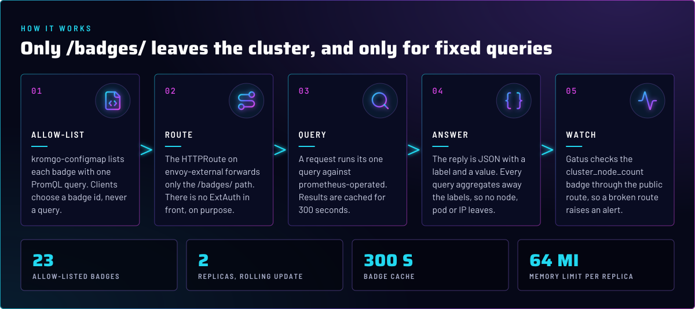
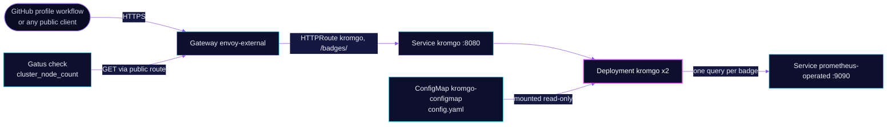

<p align="center">
  
</p>

> **Public numbers, nothing else.** kromgo answers a fixed allow-list of PromQL queries as JSON badges, on the external
> Gateway and without authentication. A client can choose a badge but never a query, and every query aggregates away
> the labels that would identify a node, pod or address, except the one label a badge displays.

## At a glance

<!-- glance:start -->
<!-- Generated by `readme.py sync`; edit the manifests, not this table. -->
| | |
|---|---|
| **Namespace** | `monitoring` |
| **Deployed by** | [`kromgo`](../../../main/monitoring/kromgo.yaml) (Flux Kustomization) |
| **Helm chart** | `app-template`, values in [`helmrelease.yaml`](app/helmrelease.yaml) |
| **Images** | `ghcr.io/home-operations/kromgo` |
<!-- glance:end -->

## What it does

- **Serves** 23 badges under `/badges/<id>` on `kromgo.${SECRET_DOMAIN}` through `envoy-external`. The route forwards
  that path prefix only.
- **Groups** the badges in [`resources/config.yaml`](app/resources/config.yaml) into four kinds: cluster health (Talos,
  Kubernetes and Flux versions, node, pod and alert counts, CPU, memory, age and uptime), the AI gateway over seven
  days (tokens, requests, local share and cache hits), the Intel GPU on talos-3 (VRAM, temperature, power and fan),
  and the local chat model (decode speed, model name and active requests).
- **Caches** each answer for 300 seconds, so a public badge never fans out to Prometheus per request.
- **Answers** from two replicas running as UID 1000, with a read-only root filesystem and every capability dropped.
- **Serves** the public GitHub profile workflow, which reads the badges anonymously, and a Gatus check on the
  `cluster_node_count` badge through the public route.

## Why it is built this way

| Choice | Why |
|---|---|
| **Public on purpose, no ExtAuth** | The profile README reads these badges from GitHub with no login, and an auth layer would break that. Cloudflare sits in front. Only `/badges/` is routed, and only the queries in the config are answered. |
| **Query allow-list, never a query parameter** | kromgo 0.16 returns every label of the result in `?format=json`. Query parameters never reach PromQL, so a caller cannot pick a metric. |
| **Every query aggregates away its labels** | Node names, pod IPs and alert labels would otherwise appear in a public response. `max by (...)`, `count(...)` and `sum(...)` drop them. Four badges (Talos, Kubernetes, Flux and the chat model) keep exactly one label, the one they display. |
| **No `/metrics` listener** | `KROMGO_METRICS_ENABLED: "false"`. Nothing scrapes it, and the main port is the only one served. |
| **Gallery disabled** | `gallery.enabled: false` and a hidden gallery default. A gallery page would publish the whole badge list, which nobody asked for. |

The public-config rules are enforced by CI: [`scripts/ci/kromgo-public-config-test.py`](../../../../../scripts/ci/kromgo-public-config-test.py)
checks the badge allow-list, the label-dropping aggregation, the absence of graphs and the gallery, and the route.

## How it works

<p align="center">
  
</p>

Flux applies the HelmRelease and the ConfigMap. The ConfigMap is generated from `resources/config.yaml` with its
name fixed, so the HelmRelease can mount it at `/config/config.yaml`. Flux substitutes that file like any other
manifest, so the config must never contain a `${...}` (the file says so at the top).

<details>
<summary><b>Resource graph</b>: every object involved, by name</summary>



</details>

1. A client requests `https://kromgo.${SECRET_DOMAIN}/badges/<id>?format=json` through `envoy-external`.
2. The HTTPRoute matches `PathPrefix /badges/` and forwards to port 8080 on either replica.
3. kromgo looks up the badge id in its config, runs its one query against `prometheus-operated:9090`, and caches the
   result for 300 seconds.
4. The response is JSON with the badge's label and value. The `valueExpr` formats it, for example `humanizeFloat`.
5. Gatus checks the `cluster_node_count` badge through the public route. A broken route raises an alert.

## Settings that matter

All values are in [`app/helmrelease.yaml`](app/helmrelease.yaml) unless noted.

| Setting | Value | Why |
|---|---|---|
| `controllers.kromgo.replicas` | `2`, `RollingUpdate` | Two copies, so one pod restart does not drop the public badges. |
| `env.KROMGO_PROMETHEUS_URL` | `http://prometheus-operated.monitoring.svc.cluster.local:9090` | Reads Prometheus directly, not through Grafana. |
| `env.KROMGO_METRICS_ENABLED` | `"false"` | No second listener. See *Why*. |
| `probes` | `/readyz` on 8080, liveness and readiness | The app's own readiness path. |
| `defaultPodOptions.securityContext` | non-root UID and GID 1000 | Runs without root. |
| `containers.app.securityContext` | read-only root filesystem, no privilege escalation, drop `ALL` | Nothing writes to the image. |
| `resources` | requests 10m CPU and 32Mi; memory limit 64Mi | Every memory limit has a request. The 32Mi request is about four times the 14-day peak across the two replicas, per the chart comment. |
| `route.app.parentRefs` | `envoy-external`, `https` | Public on purpose. See *Why*. |
| `route.app.rules` | `PathPrefix /badges/` only | Gallery, graphs and health paths are not routed. |
| `route.app.annotations.gatus.home-operations.com/endpoint` | `cluster_node_count` badge over HTTPS | The public route is the check, so a broken route alerts. |
| `persistence.config-file` | ConfigMap `kromgo-configmap` at `/config/config.yaml`, read-only | The allow-list. |
| `cache.maxAge` (in `resources/config.yaml`) | `300` | Bounds the Prometheus load a public client can cause. |

## Known gaps

- **Both replicas can land on one node.** The HelmRelease has no PodDisruptionBudget and no topology spread
  constraint, so one node drain can take both badge replicas down at once. Found while writing; not changed here.
- **The overlay's Gatus substitution values are unused and misspelled.** [`kubernetes/apps/main/monitoring/kromgo.yaml`](../../../main/monitoring/kromgo.yaml)
  sets `GATUS_SUBDOMAIN: kromogo` and `GATUS_PATH`, and nothing in this directory references them. The Gatus check
  itself is in the route annotation. The values are harmless but misleading, so they can go.

## Operate it

```bash
flux -n monitoring get ks kromgo
kubectl -n monitoring get pods -l app.kubernetes.io/name=kromgo
kubectl -n monitoring get httproute kromgo               # the route should show only /badges/
curl -s "https://kromgo.${SECRET_DOMAIN}/badges/cluster_node_count?format=json"
```

## Files

| File | Holds |
|---|---|
| [`app/helmrelease.yaml`](app/helmrelease.yaml) | Replicas, probes, route, config mount |
| [`app/resources/config.yaml`](app/resources/config.yaml) | The badge allow-list, cache and gallery settings |
| [`app/kustomization.yaml`](app/kustomization.yaml) | ConfigMap generator (name fixed, no hash suffix) |
| [`../../../main/monitoring/kromgo.yaml`](../../../main/monitoring/kromgo.yaml) | Flux Kustomization |

Upstream: [kromgo](https://github.com/home-operations/kromgo) •
[badge config reference in the project README](https://github.com/home-operations/kromgo#readme)

<!-- branded-readme v1 sources=713e1033283f -->
