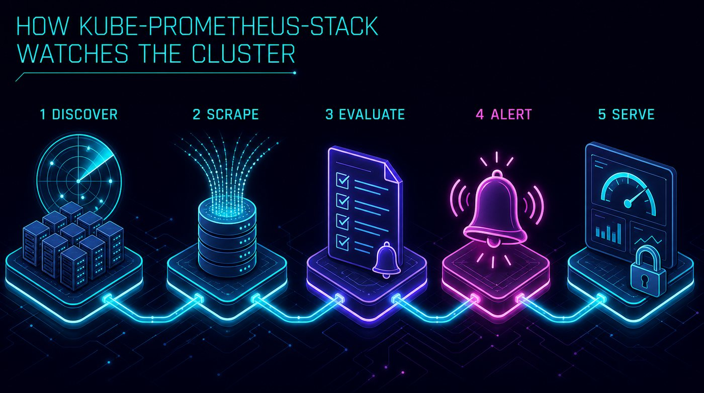
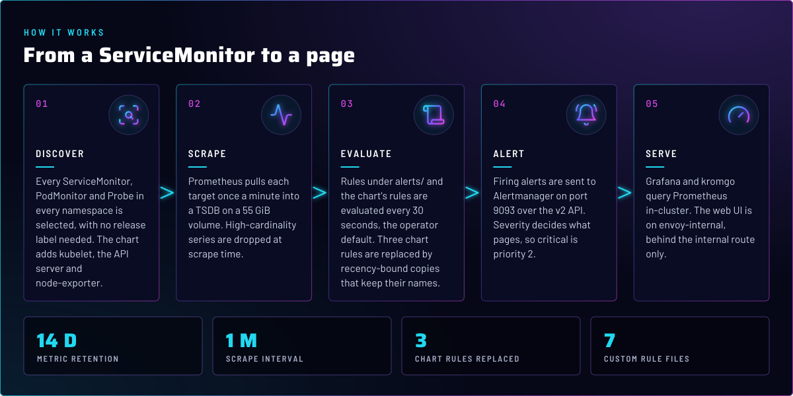
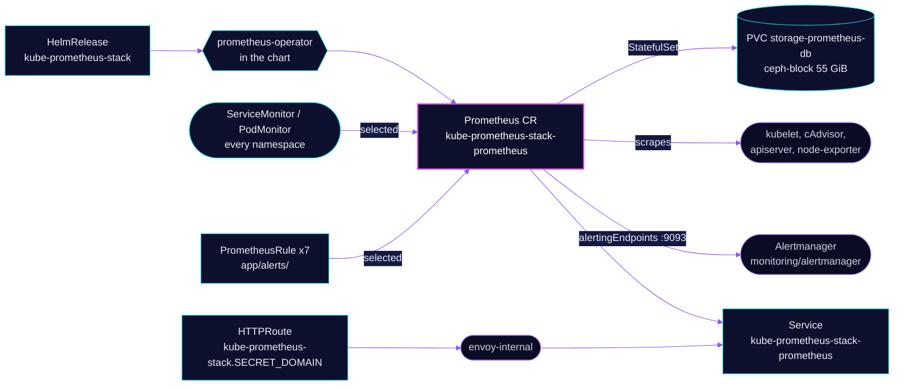

<p align="center">
  
</p>

> **The metrics and the rules.** kube-prometheus-stack runs one Prometheus, the Prometheus operator, and the chart's
> node and kubelet scrape targets. It evaluates this directory's alert rules and keeps two weeks of data on a Ceph
> volume. Alertmanager and Grafana are separate apps in the same namespace.

## At a glance

<!-- glance:start -->
<!-- Generated by `readme.py sync`; edit the manifests, not this table. -->
| | |
|---|---|
| **Namespace** | `monitoring` |
| **Deployed by** | [`kube-prometheus-stack`](../../../main/monitoring/kube-prometheus-stack.yaml) (Flux Kustomization) |
| **Helm chart** | `kube-prometheus-stack` from `oci://ghcr.io/prometheus-community/charts/kube-prometheus-stack`, values in [`helmrelease.yaml`](app/helmrelease.yaml) |
| **Needed by** | `monitoring/unpoller`, `system/xe-gpu-exporter` |
| **Alerts** | 14: `KubeAggregatedAPIErrors`, `B70GpuLost`, `XeGpuLost`, `KubeJobFailed`, `KubeContainerWaiting`, `NodeMemoryPressure`, `NodeMemoryPSIHigh`, `NodeOOMControllerKill`, `CephOsdPodTerminalError`, `CephPodCrashLooping`, `NodeNetworkPacketDrops`, `OOMKilled`, `ContainerRestartingChronically`, `ExternalSecretNotReady` |
<!-- glance:end -->

## What it does

- **Scrapes** kubelet and cAdvisor, the API server, and node-exporter on every node. Every ServiceMonitor, PodMonitor
  and Probe in every namespace is picked up, not only the ones labelled for this release.
- **Stores** samples in a TSDB on the `storage-prometheus-db` claim (`ceph-block`, 55 GiB). Retention is 14 days or
  50 GB, whichever comes first.
- **Evaluates** the chart's default rules, with three replaced, plus seven custom rule files under
  [`app/alerts/`](app/alerts/). Each replacement keeps the chart rule's name and severity.
- **Hands alerts to** Alertmanager at `alertmanager` in `monitoring`, port 9093, over the v2 API. The chart's own
  Alertmanager is off.
- **Serves** the Prometheus UI at `kube-prometheus-stack.${SECRET_DOMAIN}` on `envoy-internal`. Grafana and kromgo
  query Prometheus in-cluster.

## Why it is built this way

| Choice | Why |
|---|---|
| **One Prometheus for every concern** | One TSDB, one rule evaluator, one retention. The alerts on Ceph, the GPUs and node memory PSI all query the same series. |
| **Selectors `NilUsesHelmValues: false`** (ServiceMonitor, PodMonitor, Probe, rule, scrape config) | Prometheus selects every object in every namespace. The default only selects objects labelled for this release, so a new app's ServiceMonitor would be silently ignored. |
| **Three chart rules replaced, not disabled** | `KubeJobFailed` and `KubeContainerWaiting` latch on failed Pods and retained Jobs with no recency bound, and `KubeAggregatedAPIErrors` never returns a series at a 1 m scrape. Each replacement keeps the upstream name, severity and `for`, so routing and runbook links stay valid. |
| **`PrometheusDuplicateTimestamps` forced to critical** | Discarded samples degrade every alert over the affected target, so a silent drop is a monitoring failure. The counter has no label, so the offending target is only named in Prometheus's own log, which the annotation says to read before the pod is replaced. |
| **Single replica, 1 minute scrape, 14 days** | No HA pair is configured. The 8 GiB limit replaced a 3 GiB limit that OOM-killed the pod during TSDB head compaction, as the HelmRelease comment records. |
| **Alertmanager and Grafana off in the chart** | Both are their own apps, so their config sits in Git beside their routes and Secrets, not in a values block. |
| **Dependency on `rook-ceph-cluster`** | The TSDB volume is `ceph-block`. Installing before the cluster exists fails the claim. |

## How it works

<p align="center">
  
</p>

<p align="center">
  
</p>

<details>
<summary><b>Resource graph</b>: every object involved, by name</summary>



</details>

In more detail:

1. Flux applies the chart from [`ocirepository.yaml`](app/ocirepository.yaml) and [`helmrelease.yaml`](app/helmrelease.yaml).
   The chart's CRDs are not installed here (`crds.enabled: false`, and `install.crds: Skip`). They come from
   `prometheus-operator-crds`, see [its README](../prometheus-operator/README.md).
2. The operator renders one Prometheus CR and its StatefulSet. The Prometheus Pod selects every ServiceMonitor,
   PodMonitor, Probe, ScrapeConfig and PrometheusRule in the cluster.
3. Each target is scraped once a minute. Kubelet series lose the `uid`, `id` and `name` labels, and the API server
   series lose the request-duration and response-size histograms, at scrape time.
4. Rules are evaluated against the same TSDB. A firing alert goes to Alertmanager on port 9093.
5. Samples land in the TSDB on the Ceph volume. With `memory-snapshot-on-shutdown`, the in-memory head is written to
   disk on shutdown, which shortens the next start.

## Settings that matter

All values are in [`app/helmrelease.yaml`](app/helmrelease.yaml) unless noted.

| Setting | Value | Why |
|---|---|---|
| `prometheus.prometheusSpec.*SelectorNilUsesHelmValues` | `false` (all five) | Select objects in every namespace, not only those labelled for this release. |
| `prometheus.prometheusSpec.retention` / `retentionSize` | `14d` / `50GB` | Both limits apply, whichever is hit first. The 55 GiB claim holds the 50 GB cap with headroom. |
| `prometheus.prometheusSpec.storageSpec` | `ceph-block`, `55Gi`, claim `storage-prometheus-db` | Ceph replicates the volume, so the TSDB survives a node loss. |
| `prometheus.prometheusSpec.resources` | requests `100m` / `3Gi`, limit `8Gi` | The limit was raised after a 3 GiB limit OOM-killed the pod during head compaction (the comment has the history). |
| `prometheus.prometheusSpec.scrapeInterval` | `1m` | Matches the Grafana datasource. Rules with `[1m]` windows return nothing at this interval, so they use `[5m]`. |
| `prometheus.prometheusSpec.evaluationInterval` | not set, so the operator default of 30 s applies | Rules evaluate twice as often as they are scraped. The `[5m]` windows still hold several samples. |
| `prometheus.prometheusSpec.enableFeatures` | `auto-gomaxprocs`, `memory-snapshot-on-shutdown`, `new-service-discovery-manager` | Go runtime sized to the CPU limit; faster restarts; the newer discovery manager. |
| `prometheus.prometheusSpec.walCompression` | `true` | Smaller WAL on the same volume. |
| `kubelet.serviceMonitor.metricRelabelings` | drop `uid`, `id`, `name` labels; drop `rest_client_request_duration_seconds_{bucket,sum,count}` | Cardinality. `id` and `name` are per-container identifiers; `container` and `pod` stay. |
| `kubeApiServer.serviceMonitor.metricRelabelings` | drop request-duration and response-size histogram buckets | Per-verb, per-resource buckets are high-cardinality. |
| `prometheus-node-exporter.prometheus.monitor.relabelings` | `instance` = node name | Alerts target `instance="talos-1"` directly, not a pod IP. |
| `defaultRules.disabled` | `KubeJobFailed`, `KubeContainerWaiting`, `KubeAggregatedAPIErrors` | Replaced by the [`app/alerts/`](app/alerts/) rules that keep the names (see Why). |
| `alertmanager.enabled`, `grafana.enabled`, `kubeStateMetrics.enabled` | `false` | Each is its own app. `grafana.forceDeployDashboards: true` still ships the chart dashboards to Grafana. |
| `prometheus.prometheusSpec.alertingEndpoints` | `monitoring/alertmanager`, port 9093, `v2` | Points Prometheus at the Alertmanager app. |
| `prometheusOperator.resources` | requests `35m` / `273M`, limit `326M` | Sized for the operator Pod, which watches every monitor CRD in the cluster. |

## Alerts

The chart's rules and the replacements under [`app/alerts/`](app/alerts/). Routing and receivers are in the `alerts`
component and the Alertmanager app. `critical` pages (priority 2), `warning` does not. The glance count covers the seven
custom rule files only, so the table's 15th row, `PrometheusDuplicateTimestamps`, is the chart's `customRules` alert and is not in that count.

| Alert | Fires when | First look |
|---|---|---|
| `PrometheusDuplicateTimestamps` | Prometheus discards samples with a duplicate timestamp | Read the Prometheus log before the pod is replaced: the annotation has the LogQL. Skill `observability`. |
| `KubeAggregatedAPIErrors` | an aggregated API reports errors for 10 m | `kubectl get apiservice`, the one not `Available`. |
| `KubeJobFailed` | a Job failed in the last 12 h, for 15 m | `kubectl get jobs -A`. The alert stops after 12 h, the object stays. |
| `KubeContainerWaiting` | a live container waits over 1 h, not in `CrashLoopBackOff` | `kubectl describe pod`: image pulls and config errors. |
| `B70GpuLost` | talos-3 reports `devic.es/b70` at 0 for 5 m | The Arc B70 left PCIe. Skill `intel-gpu`. |
| `XeGpuLost` | any node reports `gpu.intel.com/xe` at 0 for 5 m | The iGPU dropped, or the device plugin stopped reporting it. Skill `intel-gpu`. |
| `NodeMemoryPressure` | full memory PSI above 5% of wall time over 15 m, for 10 m | Move burstable pods off the node. Skill `talos-nodes`. |
| `NodeMemoryPSIHigh` | full memory PSI above 25% over 3 m | The node is thrashing toward the Talos OOMController. Shed load now. |
| `NodeOOMControllerKill` | a container restarted in the last 10 m with exit code 137 and reason `Error` | The Talos OOMController killed it. Skill `talos-nodes`. |
| `CephOsdPodTerminalError` | a rook-ceph pod is `Failed` for 15 m | The OOMController killed an OSD and the kubelet did not recover it. Skill `rook-ceph`. |
| `CephPodCrashLooping` | a rook-ceph container is in `CrashLoopBackOff` for 15 m | Store corruption or device-path drift. Skill `rook-ceph`. |
| `NodeNetworkPacketDrops` | an interface drops over 0.5% and over 10 packets/s, over 5 m | NIC, bond or switch on that node. |
| `OOMKilled` | a container was OOM-killed one or more times in 10 m | The container hit its own memory limit. Raise it or fix the leak. |
| `ContainerRestartingChronically` | 20 or more restarts in 24 h, and still restarting | A slow crash loop that `KubePodCrashLooping` misses. |
| `ExternalSecretNotReady` | an ExternalSecret is not Ready for 30 m | The Secret is stale. Skill `secrets-1password`. |

## Operate it

```bash
flux -n monitoring get ks kube-prometheus-stack           # Flux view
flux -n monitoring get hr kube-prometheus-stack           # chart state
kubectl -n monitoring get prometheus,statefulset          # the Prometheus CR and its StatefulSet
kubectl -n monitoring get prometheusrule                  # the custom files plus the chart's
```

Writes (suspending the Kustomization, changing the Prometheus CR or its PVC) need the admin kubeconfig and owner
approval. Skill `flux-gitops` covers the suspend-first rule.

## Known gaps

- **The `app/kustomization.yaml` patch matches nothing.** It renames `StatefulSet/prometheus-kube-prometheus-stack` and
  the claim template `storage-prometheus-db`. `kubectl kustomize` on `app/` produces no StatefulSet and exits 0, so the
  patch does nothing. The operator creates the StatefulSet at runtime, and Git never renders it.
- **`replicaExternalLabelName: "__replica__"` points at a Thanos Query that is not in this repo.** The comment says it
  must match `query.replicaLabel`, but no Thanos is deployed. The label is written and read by nothing here.
- **`enableAdminAPI: true` has no consumer in Git.** It exposes the TSDB admin API (delete series, snapshots) on the
  Prometheus Service. Nothing in the repo calls it. Turn it off, or record who does.
- **No `dependsOn` on `prometheus-operator-crds`.** The `kube-prometheus-stack` Kustomization depends on nothing, and
  `install.crds: Skip` means a first install depends on Flux retrying until the CRDs exist.

## Files

| File | Holds |
|---|---|
| [`app/helmrelease.yaml`](app/helmrelease.yaml) | Chart values: selectors, retention, resources, relabelling, route |
| [`app/ocirepository.yaml`](app/ocirepository.yaml) | Chart source and version |
| [`app/alerts/`](app/alerts/) | Custom PrometheusRules, one file per concern |
| [`app/prometheusrules/`](app/prometheusrules/) | Kustomization with no resources |
| [`app/scrapeconfigs/`](app/scrapeconfigs/) | Kustomization with no resources |
| [`../../../main/monitoring/kube-prometheus-stack.yaml`](../../../main/monitoring/kube-prometheus-stack.yaml) | Flux Kustomization |

Upstream: [kube-prometheus-stack chart](https://github.com/prometheus-community/helm-charts/tree/main/charts/kube-prometheus-stack) •
[Prometheus storage](https://prometheus.io/docs/prometheus/latest/storage/) •
[Prometheus feature flags](https://prometheus.io/docs/prometheus/latest/feature_flags/)

<!-- branded-readme v1 sources=5e73753c9e59 -->
