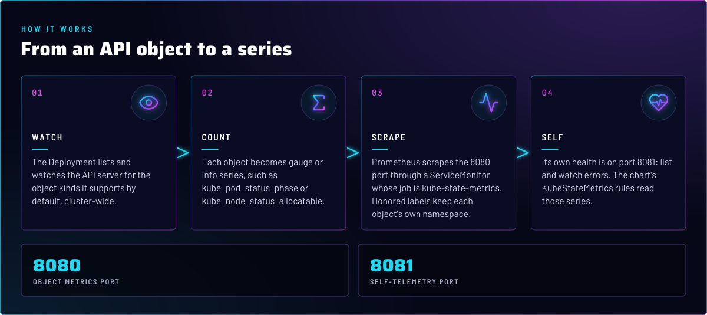
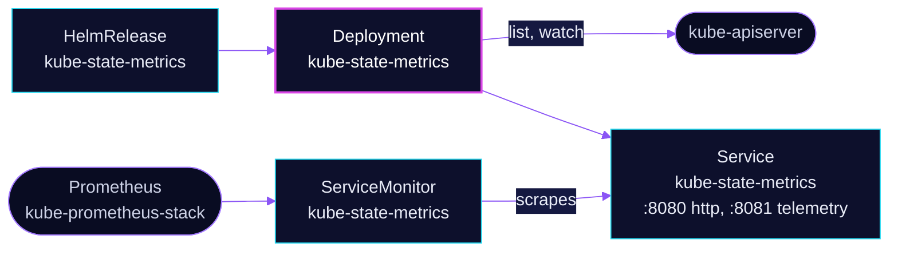

<p align="center">
  
</p>

> **The object state, as numbers.** kube-state-metrics lists and watches the API server and exposes each object's state
> as Prometheus series. It reports nothing about CPU or memory use, that is kubelet's job. Most of the cluster's
> container, Job and GPU alerts read its series.

## At a glance

<!-- glance:start -->
<!-- Generated by `readme.py sync`; edit the manifests, not this table. -->
| | |
|---|---|
| **Namespace** | `monitoring` |
| **Deployed by** | [`kube-state-metrics`](../../../main/monitoring/kube-state-metrics.yaml) (Flux Kustomization) |
| **Helm chart** | `kube-state-metrics` from `oci://ghcr.io/prometheus-community/charts/kube-state-metrics`, values in [`helmrelease.yaml`](app/helmrelease.yaml) |
<!-- glance:end -->

## What it does

- **Watches** the API server for the object kinds it supports by default, cluster-wide, and keeps a cache of them.
- **Exposes** each object as gauge or info series on port 8080, such as `kube_pod_status_phase`,
  `kube_pod_container_status_restarts_total`, `kube_job_failed` and `kube_node_status_allocatable`.
- **Reports its own health** on port 8081: list and watch errors and the other `kube_state_metrics_*` series. The
  chart's `KubeStateMetrics*` rules read these.

## Why it is built this way

| Choice | Why |
|---|---|
| **`fullnameOverride: kube-state-metrics`** | The Service, and so the Prometheus `job` label, is `kube-state-metrics`. The recency rules in the kube-prometheus-stack alerts match `job="kube-state-metrics"`, so the name is load-bearing. |
| **`prometheus.monitor.honorLabels: true`** | KSM's `namespace`, `pod` and `job_name` labels describe the object. Honoring them keeps those labels instead of renaming them `exported_*` when Prometheus adds its target labels. |
| **`selfMonitor.enabled: true`** | The 8081 telemetry port is a separate endpoint. Without it, the chart's `KubeStateMetrics*` rules have no series to evaluate. |

## How it works

<p align="center">
  
</p>

<details>
<summary><b>Resource graph</b>: every object involved, by name</summary>



</details>

In more detail:

1. Flux applies the chart from [`ocirepository.yaml`](app/ocirepository.yaml) and [`helmrelease.yaml`](app/helmrelease.yaml).
   The chart creates the Deployment, its RBAC, the Service and a ServiceMonitor.
2. The Deployment reads the API server and holds the object state in memory. Nothing is stored on disk.
3. Prometheus scrapes the ServiceMonitor's two endpoints. The series are what the rules in
   [kube-prometheus-stack](../kube-prometheus-stack/README.md) read.

## Settings that matter

All values are in [`app/helmrelease.yaml`](app/helmrelease.yaml) unless noted.

| Setting | Value | Why |
|---|---|---|
| `fullnameOverride` | `kube-state-metrics` | Fixes the Service and job name that the alert rules match. |
| `prometheus.monitor.enabled` | `true` | Creates the ServiceMonitor. The chart's default is off. |
| `prometheus.monitor.honorLabels` | `true` | Keeps the object's own `namespace` and `pod` labels, rather than Prometheus's target labels. |
| `selfMonitor.enabled` | `true` | Scrapes the 8081 telemetry port. |

## Operate it

```bash
flux -n monitoring get hr kube-state-metrics
kubectl -n monitoring get deploy,svc,servicemonitor kube-state-metrics
```

## Known gaps

- None found while writing this README.

## Files

| File | Holds |
|---|---|
| [`app/helmrelease.yaml`](app/helmrelease.yaml) | Chart values |
| [`app/ocirepository.yaml`](app/ocirepository.yaml) | Chart source and version |
| [`../../../main/monitoring/kube-state-metrics.yaml`](../../../main/monitoring/kube-state-metrics.yaml) | Flux Kustomization |

Upstream: [kube-state-metrics docs](https://kubernetes.io/docs/concepts/cluster-administration/kube-state-metrics/) •
[kube-state-metrics repository](https://github.com/kubernetes/kube-state-metrics)

<!-- branded-readme v1 sources=a0893ac71e33 -->
