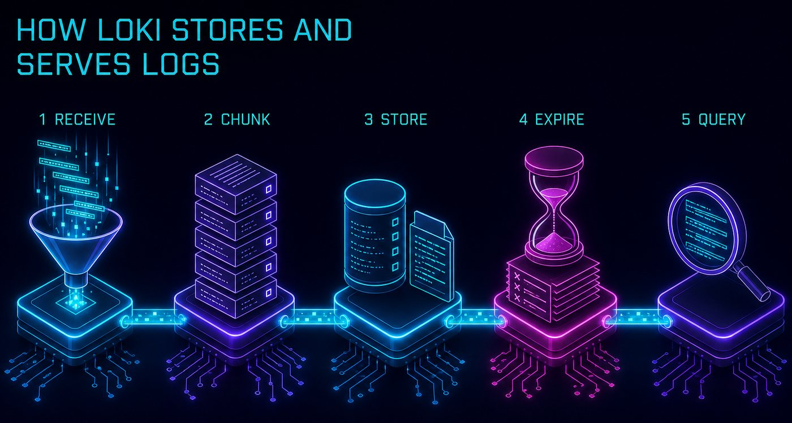
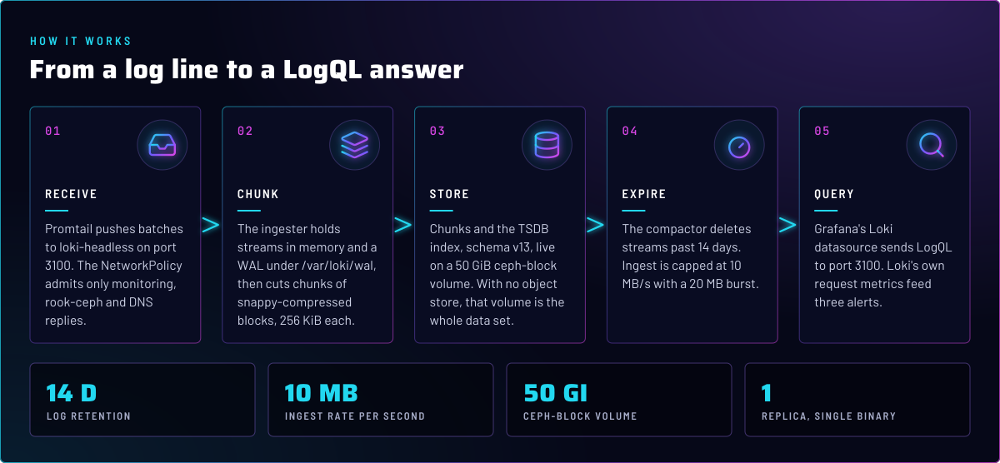
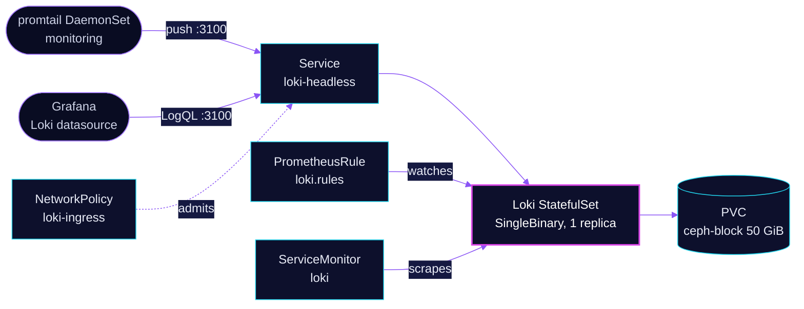

<p align="center">
  
</p>

> **Logs for 14 days, on one volume.** Loki runs as a single binary and keeps every container log that promtail ships
> to it. Data lives on a 50 GiB `ceph-block` claim, with no object store. Grafana queries it, and promtail is the only
> writer in Git.

## At a glance

<!-- glance:start -->
<!-- Generated by `readme.py sync`; edit the manifests, not this table. -->
| | |
|---|---|
| **Namespace** | `monitoring` |
| **Deployed by** | [`loki`](../../../main/monitoring/loki.yaml) (Flux Kustomization) |
| **Helm chart** | `loki` from `oci://ghcr.io/grafana-community/helm-charts/loki`, values in [`helmrelease.yaml`](app/helmrelease.yaml) |
| **Images** | `kiwigrid/k8s-sidecar` |
| **Alerts** | 3: `LokiRequestErrors`, `LokiRequestPanics`, `LokiRequestLatency` |
<!-- glance:end -->

## What it does

- **Receives** log batches from promtail on port 3100 at `loki-headless`. The NetworkPolicy admits only the
  `monitoring` and `rook-ceph` namespaces and DNS replies.
- **Stores** streams as chunks plus a TSDB index (schema `v13`) on the `ceph-block` volume, with the WAL under
  `/var/loki/wal`.
- **Expires** data through the compactor. Streams older than 14 days are deleted; the limit applies to every stream.
- **Answers** LogQL from Grafana's Loki datasource on the same port.
- **Alerts** on its own request errors, panics and p99 latency through [`app/prometheus-rule.yaml`](app/prometheus-rule.yaml).

## Why it is built this way

| Choice | Why |
|---|---|
| **`SingleBinary`, one replica** | The only writer is the promtail DaemonSet, and one volume is the whole data set. Read, write and backend components are set to zero. |
| **Filesystem object store on a `ceph-block` claim, not S3** | The data stays inside the cluster on the replicated pool. No object-store credentials are needed for logs. |
| **`auth_enabled: false`** | Promtail sends an empty tenant ID, and no client needs tenant isolation. Enabling auth would reject every push until each client set a tenant. |
| **`replication_factor: 1`** | One ingester, so there is no peer to replicate to. The Ceph volume is the replica. |
| **`chunksCache`, `resultsCache`, gateway and canary off** | All exist to speed up or front a larger deployment. The single binary serves queries directly. |
| **`ingestion_rate_mb: 10`, burst 20, 10 000 streams** | Bounds ingest so one noisy source cannot fill the single ingester. |
| **`tsdb` with schema `v13` from `2024-04-01`** | The current index format. Loki does not support changing an existing `from` date; a new entry is added instead. |

## How it works

<p align="center">
  
</p>

<p align="center">
  
</p>

<details>
<summary><b>Resource graph</b>: every object involved, by name</summary>



</details>

In more detail:

1. Flux applies the chart from [`ocirepository.yaml`](app/ocirepository.yaml) and [`helmrelease.yaml`](app/helmrelease.yaml).
   The HelmRelease waits for `rook-ceph-cluster`, because the volume is a Ceph claim.
2. Promtail pushes batches. The ingester holds each stream in memory, journals it to the WAL, and flushes chunks after
   30 minutes idle.
3. Chunks and the index go to the 50 GiB volume. The compactor applies retention and deletes streams older
   than 14 days.
4. Grafana sends LogQL. Loki's request metrics feed the three rules in [`app/prometheus-rule.yaml`](app/prometheus-rule.yaml).

## Settings that matter

All values are in [`app/helmrelease.yaml`](app/helmrelease.yaml) unless noted.

| Setting | Value | Why |
|---|---|---|
| `deploymentMode` | `SingleBinary` | One Pod runs every component. The alternative modes need an object store. |
| `loki.storage.type` / `object_store` | `filesystem` | No S3 bucket. The Ceph claim holds the data. |
| `singleBinary.persistence` | `ceph-block`, `50Gi` | Replicated storage, so a node loss does not lose the logs. |
| `loki.limits_config.retention_period` | `14d` | Matches the Prometheus retention window. |
| `loki.compactor.retention_enabled` | `true`, `delete_request_store: filesystem` | Without it the 14 days never delete anything. |
| `loki.ingester.wal.enabled` | `true` | Pushes survive an ingester restart. |
| `loki.limits_config.ingestion_rate_mb` / `ingestion_burst_size_mb` | `10` / `20` | Caps one noisy source. |
| `loki.limits_config.max_streams_per_user` | `10000` | Bounds index size. A label that explodes stream count is refused, not indexed. |
| `loki.limits_config.max_line_size` | `256KB` | Lines over the limit are refused rather than stored, so one line cannot dominate a chunk. |
| `monitoring.serviceMonitor.enabled` | `true` | The chart's default is off. Without it no `loki_*` series exist, and the three rules can never fire. |
| `loki.auth_enabled` | `false` | Single tenant. Promtail's `tenant_id` is empty to match. |
| `singleBinary.resources` | requests `100m` / `256Mi`, limit `2Gi` | Memory limit only; CPU is requested, not limited. |

## Alerts

From [`app/prometheus-rule.yaml`](app/prometheus-rule.yaml), all `critical`, so they page.

| Alert | Fires when | First look |
|---|---|---|
| `LokiRequestErrors` | over 10% of requests return 5xx, for 15 m | Loki's logs, and the Ceph volume it writes to. |
| `LokiRequestPanics` | any panic in 10 m | Loki's logs. Restart only after reading the panic. |
| `LokiRequestLatency` | 99th percentile over 1 s for 15 m | Query size, and the volume's latency. Skill `rook-ceph`. |

## Operate it

```bash
flux -n monitoring get hr loki
kubectl -n monitoring get statefulset,pvc -l app.kubernetes.io/name=loki
```

## Known gaps

- **Rule ConfigMaps may have no evaluator.** `sidecar.rules.searchNamespace: ALL` loads rule ConfigMaps from every
  namespace. Rendering the chart with these values produces a `ruler:` block in the Loki config but no separate ruler
  workload. Whether the single binary evaluates those rules was not verified here. Check before relying on LogQL alert rules.

## Files

| File | Holds |
|---|---|
| [`app/helmrelease.yaml`](app/helmrelease.yaml) | Chart values: mode, storage, limits, retention |
| [`app/ocirepository.yaml`](app/ocirepository.yaml) | Chart source and version |
| [`app/networkpolicy.yaml`](app/networkpolicy.yaml) | Ingress to port 3100 from `monitoring`, `rook-ceph`, and DNS replies |
| [`app/prometheus-rule.yaml`](app/prometheus-rule.yaml) | Request alerts and the recording rules they use |
| [`../../../main/monitoring/loki.yaml`](../../../main/monitoring/loki.yaml) | Flux Kustomization |

Upstream: [Loki docs](https://grafana.com/docs/loki/latest/) •
[Retention](https://grafana.com/docs/loki/latest/operations/storage/retention/) •
[Single binary mode](https://grafana.com/docs/loki/latest/setup/install/helm/install-monolithic/)

<!-- branded-readme v1 sources=9f8665922cd1 -->
