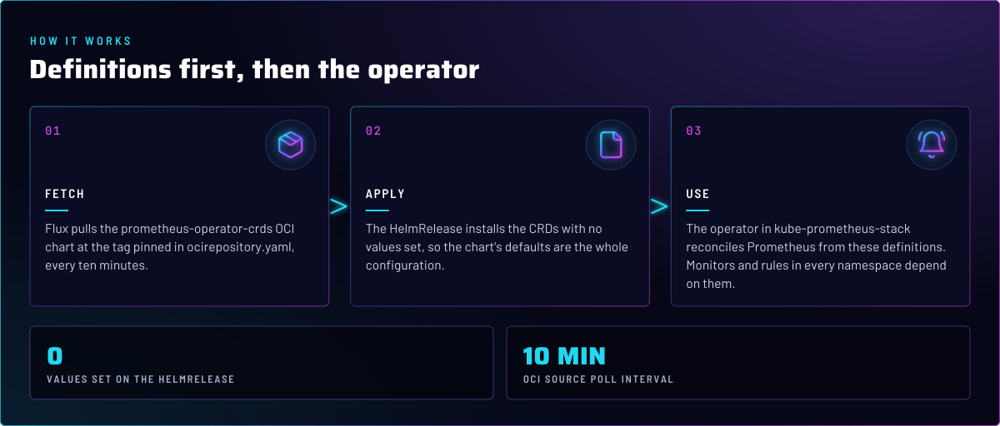
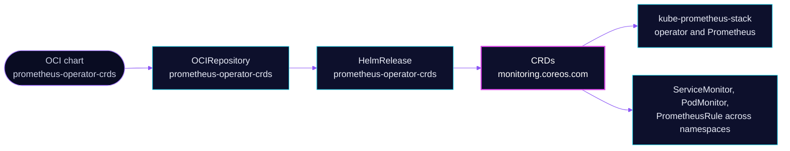

<p align="center">
  
</p>

> **Definitions, not the operator.** This directory installs only the Prometheus operator's CustomResourceDefinitions.
> The operator itself runs inside the kube-prometheus-stack chart. Splitting the two means a CRD upgrade is a separate,
> Renovate-tracked change, and every monitor in the cluster has its schema before anything reconciles it.

## At a glance

<!-- glance:start -->
<!-- Generated by `readme.py sync`; edit the manifests, not this table. -->
| | |
|---|---|
| **Namespace** | `monitoring` |
| **Deployed by** | [`prometheus-operator-crds`](../../../main/monitoring/prometheus-operator.yaml) (Flux Kustomization) |
| **Helm chart** | `prometheus-operator-crds` from `oci://ghcr.io/prometheus-community/charts/prometheus-operator-crds`, values in [`helmrelease.yaml`](crds/helmrelease.yaml) |
<!-- glance:end -->

## What it does

- **Installs** the `monitoring.coreos.com` CRDs from the `prometheus-operator-crds` OCI chart, among them
  ServiceMonitor, PodMonitor, PrometheusRule, Probe and ScrapeConfig.
- **Provides** the schema that `kube-prometheus-stack` and every app that ships a monitor or rule are validated and
  reconciled against.

## Why it is built this way

| Choice | Why |
|---|---|
| **A separate Kustomization for the CRDs** | The `kube-prometheus-stack` HelmRelease sets `crds.enabled: false` and `install.crds: Skip`, so something else must own the definitions. This directory does, from its own pinned OCI chart. |
| **No values on the HelmRelease** | The CRD chart has nothing to configure. The HelmRelease sets none, so the chart's defaults are the whole configuration. |
| **OCI chart pinned by tag in `ocirepository.yaml`** | Renovate bumps the tag like any other chart. A CRD change is reviewed as its own diff. |

## How it works

<p align="center">
  
</p>

<details>
<summary><b>Resource graph</b>: every object involved, by name</summary>



</details>

In more detail:

1. Flux's `prometheus-operator-crds` Kustomization applies [`crds/`](crds/), the OCIRepository and the HelmRelease.
2. The HelmRelease installs the CRDs. The CRDs are cluster-scoped, so they are shared by every namespace.
3. [kube-prometheus-stack](../kube-prometheus-stack/README.md) and every app that ships a monitor or rule read them.

## Settings that matter

The HelmRelease sets no values. The pinned tag is in [`crds/ocirepository.yaml`](crds/ocirepository.yaml).

| Setting | Value | Why |
|---|---|---|
| `spec.values` | not set | The CRD chart has nothing to configure. Setting values here would be the only way to diverge from upstream. |
| `OCIRepository.spec.ref.tag` | pinned | Renovate owns the version. The CRD set changes with it. |

## Operate it

```bash
flux -n monitoring get ks prometheus-operator-crds
kubectl get crd servicemonitors.monitoring.coreos.com prometheusrules.monitoring.coreos.com
```

## Known gaps

- **The CRD Kustomization is `wait: false`.** The repo's convention is that a CRD gate sets `wait: true`, so the
  Kustomizations that depend on these definitions see them established before they apply. Here nothing waits.
- **No Kustomization depends on it.** `kube-prometheus-stack` and `unpoller` depend on nothing in this group. The
  ServiceMonitor and PrometheusRule kinds are not ordered before them, so a first install relies on Flux retrying.

## Files

| File | Holds |
|---|---|
| [`crds/helmrelease.yaml`](crds/helmrelease.yaml) | HelmRelease for the CRD chart, no values |
| [`crds/ocirepository.yaml`](crds/ocirepository.yaml) | Chart source and pinned tag |
| [`crds/kustomization.yaml`](crds/kustomization.yaml) | Lists the two files above |
| [`../../../main/monitoring/prometheus-operator.yaml`](../../../main/monitoring/prometheus-operator.yaml) | Flux Kustomization `prometheus-operator-crds` |

Upstream: [prometheus-operator CRD docs](https://prometheus-operator.dev/docs/getting-started/introduction/) •
[prometheus-community charts](https://github.com/prometheus-community/helm-charts/tree/main/charts/prometheus-operator-crds)

<!-- branded-readme v1 sources=991cabb4fe09 -->
