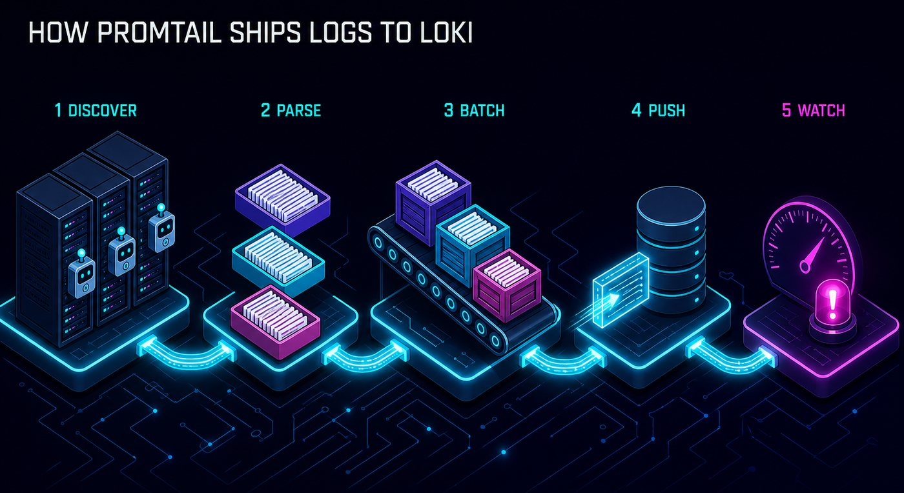
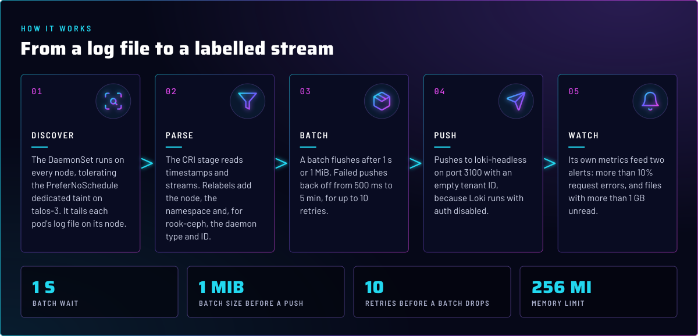
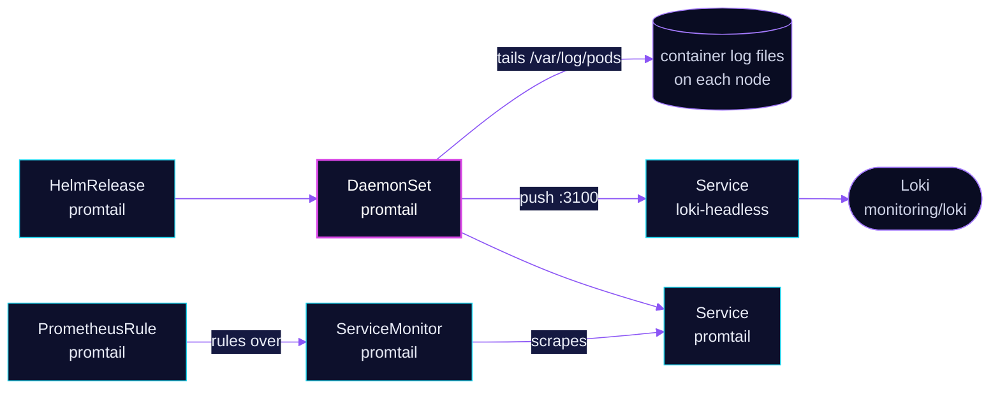

<p align="center">
  
</p>

> **Every node's logs, labelled and shipped.** promtail runs once per node, tails the container log files there, and
> pushes them to Loki with labels for the pod, the node and, for rook-ceph, the daemon. It keeps no state of its own
> beyond read positions, and it does not store logs.

## At a glance

<!-- glance:start -->
<!-- Generated by `readme.py sync`; edit the manifests, not this table. -->
| | |
|---|---|
| **Namespace** | `monitoring` |
| **Deployed by** | [`promtail`](../../../main/monitoring/promtail.yaml) (Flux Kustomization) |
| **Helm chart** | `promtail` from `oci://ghcr.io/grafana/helm-charts/promtail`, values in [`helmrelease.yaml`](app/helmrelease.yaml) |
| **Alerts** | 2: `PromtailRequestErrors`, `PromtailFileLagging` |
<!-- glance:end -->

## What it does

- **Tails** each pod's log file on its node, through the CRI pipeline stage.
- **Labels** every stream with the node (`hostname`) and, for rook-ceph pods, `ceph_daemon_type`, `ceph_daemon_id`,
  `ceph_cluster_id` and `log_type` (`daemon` for mgr, mon, osd, mds and rgw containers).
- **Pushes** batches to `http://loki-headless.monitoring.svc.cluster.local:3100/loki/api/v1/push`, with an empty tenant ID.
- **Exposes** its own metrics through a ServiceMonitor and two rules in [`app/prometheusrule.yaml`](app/prometheusrule.yaml).

## Why it is built this way

| Choice | Why |
|---|---|
| **A DaemonSet, not a sidecar** | One agent per node reads every pod's log file, so no pod needs an extra container. |
| **Tolerations restated, not inherited** | Helm replaces the chart's `tolerations` list wholesale when a value is set. The two control-plane defaults are written out beside the dedicated-node toleration, so setting it does not drop them. |
| **`tenant_id: ""`** | Loki runs with `auth_enabled: false`, so the single-tenant default must match on both sides. |
| **Ceph labels from pod labels, not from log text** | rook-ceph's pod labels already carry the daemon type and ID. Labels from metadata do not depend on how a daemon formats its log lines. |
| **`batchsize: 1048576`, `batchwait: 1s`** | Batches flush at 1 MiB or after 1 s, so a quiet node still ships logs within a second. |
| **Backoff to 5 min, 10 retries** | Loki restarts and brief outages are ridden out. Past the limit, the batch is dropped and counted in the error metrics. |

## How it works

<p align="center">
  
</p>

<p align="center">
  
</p>

<details>
<summary><b>Resource graph</b>: every object involved, by name</summary>



</details>

In more detail:

1. Flux applies the chart from [`ocirepository.yaml`](app/ocirepository.yaml) and [`helmrelease.yaml`](app/helmrelease.yaml).
   The DaemonSet, its RBAC and the Service come from the chart with `fullnameOverride: promtail`.
2. Each promtail pod reads the log files of the containers on its own node. A file is tracked by its read position, so
   a restart resumes where it stopped.
3. The CRI stage splits each line, then the relabel rules add the labels above.
4. Batches are pushed to Loki. A failed push backs off and retries before the batch is dropped.

## Settings that matter

All values are in [`app/helmrelease.yaml`](app/helmrelease.yaml) unless noted.

| Setting | Value | Why |
|---|---|---|
| `tolerations` | `control-plane`, `master` (NoSchedule), `home-operations.com/dedicated` (PreferNoSchedule) | Runs on every node, including talos-3, which carries the dedicated taint. `PreferNoSchedule` is a score penalty, not a filter, so the taint does not strand the DaemonSet. |
| `config.clients[0].url` | `loki-headless` on port 3100 | The headless Service, so every push goes to the one Loki Pod. |
| `config.clients[0].tenant_id` | `""` | Matches Loki's `auth_enabled: false`. |
| `config.clients[0].batchsize` / `batchwait` | `1048576` / `1s` | Flush at 1 MiB or 1 s, whichever comes first. |
| `config.clients[0].backoff_config` | `500ms` to `5m`, 10 retries | Rides out a Loki restart. Past the limit, the batch is dropped. |
| `config.snippets.pipelineStages` | `cri` | Container runtime log format on Talos. |
| `config.snippets.extraRelabelConfigs` | Ceph labels; `hostname` from node name | Lets Grafana filter Ceph daemons and nodes without parsing log text. |
| `resources` | requests `50m` / `64Mi`, limit `256Mi` | Memory limited, CPU requested. |
| `serviceMonitor.enabled` | `true` | Exposes `promtail_*` metrics for the two alerts. |

## Alerts

From [`app/prometheusrule.yaml`](app/prometheusrule.yaml), both `warning`.

| Alert | Fires when | First look |
|---|---|---|
| `PromtailRequestErrors` | over 10% of pushes fail for 15 m | Loki's health (`LokiRequestErrors`), then the network path to `loki-headless`. |
| `PromtailFileLagging` | files have more than 1 GB unread for 15 m | The pod on that node. A large backlog means promtail is behind the log writer. |

## Operate it

```bash
flux -n monitoring get hr promtail
kubectl -n monitoring get ds promtail -o wide     # one pod per node
```

## Known gaps

- **`PromtailFileLagging` says "more than 1 hour", but the rule measures bytes.** The expression is
  `promtail_file_bytes_total - promtail_read_bytes_total > 1e9`, which is 1 GB unread, not a time. The message on
  the alert describes a different threshold, so the text misleads whoever is paged.

## Files

| File | Holds |
|---|---|
| [`app/helmrelease.yaml`](app/helmrelease.yaml) | Chart values: tolerations, client, relabelling, resources |
| [`app/ocirepository.yaml`](app/ocirepository.yaml) | Chart source and version |
| [`app/prometheusrule.yaml`](app/prometheusrule.yaml) | `PromtailRequestErrors` and `PromtailFileLagging` |
| [`../../../main/monitoring/promtail.yaml`](../../../main/monitoring/promtail.yaml) | Flux Kustomization |

Upstream: [Promtail docs](https://grafana.com/docs/loki/latest/send-data/promtail/) •
[Promtail configuration](https://grafana.com/docs/loki/latest/send-data/promtail/configuration/)

<!-- branded-readme v1 sources=904112b1c3eb -->
