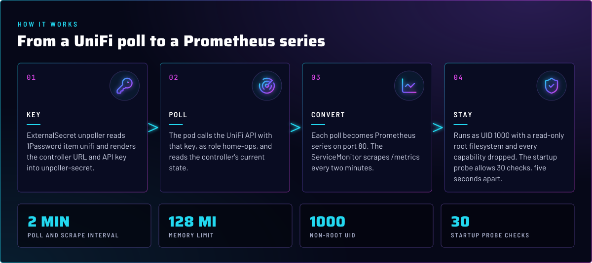
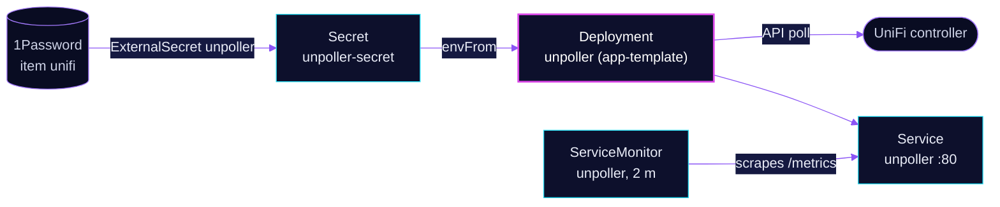

<p align="center">
  
</p>

> **The UniFi network, as Prometheus series.** unpoller reads the UniFi controller's API every two minutes and serves
> the results on `/metrics` for Prometheus. It only reads. The controller's API key comes from 1Password, and nothing
> it does changes the network.

## At a glance

<!-- glance:start -->
<!-- Generated by `readme.py sync`; edit the manifests, not this table. -->
| | |
|---|---|
| **Namespace** | `monitoring` |
| **Deployed by** | [`unpoller`](../../../main/monitoring/unpoller.yaml) (Flux Kustomization) |
| **Helm chart** | `app-template`, values in [`helmrelease.yaml`](app/helmrelease.yaml) |
| **Images** | `ghcr.io/unpoller/unpoller` |
| **Depends on** | `monitoring/kube-prometheus-stack`, `security/external-secrets` |
| **Secret** | `unpoller-secret` from onepassword item `unifi` |
<!-- glance:end -->

## What it does

- **Reads** the UniFi controller at the URL and with the API key from the `unpoller-secret` Secret, as the role
  `home-ops`.
- **Converts** each poll into Prometheus series: clients, ports, devices and sites, served on port 80 at `/metrics`.
- **Is scraped** by the ServiceMonitor `unpoller` every two minutes. The controller refreshes at that rate, so a shorter
  interval would only re-read the same data.

## Why it is built this way

| Choice | Why |
|---|---|
| **Credentials from 1Password through an ExternalSecret** | The URL and API key are not in Git. The ExternalSecret renders them into `unpoller-secret`, and Flux substitution is not involved. Skill `secrets-1password`. |
| **Metrics only, InfluxDB disabled** | `UP_INFLUXDB_DISABLE` keeps the exporter from also writing to an InfluxDB that does not exist. Prometheus is the one sink. |
| **Read-only root filesystem, every capability dropped, UID 1000** | The exporter needs no writable path in its image, so the root filesystem stays read-only and no capability is granted. |
| **`dependsOn` external-secrets and kube-prometheus-stack** | The ExternalSecret needs the `onepassword` store from external-secrets. The second entry is kube-prometheus-stack. Known gaps states what it does not order. |

## How it works

<p align="center">
  
</p>

<details>
<summary><b>Resource graph</b>: every object involved, by name</summary>



</details>

In more detail:

1. Flux applies the ExternalSecret and the HelmRelease. The HelmRelease uses the app-template chart from the
   `app-template` OCIRepository in `flux-system`.
2. The ExternalSecret reads 1Password item `unifi` from the `onepassword` ClusterSecretStore and renders two keys into
   `unpoller-secret`: `UP_UNIFI_DEFAULT_URL` and `UP_UNIFI_DEFAULT_API_KEY`.
3. The pod starts, and its startup probe allows 30 checks, five seconds apart, for the endpoint to answer.
4. Prometheus scrapes `/metrics` every two minutes, with a 10 s timeout.

## Settings that matter

All values are in [`app/helmrelease.yaml`](app/helmrelease.yaml) unless noted.

| Setting | Value | Why |
|---|---|---|
| `UP_PROMETHEUS_HTTP_LISTEN` | `0.0.0.0:80` | Serves the scrape endpoint on the Service port. |
| `UP_UNIFI_DEFAULT_ROLE` | `home-ops` | The controller role the exporter reads with. |
| `UP_UNIFI_DEFAULT_VERIFY_SSL` | `false` | TLS to the controller is not verified. No reason is recorded in Git (see Known gaps). |
| `UP_INFLUXDB_DISABLE` | `true` | Prometheus is the only sink. |
| `serviceMonitor.endpoints[0].interval` | `2m` | The UniFi API updates at that rate. |
| `securityContext` | read-only root filesystem, no privilege escalation, drop `ALL` | The exporter needs no write access and no capabilities. |
| `defaultPodOptions.securityContext` | non-root, UID and GID `1000`, `RuntimeDefault` seccomp | Runs as an unprivileged user. |
| `probes.startup.spec` | `failureThreshold: 30`, `periodSeconds: 5` | Gives the first poll 150 s before the kubelet restarts the pod. |
| `resources` | requests `10m` / `64Mi`, limit `128Mi` | The 64 MiB request is about twice the 14-day peak, per the HelmRelease comment. |

## Operate it

```bash
flux -n monitoring get hr unpoller
kubectl -n monitoring get pods -l app.kubernetes.io/name=unpoller
kubectl -n monitoring get externalsecret unpoller
```

An ExternalSecret that is `SecretSynced` with an empty value is not proof the keys are present. Check the keys
exist in 1Password (skill `secrets-1password`).

## Known gaps

- **TLS verification is off with no recorded reason.** `UP_UNIFI_DEFAULT_VERIFY_SSL: false` is in Git without a
  comment. Whoever set it should confirm the controller's certificate, and either record why or pin a CA.
- **The `dependsOn` list does not include `prometheus-operator-crds`.** The Kustomization in
  [`main/monitoring/unpoller.yaml`](../../../main/monitoring/unpoller.yaml) depends on `security/external-secrets` and
  `monitoring/kube-prometheus-stack`. The ServiceMonitor kind is provided by `prometheus-operator-crds`, which is not in
  that list.

## Files

| File | Holds |
|---|---|
| [`app/helmrelease.yaml`](app/helmrelease.yaml) | Container, env, probes, security context, Service and ServiceMonitor |
| [`app/externalsecret.yaml`](app/externalsecret.yaml) | Renders the URL and API key from 1Password item `unifi` |
| [`app/kustomization.yaml`](app/kustomization.yaml) | Lists the two files above |
| [`../../../main/monitoring/unpoller.yaml`](../../../main/monitoring/unpoller.yaml) | Flux Kustomization and its `dependsOn` |

Upstream: [unpoller docs](https://unpoller.com/docs/install/configuration) •
[unpoller repository](https://github.com/unpoller/unpoller)

<!-- branded-readme v1 sources=85b4caf70111 -->
