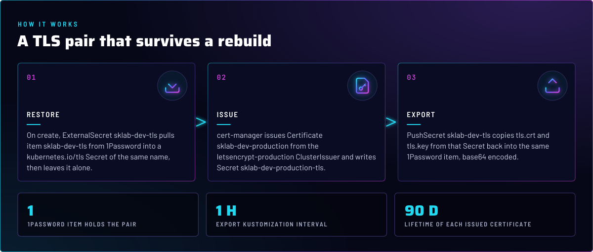
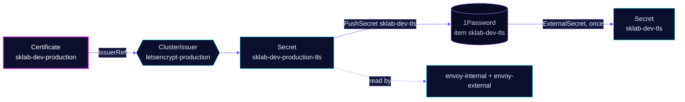

<p align="center">
  
</p>

> **The TLS pair also lives in 1Password.** `certificates` moves the wildcard certificate between the cluster and one
> 1Password item. A rebuilt cluster restores the pair at create time, and a live cluster exports whatever cert-manager
> issues. Issuance itself belongs to [cert-manager](../../cert-manager/cert-manager/README.md).

## At a glance

<!-- glance:start -->
<!-- Generated by `readme.py sync`; edit the manifests, not this table. -->
| | |
|---|---|
| **Namespace** | `network` |
| **Deployed by** | [`certificates-import`](../../../main/network/certificates.yaml), [`certificates-export`](../../../main/network/certificates.yaml) (Flux Kustomization) |
| **Depends on** | `network/certificates-import` |
| **Needed by** | `network/certificates-export`, `network/envoy-gateway` |
| **Secret** | `sklab-dev-tls` from onepassword item `sklab-dev-tls` |
| **Pushes to 1Password** | `sklab-dev-tls` |
<!-- glance:end -->

## What it does

- **Restores** the pair once, on create. ExternalSecret `sklab-dev-tls` pulls 1Password item `sklab-dev-tls` into a
  `kubernetes.io/tls` Secret of the same name in `network` ([`import/externalsecret.yaml`](import/externalsecret.yaml)).
- **Requests** the Certificate `sklab-dev-production`, the apex and wildcard certificate, from the `letsencrypt-production`
  ClusterIssuer. cert-manager writes the result to Secret `sklab-dev-production-tls`
  ([`export/certificate.yaml`](export/certificate.yaml)).
- **Exports** that issued pair. PushSecret `sklab-dev-tls` keeps `tls.crt` and `tls.key` from
  `sklab-dev-production-tls` in the same 1Password item ([`export/pushsecret.yaml`](export/pushsecret.yaml)).

## Why it is built this way

| Choice | Why |
|---|---|
| **Import and export are two Kustomizations** | Import must finish before `envoy-gateway` starts (it `dependsOn` `certificates-import`). Export depends on import, and does not block on 1Password. |
| **Export does not wait** | `certificates-export` is `wait: false`, so a 1Password outage does not hold the Kustomization open. |
| **The pair lives in 1Password, not Git** | Nothing secret is committed. One item holds both keys, and the PushSecret base64-encodes them so they survive as item text. |
| **The live copy is cert-manager's, the restore is a source** | The restored Secret is never read by the Gateways (see Known gaps). Traffic only ever uses the Secret cert-manager maintains. |

## How it works

<p align="center">
  
</p>

<details>
<summary><b>Resource graph</b>: every object involved, by name</summary>



</details>

In more detail:

1. Flux applies `certificates-import` first (`wait: true`). It restores `sklab-dev-tls` from the item, decoding the Base64 values.
2. `certificates-export` applies the Certificate and the PushSecret. cert-manager does the ACME work; see the
   [cert-manager README](../../cert-manager/cert-manager/README.md).
3. The PushSecret writes `tls.crt` and `tls.key` into the item, so the item tracks the issued pair.

## Settings that matter

All values are in [`import/externalsecret.yaml`](import/externalsecret.yaml) and [`export/pushsecret.yaml`](export/pushsecret.yaml).

| Setting | Value | Why |
|---|---|---|
| `refreshPolicy` (import) | `CreatedOnce` | Pulled once, at create. Later edits to the item do not rewrite the restored Secret. |
| `creationPolicy` (import) | `Orphan` | Deleting the ExternalSecret keeps the Secret, so pruning the import side cannot remove a restored pair. |
| `decodingStrategy` (import) | `Base64` | Matches the PushSecret template, which base64-encodes both keys before they reach 1Password. |
| `template.type` (import) | `kubernetes.io/tls` | The Secret type a TLS pair needs. |
| `template.metadata.annotations` (import) | `cert-manager.io/*` | Claim the restored Secret for a Certificate. The certificate name in them is wrong; see Known gaps. |
| `wait` | `true` import, `false` export | Import gates `envoy-gateway`. Export does not hold its Kustomization on 1Password. |
| `interval` | `1h` on both | Re-applies hourly. The PushSecret does the ongoing work. |

## Operate it

```bash
flux -n network get ks certificates-import certificates-export
kubectl -n network get externalsecret,pushsecret sklab-dev-tls
kubectl -n network get certificate sklab-dev-production
```

## Known gaps

- **The restore writes the wrong Certificate name, and the Gateways never read the restored Secret.** The import
  annotates the Secret for Certificate `sklab-dev`, and writes Secret `sklab-dev-tls`. The live Certificate is
  `sklab-dev-production`, and the Gateways read `sklab-dev-production-tls`. A rebuild therefore issues a new
  certificate instead of using the restored pair. The same finding is in the
  [cert-manager README](../../cert-manager/cert-manager/README.md#known-gaps). Found while writing; not fixed here.

## Files

| File | Holds |
|---|---|
| [`export/certificate.yaml`](export/certificate.yaml) | Certificate `sklab-dev-production`, apex and wildcard |
| [`export/pushsecret.yaml`](export/pushsecret.yaml) | PushSecret `sklab-dev-tls`, live Secret to 1Password |
| [`import/externalsecret.yaml`](import/externalsecret.yaml) | ExternalSecret `sklab-dev-tls`, 1Password to Secret |
| [`../../../main/network/certificates.yaml`](../../../main/network/certificates.yaml) | Flux Kustomizations `certificates-import` and `certificates-export` |

Upstream: [External Secrets PushSecret](https://external-secrets.io/latest/api/pushsecret/) •
[ExternalSecret creation and refresh policies](https://external-secrets.io/latest/api/externalsecret/)

<!-- branded-readme v1 sources=f5cd6ac4c63d -->
