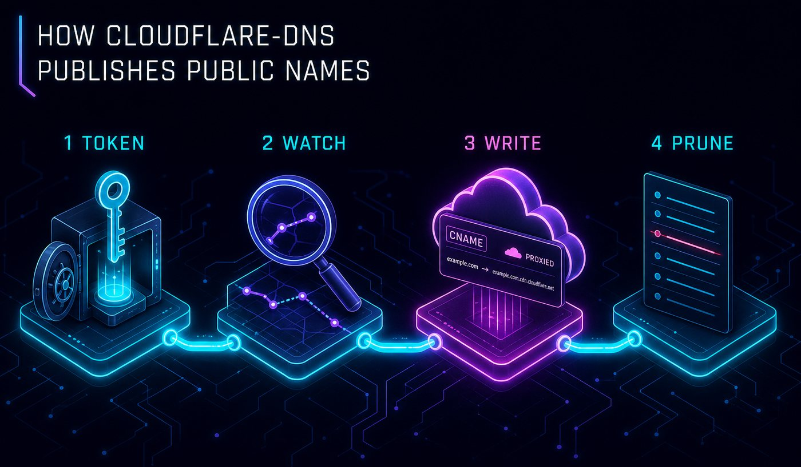
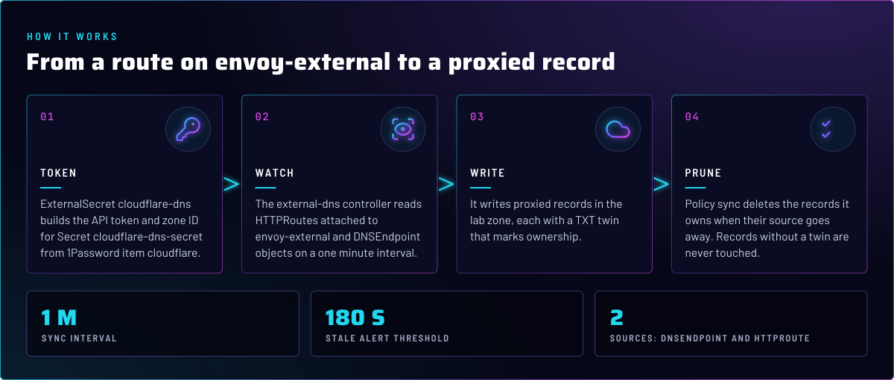
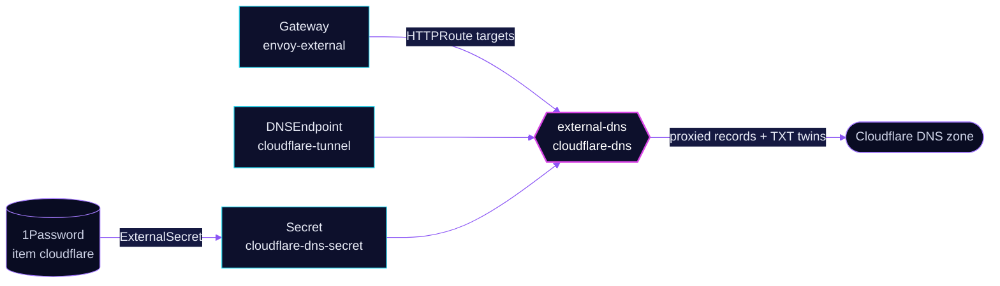

<p align="center">
  
</p>

> **Public names follow the public Gateway.** `cloudflare-dns` runs external-dns against the lab zone in Cloudflare. It
> publishes only routes attached to `envoy-external`, plus any `DNSEndpoint` objects, and it removes the records it
> owns when their source goes away. The LAN side is [`unifi-dns`](../unifi-dns/README.md).

## At a glance

<!-- glance:start -->
<!-- Generated by `readme.py sync`; edit the manifests, not this table. -->
| | |
|---|---|
| **Namespace** | `network` |
| **Deployed by** | [`cloudflare-dns`](../../../main/network/cloudflare-dns.yaml) (Flux Kustomization) |
| **Secret** | `cloudflare-dns-secret` from onepassword item `cloudflare` |
| **Alerts** | 1: `ExternalDNSStale` |
<!-- glance:end -->

## What it does

- **Publishes** HTTPRoutes attached to the `envoy-external` Gateway (`--gateway-name=envoy-external`). The record target
  comes from that Gateway's `external-dns.kubernetes.io/target` annotation.
- **Publishes** the `DNSEndpoint` objects in the cluster. The tunnel's `external` CNAME is one of these
  ([`cloudflare-tunnel`](../cloudflare-tunnel/README.md)).
- **Writes** each record proxied, with a TXT twin under the `k8s.` prefix that marks ownership, and keeps the zone in
  step with policy `sync`.

## Why it is built this way

| Choice | Why |
|---|---|
| **Public and LAN DNS are separate instances** | `cloudflare-dns` writes the public zone, `unifi-dns` writes the router. Each has its own owner id, so neither touches the other's records. |
| **Only `envoy-external` is published** | `--gateway-name` filters HTTPRoutes to the public Gateway. A route attached only to `envoy-internal` never gets a public name. |
| **Proxied records** | `--cloudflare-proxied` puts the records behind Cloudflare. The public name resolves to the edge, not to the home address. |
| **`policy: sync`** | Records are deleted when their source goes. Records without a TXT twin are never touched, so hand-made records survive (skill `networking`). |
| **Owner id `default`** | The chart default, left alone. The TXT twins name the owner, so changing it orphans every record this instance wrote. |

## How it works

<p align="center">
  
</p>

<p align="center">
  
</p>

<details>
<summary><b>Resource graph</b>: every object involved, by name</summary>



</details>

In more detail:

1. The ExternalSecret builds `CF_API_TOKEN` and `CF_ZONE_ID` in `cloudflare-dns-secret`. The HelmRelease reads both as env,
   and the Deployment reloads when the Secret changes.
2. The controller lists the `envoy-external` HTTPRoutes and the `DNSEndpoint` objects. It compares them with the zone,
   using the TXT twins to tell what it owns.
3. It creates or updates proxied records, then deletes owned records whose source is gone.

## Settings that matter

All values are in [`app/helmrelease.yaml`](app/helmrelease.yaml) unless noted.

| Setting | Value | Why |
|---|---|---|
| `--gateway-name` | `envoy-external` | Publishes only the public Gateway's routes. |
| `--cloudflare-proxied` | set | Records sit behind Cloudflare's edge. |
| `--zone-id-filter` | `$(CF_ZONE_ID)` | Pins writes to the lab zone, even if the token can see more zones. |
| `--cloudflare-dns-records-per-page` | `1000` | Reads the zone in large pages, so one sync makes few Cloudflare API calls. |
| `--crd-source-kind` | `DNSEndpoint` | Lets apps publish records as `DNSEndpoint` objects. The tunnel uses it. |
| `policy` | `sync` | Owned records are deleted with their source. |
| `triggerLoopOnEvent` | `true` | A route change syncs at once, not at the next loop. |
| `txtPrefix` / `txtOwnerId` | `k8s.` / `default` | Ownership marker. Changing either re-owns nothing and orphans what exists. |
| `resources` | 10m CPU, 32Mi request, 64Mi limit | Every limit has a request (skill `node-scheduling`). |

## Alerts

From [`app/prometheusrule.yaml`](app/prometheusrule.yaml). The rule covers `cloudflare-dns` and `unifi-dns` through the `job` label.

| Alert | Fires when | First look |
|---|---|---|
| `ExternalDNSStale` | no completed sync for over 3 minutes, for 5 minutes | `kubectl -n network logs deploy/cloudflare-dns`. The `job` label says which instance stalled. |

## Operate it

```bash
flux -n network get ks cloudflare-dns
kubectl -n network logs deploy/cloudflare-dns --tail=50
kubectl get dnsendpoints.externaldns.k8s.io -A
```

## Files

| File | Holds |
|---|---|
| [`app/helmrelease.yaml`](app/helmrelease.yaml) | Chart values: provider, sources, policy, owner id |
| [`app/ocirepository.yaml`](app/ocirepository.yaml) | Chart source and version |
| [`app/externalsecret.yaml`](app/externalsecret.yaml) | Cloudflare token and zone ID from 1Password |
| [`app/prometheusrule.yaml`](app/prometheusrule.yaml) | `ExternalDNSStale` |
| [`../../../main/network/cloudflare-dns.yaml`](../../../main/network/cloudflare-dns.yaml) | Flux Kustomization |

Upstream: [external-dns Cloudflare provider](https://kubernetes-sigs.github.io/external-dns/latest/docs/tutorials/cloudflare/) •
[external-dns sources](https://kubernetes-sigs.github.io/external-dns/latest/docs/sources/gateway-api/)

<!-- branded-readme v1 sources=5df54486756d -->
