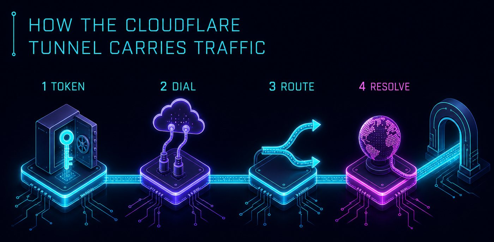
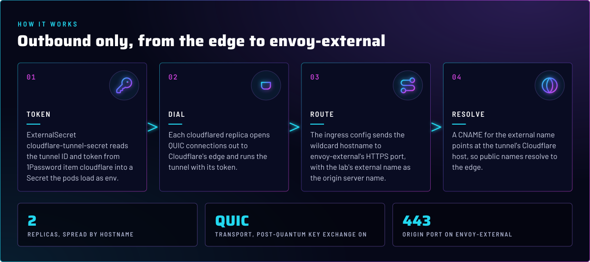
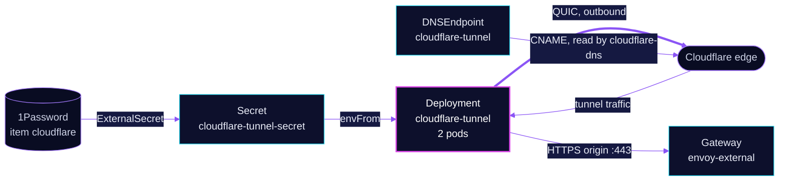

<p align="center">
  
</p>

> **Public traffic comes in over a tunnel the cluster dials out.** Two `cloudflared` pods hold outbound connections to
> Cloudflare's edge and forward every name under the lab domain to `envoy-external`. Which names are public is decided
> by the routes on that Gateway, not by this app.

## At a glance

<!-- glance:start -->
<!-- Generated by `readme.py sync`; edit the manifests, not this table. -->
| | |
|---|---|
| **Namespace** | `network` |
| **Deployed by** | [`cloudflare-tunnel`](../../../main/network/cloudflare-tunnel.yaml) (Flux Kustomization) |
| **Helm chart** | `app-template` from `oci://ghcr.io/bjw-s-labs/helm/app-template`, values in [`helmrelease.yaml`](app/helmrelease.yaml) |
| **Images** | `docker.io/cloudflare/cloudflared` |
| **Depends on** | `security/onepassword-store` |
| **Secret** | `cloudflare-tunnel-secret` from onepassword item `cloudflare` |
<!-- glance:end -->

## What it does

- **Connects** two `cloudflared` replicas to the tunnel, using the token from 1Password item `cloudflare` through
  Secret `cloudflare-tunnel-secret`.
- **Forwards** the wildcard hostname to `envoy-external` on its HTTPS port, with the lab's external name as the origin
  server name ([`helmrelease.yaml`](app/helmrelease.yaml), the `config.yaml` ConfigMap).
- **Publishes** the `external` CNAME that points at the tunnel's Cloudflare host, through a `DNSEndpoint` that
  [`cloudflare-dns`](../cloudflare-dns/README.md) reads ([`dnsendpoint.yaml`](app/dnsendpoint.yaml)).

## Why it is built this way

| Choice | Why |
|---|---|
| **Outbound only** | The tunnel dials Cloudflare, so public traffic needs no port forwarded on the router. |
| **Tunnel to one Gateway** | Everything goes to `envoy-external`. Envoy answers only for routes it knows, so the public surface is the set of HTTPRoutes on that Gateway. |
| **QUIC, post-quantum on** | Transport is set explicitly. The chart comment ties the post-quantum flag to QUIC: switching to HTTP/2 means turning it off. |
| **HTTP/2 to the origin, server name set** | `http2Origin` and `originServerName` mean the origin is reached over TLS with a name the wildcard certificate covers. |
| **Tunnel host written in Git** | The `DNSEndpoint` hard-codes the tunnel's Cloudflare host. A new tunnel means editing that file, and a new token in 1Password. |
| **Two replicas, spread when possible** | A PDB with `minAvailable: 1` keeps one tunnel up through a drain. Anti-affinity by hostname is preferred, not required, so both pods still schedule when the cluster is short of nodes. |

## How it works

<p align="center">
  
</p>

<p align="center">
  
</p>

<details>
<summary><b>Resource graph</b>: every object involved, by name</summary>



</details>

In more detail:

1. The ExternalSecret writes `TUNNEL_ID` and `TUNNEL_TOKEN` into `cloudflare-tunnel-secret`. The pods load it as env.
2. Each `cloudflared` runs `tunnel run` with QUIC and metrics on 8080. `/ready` on that port is the liveness and readiness probe.
3. The ingress config sends `*.` plus the lab domain to `envoy-external`. The final rule returns 404 for anything else.
4. The `external` CNAME resolves public names to the tunnel host. The tunnel then carries the request to Envoy.

## Settings that matter

All values are in [`app/helmrelease.yaml`](app/helmrelease.yaml) unless noted.

| Setting | Value | Why |
|---|---|---|
| `replicas` | `2` | One pod can restart or drain while the other holds the tunnel. |
| `podDisruptionBudget` ([`pdb.yaml`](app/pdb.yaml)) | `minAvailable: 1` | Keeps one connector through a node drain. |
| `TUNNEL_TRANSPORT_PROTOCOL` | `quic` | Explicit transport. The chart comment names HTTP/2 as the alternative. |
| `TUNNEL_POST_QUANTUM` | `true` | Post-quantum key exchange. The chart comment says to disable it under HTTP/2. |
| `originRequest.http2Origin` | `true` | HTTP/2 to Envoy's HTTPS listener. |
| `originRequest.originServerName` | the external name | The origin name the wildcard certificate covers. |
| `resources.requests.memory` | `128Mi` (limit `256Mi`) | The chart comment: a limit with no request reserves the whole limit. |
| `reloader.stakater.com/auto` | `"true"` | Restarts the pods when the token Secret changes. |

## Operate it

```bash
flux -n network get ks cloudflare-tunnel
kubectl -n network get pods -l app.kubernetes.io/name=cloudflare-tunnel -o wide
kubectl -n network logs deploy/cloudflare-tunnel --tail=50
```

## Files

| File | Holds |
|---|---|
| [`app/helmrelease.yaml`](app/helmrelease.yaml) | Chart values: replicas, env, probes, ingress config |
| [`app/ocirepository.yaml`](app/ocirepository.yaml) | Chart source and version |
| [`app/externalsecret.yaml`](app/externalsecret.yaml) | Tunnel ID and token from 1Password |
| [`app/dnsendpoint.yaml`](app/dnsendpoint.yaml) | The `external` CNAME to the tunnel host |
| [`app/pdb.yaml`](app/pdb.yaml) | Minimum one pod available |
| [`../../../main/network/cloudflare-tunnel.yaml`](../../../main/network/cloudflare-tunnel.yaml) | Flux Kustomization |

Upstream: [Cloudflare Tunnel docs](https://developers.cloudflare.com/cloudflare-one/connections/connect-networks/) •
[cloudflared configuration](https://developers.cloudflare.com/cloudflare-one/connections/connect-networks/configure-tunnels/cloudflared-parameters/)

<!-- branded-readme v1 sources=d5f9cca54f7e -->
