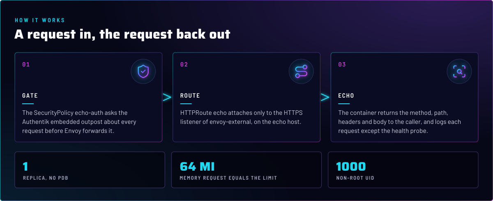
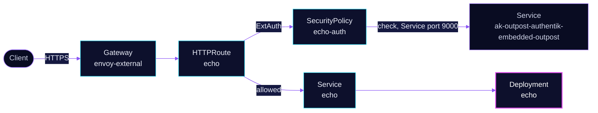

<p align="center">
  
</p>

> **A public request, gated, and reflected back.** `echo` is a diagnostic service on `envoy-external`. Authentik checks
> every request first, then the container returns what it received. Use it to see what a backend actually gets from the
> gateway.

## At a glance

<!-- glance:start -->
<!-- Generated by `readme.py sync`; edit the manifests, not this table. -->
| | |
|---|---|
| **Namespace** | `network` |
| **Deployed by** | [`echo`](../../../main/network/echo.yaml) (Flux Kustomization) |
| **Helm chart** | `app-template` from `oci://ghcr.io/bjw-s-labs/helm/app-template`, values in [`helmrelease.yaml`](app/helmrelease.yaml) |
| **Images** | `ghcr.io/mendhak/http-https-echo` |
<!-- glance:end -->

## What it does

- **Reflects** the request: method, path, headers and body, returned to the caller. The container is
  `mendhak/http-https-echo`, plain HTTP on port 80 behind the gateway.
- **Gates** each request through an Authentik ExtAuth check, using the `echo-auth` SecurityPolicy and the embedded outpost.
- **Logs** each request to stdout, except the health probe path.

## Why it is built this way

| Choice | Why |
|---|---|
| **Behind Authentik** | The reply includes the request's cookies and authorization headers. An anonymous caller should not see what an authenticated session sends. |
| **Attached to `envoy-external` only** | The point is to test the public path, from the tunnel through Envoy and ExtAuth to the backend. |
| **Read-only root, no capabilities, non-root UID** | It only echoes. There is nothing to write and no privilege to use. |

## How it works

<p align="center">
  
</p>

<details>
<summary><b>Resource graph</b>: every object involved, by name</summary>



</details>

In more detail:

1. Flux applies the HelmRelease, which creates the Deployment, Service, ServiceMonitor and the HTTPRoute.
2. The HTTPRoute `echo` carries the SecurityPolicy `echo-auth`, which forwards cookie and authorization headers to
   Authentik and waits for its answer.
3. On allow, Envoy forwards the request to the Service. The container replies with the request as it arrived.

## Settings that matter

All values are in [`app/helmrelease.yaml`](app/helmrelease.yaml) unless noted.

| Setting | Value | Why |
|---|---|---|
| `resources` | request `64Mi`, limit `64Mi` | Equal on purpose. Peak use sits near the limit, so a lower request would reclaim nothing, and a limit alone reserves the whole limit (skill `node-scheduling`). |
| `LOG_IGNORE_PATH` | `/healthz` | Keeps the probe out of the logs. |
| `readOnlyRootFilesystem` / `capabilities.drop` | `true` / `ALL` | Nothing to write, nothing to escalate. |
| `PROMETHEUS_ENABLED` + ServiceMonitor | on | Request metrics for the app. |
| `headersToExtAuth` / `headersToBackend` ([`securitypolicy.yaml`](app/securitypolicy.yaml)) | cookie, authorization, forwarded headers out; `set-cookie`, `authorization` and `x-authentik-*` back | Authentik sees what it needs to decide. The echo sees the identity headers Authentik adds, and any cookie or authorization value it sets is passed on to the client. |

## Operate it

```bash
flux -n network get ks echo
kubectl -n network get httproute echo
kubectl -n network get securitypolicy echo-auth
```

## Known gaps

- **The homepage link points at a name the route does not serve.** `gethomepage.dev/href` is `echo-server`, but the route
  hostname comes from the release name, `echo`. On the LAN, unclaimed names resolve to the AI gateway (skill
  `networking`), so the tile opens the wrong service. Found while writing; not fixed here.

## Files

| File | Holds |
|---|---|
| [`app/helmrelease.yaml`](app/helmrelease.yaml) | Container, probes, route, homepage and Gatus annotations |
| [`app/securitypolicy.yaml`](app/securitypolicy.yaml) | ExtAuth gate through Authentik |
| [`app/ocirepository.yaml`](app/ocirepository.yaml) | Chart source (app-template) |
| [`../../../main/network/echo.yaml`](../../../main/network/echo.yaml) | Flux Kustomization |

Upstream: [http-https-echo](https://github.com/mendhak/docker-http-https-echo) •
[Envoy Gateway ext auth](https://gateway.envoyproxy.io/docs/tasks/security/ext-auth/)

<!-- branded-readme v1 sources=a768be273ad4 -->
