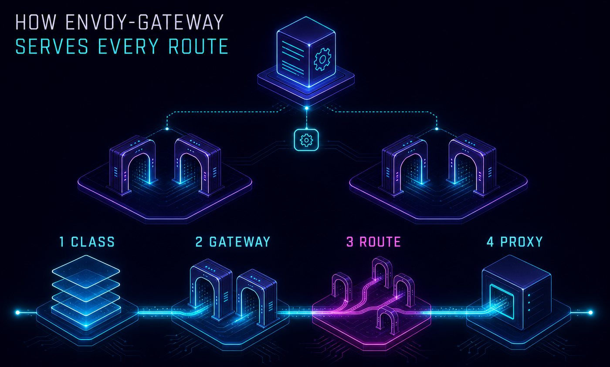
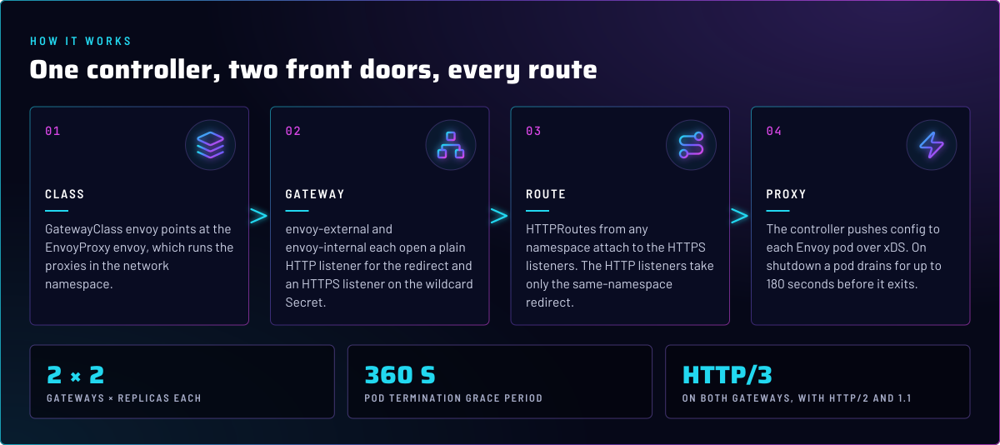
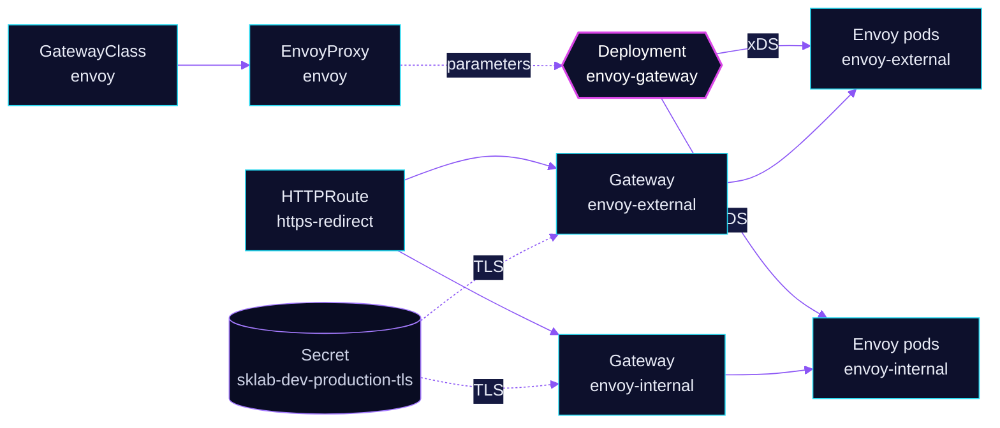

<p align="center">
  
</p>

> **Every HTTP route in the cluster goes through here.** The controller turns Gateway API objects into Envoy
> configuration, and two Envoy fleets serve it: `envoy-external` for the public path through the tunnel, and
> `envoy-internal` for the LAN. Both serve the same wildcard certificate.

## At a glance

<!-- glance:start -->
<!-- Generated by `readme.py sync`; edit the manifests, not this table. -->
| | |
|---|---|
| **Namespace** | `network` |
| **Deployed by** | [`envoy-gateway`](../../../main/network/envoy-gateway.yaml) (Flux Kustomization) |
| **Helm chart** | `gateway-helm` from `oci://mirror.gcr.io/envoyproxy/gateway-helm`, values in [`helmrelease.yaml`](app/helmrelease.yaml) |
| **Depends on** | `network/certificates-import` |
| **Route** | `(no hostname)` via `envoy-external`, `envoy-internal` |
| **Alerts** | 2: `EnvoyProxyControlPlaneDisconnected`, `EnvoyGatewayControllerCrashLooping` |
<!-- glance:end -->

## What it does

- **Runs the controller** (`envoy-gateway`), which watches Gateway API objects and pushes configuration to Envoy over xDS.
- **Runs two Gateways** in `network`: `envoy-external`, reached through the tunnel and published by
  [`cloudflare-dns`](../cloudflare-dns/README.md), and `envoy-internal`, published by [`unifi-dns`](../unifi-dns/README.md).
- **Redirects** HTTP to HTTPS on both Gateways with the `https-redirect` HTTPRoute.
- **Serves** HTTP/3 on both Gateways, alongside HTTP/2 and 1.1 over TLS 1.2 and up.
- **Exports metrics** with a PodMonitor for the proxies and a ServiceMonitor for the controller.

## Why it is built this way

| Choice | Why |
|---|---|
| **Two Gateways, not one** | Public and internal listeners need different reachability and DNS. Splitting them keeps a route's visibility in its parent Gateway. |
| **Proxies run in `network`** | `deploy.type: GatewayNamespace` puts each fleet in its Gateway's namespace, next to the Services the controller creates for it. |
| **Two replicas per Gateway, never on one node** | A hard topology spread on the owning Gateway name. `externalTrafficPolicy: Local` means a node with no endpoint does not advertise the VIP, so a shared node would leave one replica unreachable. |
| **Long drain** | After a pod starts draining, it keeps serving in-flight requests for up to 180 seconds. The grace period is 360 seconds, so the 210-second preStop sleep finishes before the kill. |
| **HTTPS listeners accept routes from all namespaces** | Apps own their routes in their own namespaces. The HTTP listeners accept only the same-namespace redirect. |
| **No gateway-wide request timeout** | Streams and long requests are not cut at the Gateway. Individual apps set their own limits when they need them. |

## How it works

<p align="center">
  
</p>

<p align="center">
  
</p>

<details>
<summary><b>Resource graph</b>: every object involved, by name</summary>



</details>

In more detail:

1. Flux waits for `certificates-import` (the Kustomization's `dependsOn`), then applies the controller HelmRelease. The
   controller accepts the `envoy` GatewayClass that `app/envoy.yaml` declares, because its `controllerName` is
   `gateway.envoyproxy.io/gatewayclass-controller`.
2. The `envoy` EnvoyProxy sets the fleet size, spread, image, drain timing and the `externalTrafficPolicy: Local`
   that the BGP advertisement depends on.
3. Each Gateway declares its listeners. The controller creates an Envoy Deployment and Service per Gateway. The
   `external-dns` target is a Gateway annotation, and the Cilium LB IP is set in `infrastructure.annotations`, which the
   controller copies to the Service.
4. Routes attach to the HTTPS listeners, and the controller pushes the result to every Envoy pod over xDS.

## Settings that matter

All values are in [`app/helmrelease.yaml`](app/helmrelease.yaml) and [`app/envoy.yaml`](app/envoy.yaml) unless noted.

| Setting | Value | Why |
|---|---|---|
| `deployment.envoyGateway.resources` | request 256Mi, limit 1Gi | Under `deployment`. A `resources:` block under `config.envoyGateway` is silently ignored by the chart. |
| `EnvoyProxy` `replicas` | `2` per Gateway | Each Gateway runs two pods, spread across nodes. |
| `topologySpreadConstraints` | `DoNotSchedule`, per owning Gateway | Replicas of one Gateway never share a node. The `matchLabelKeys` makes the count per Gateway, not across the shared spec. |
| `container.resources` | request `256Mi`, limit `1Gi` | The request tracks observed peak. Without it, the request defaults to the limit and every proxy reserves 1Gi. |
| `shutdown.drainTimeout` / `minDrainDuration` | `180s` / `60s` | The window in which in-flight requests finish. |
| `terminationGracePeriodSeconds` | `360` | Longer than the drain, so the preStop sleep of 210 seconds completes first. |
| `externalTrafficPolicy` | `Local` | Keeps the client address, and lets only nodes with a proxy advertise the VIP. |
| `ClientTrafficPolicy` `xForwardedFor.numTrustedHops` | `1` | Trusts exactly one proxy hop, so a client cannot choose its own address by adding headers. |
| `ClientTrafficPolicy` `http3` / `tls.minVersion` | `{}` / `1.2` | HTTP/3 on, TLS 1.2 minimum. |
| `BackendTrafficPolicy` `requestTimeout` | `0s` | No gateway-wide cap on request length. |

The preStop `exec` replaces the chart's injected hook. The CRD does not expose lifecycle or grace period, so the strategic
merge patch in [`app/envoy.yaml`](app/envoy.yaml) sets them.

## Alerts

From [`app/prometheusrule.yaml`](app/prometheusrule.yaml).

| Alert | Fires when | First look |
|---|---|---|
| `EnvoyProxyControlPlaneDisconnected` | a proxy has lost its xDS connection for 10 minutes | The proxy serves frozen config. Restart `envoy-gateway`, then `envoy-internal` and `envoy-external`. |
| `EnvoyGatewayControllerCrashLooping` | the controller restarted twice in 15 minutes | Controller logs. Look for a token-expiry storm from stale proxies. |

## Operate it

```bash
flux -n network get ks envoy-gateway
kubectl -n network get gateway envoy-external envoy-internal
kubectl -n network get pods -l app.kubernetes.io/name=envoy -o wide
```

A restart is a write: use the admin kubeconfig with owner approval (`kubectl -n network rollout restart deploy envoy-gateway`).

## Files

| File | Holds |
|---|---|
| [`app/helmrelease.yaml`](app/helmrelease.yaml) | Controller chart values |
| [`app/envoy.yaml`](app/envoy.yaml) | EnvoyProxy, GatewayClass, the two Gateways, traffic policies, the HTTPS redirect |
| [`app/observability.yaml`](app/observability.yaml) | PodMonitor (proxies) and ServiceMonitor (controller) |
| [`app/pdb.yaml`](app/pdb.yaml) | One pod minimum per Gateway |
| [`app/prometheusrule.yaml`](app/prometheusrule.yaml) | Two alerts |
| [`app/ocirepository.yaml`](app/ocirepository.yaml) | Chart source and version |
| [`../../../main/network/envoy-gateway.yaml`](../../../main/network/envoy-gateway.yaml) | Flux Kustomization |

Upstream: [Envoy Gateway docs](https://gateway.envoyproxy.io/docs/) •
[EnvoyProxy API](https://gateway.envoyproxy.io/docs/api/extension_types/) •
[Gateway API](https://gateway-api.sigs.k8s.io/)

<!-- branded-readme v1 sources=8c5b1fb2d7bf -->
