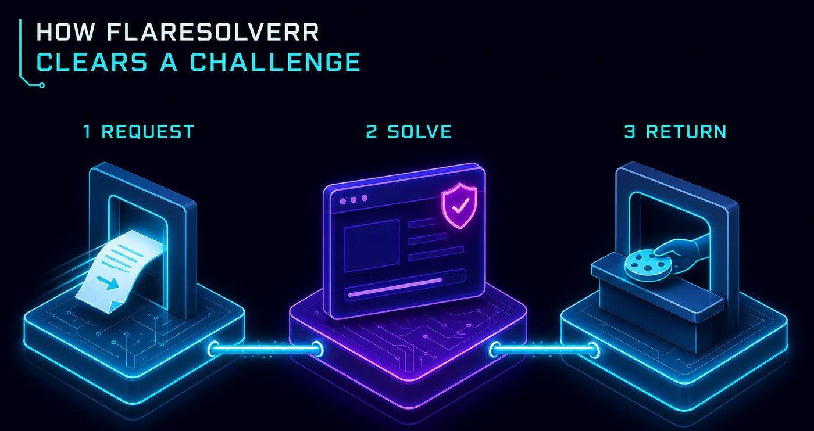
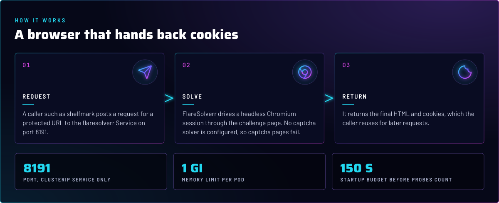
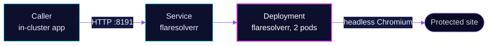

<p align="center">
  
</p>

> **A browser that other apps can call, and nothing else can.** FlareSolverr loads a protected page in a headless
> Chromium, clears the challenge, and hands back the HTML and cookies. It has a ClusterIP Service and no route, so only
> in-cluster callers reach it.

## At a glance

<!-- glance:start -->
<!-- Generated by `readme.py sync`; edit the manifests, not this table. -->
| | |
|---|---|
| **Namespace** | `network` |
| **Deployed by** | [`flaresolverr`](../../../main/network/flaresolverr.yaml) (Flux Kustomization) |
| **Helm chart** | `app-template`, values in [`helmrelease.yaml`](app/helmrelease.yaml) |
| **Images** | `ghcr.io/flaresolverr/flaresolverr` |
<!-- glance:end -->

## What it does

- **Solves** Cloudflare's browser challenges for callers in the cluster. Today the caller is `downloads/shelfmark`, which
  reaches it at `flaresolverr.network.svc.cluster.local:8191`.
- **Returns** the final HTML and cookies. The caller keeps the cookies for its own later requests.
- **Serves** two replicas behind one Service, with no captcha solver configured.

## Why it is built this way

| Choice | Why |
|---|---|
| **ClusterIP only, no route** | A browser that fetches URLs chosen by a caller is a proxy. Putting it behind a gateway would hand that proxy to the internet. |
| **No captcha solver** | `CAPTCHA_SOLVER: none`. Pages that need a captcha fail, instead of sending the challenge to a paid third party. |
| **Two replicas** | A challenge takes seconds, and one pod restarting would fail the caller's requests. Two keep the Service answering. |
| **Not pinned away from talos-3** | The `PreferNoSchedule` taint scores talos-3 lower, but it is a soft preference: a pod can still land there when the other nodes lack room (skill `node-scheduling`). |

## How it works

<p align="center">
  
</p>

<p align="center">
  
</p>

<details>
<summary><b>Resource graph</b>: every object involved, by name</summary>



</details>

In more detail:

1. Flux applies the HelmRelease, which runs two pods from the `app-template` chart with the FlareSolverr image.
2. A startup probe on `/` allows up to 150 seconds for Chromium to start. Liveness and readiness begin after that.
3. The caller posts a request. FlareSolverr opens a browser session, solves the challenge in the page, and replies.

## Settings that matter

All values are in [`app/helmrelease.yaml`](app/helmrelease.yaml) unless noted.

| Setting | Value | Why |
|---|---|---|
| `service.app.type` | `ClusterIP` | No external Service and no route. |
| `CAPTCHA_SOLVER` | `none` | No third-party captcha solver is used. |
| `LOG_HTML` | `false` | Page bodies stay out of the logs. |
| `startup` probe | 30 failures × 5 s | Chromium is slow to start. The budget keeps liveness from killing a pod that is still booting. |
| `resources` | request `512Mi`, limit `1Gi` | Each session runs a browser, so a pod needs real memory before it can serve a challenge. |
| `replicas` | `2` | Keeps the Service answering while one pod restarts. |
| `install.remediation.retries` | `-1` | Keeps retrying the first install. Upgrades stop after 3. |

## Operate it

```bash
flux -n network get ks flaresolverr
kubectl -n network get pods -l app.kubernetes.io/name=flaresolverr -o wide
kubectl -n network logs deploy/flaresolverr --tail=50
```

## Files

| File | Holds |
|---|---|
| [`app/helmrelease.yaml`](app/helmrelease.yaml) | Container, probes, resources, Service |
| [`app/kustomization.yaml`](app/kustomization.yaml) | Resource list |
| [`../../../main/network/flaresolverr.yaml`](../../../main/network/flaresolverr.yaml) | Flux Kustomization |

Upstream: [FlareSolverr](https://github.com/FlareSolverr/FlareSolverr) •
[FlareSolverr API](https://github.com/FlareSolverr/FlareSolverr#readme)

<!-- branded-readme v1 sources=79a14aab0b02 -->
