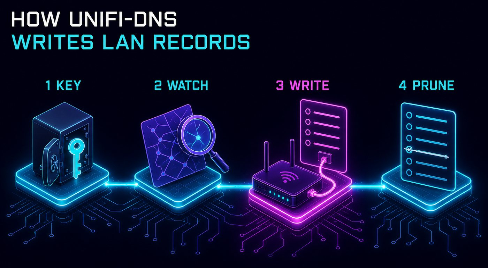
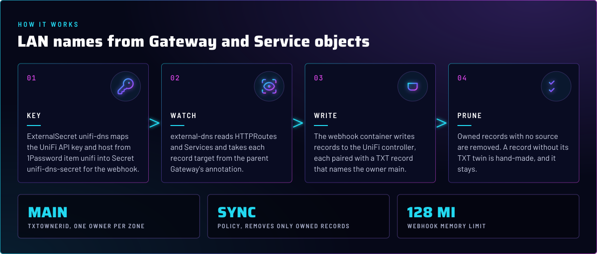
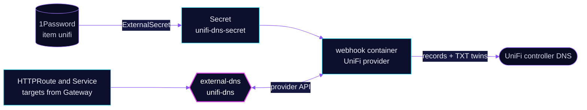

<p align="center">
  
</p>

> **The LAN resolves internal names without a public record.** `unifi-dns` runs external-dns with a UniFi webhook. It
> reads HTTPRoutes and Services, and writes their names into the UniFi controller's DNS, so LAN clients reach
> `envoy-internal` directly. The public side is [`cloudflare-dns`](../cloudflare-dns/README.md).

## At a glance

<!-- glance:start -->
<!-- Generated by `readme.py sync`; edit the manifests, not this table. -->
| | |
|---|---|
| **Namespace** | `network` |
| **Deployed by** | [`unifi-dns`](../../../main/network/unifi-dns.yaml) (Flux Kustomization) |
| **Helm chart** | `external-dns` from `oci://ghcr.io/home-operations/charts-mirror/external-dns`, values in [`helmrelease.yaml`](app/helmrelease.yaml) |
| **Images** | `ghcr.io/home-operations/external-dns-unifi-webhook` |
| **Secret** | `unifi-dns-secret` from onepassword item `unifi` |
<!-- glance:end -->

## What it does

- **Writes** records for HTTPRoutes and Services into the UniFi controller, with the target taken from the parent Gateway's
  `external-dns.kubernetes.io/target` annotation.
- **Pairs** each record with a TXT twin under `k8s.main.`, which marks it as owned by this instance.
- **Removes** owned records whose source goes away. Records without a twin are never touched.

## Why it is built this way

| Choice | Why |
|---|---|
| **A webhook provider** | UniFi has no built-in external-dns provider. The webhook runs next to external-dns in the same pod and speaks to the controller API. |
| **Owner `main`** | The TXT twins name `main`, a different owner from `cloudflare-dns`. Two instances never fight over one name. |
| **`policy: sync`** | A record whose route is removed is deleted. Without it, stale LAN names would keep resolving. |
| **The LAN wildcard stays** | `*.${SECRET_DOMAIN}` was made by hand in the controller and has no TXT twin, so this app cannot remove it. Unclaimed names therefore resolve to the AI gateway. Skill `networking` covers the reasoning. |
| **Hostnames from the Gateway** | The internal Gateway's annotation decides the target. Route-level targets are documentation, not the control (skill `networking`). |

## How it works

<p align="center">
  
</p>

<p align="center">
  
</p>

<details>
<summary><b>Resource graph</b>: every object involved, by name</summary>



</details>

In more detail:

1. The ExternalSecret writes the controller host and API key into `unifi-dns-secret`. Both reach the webhook as env, and the
   pod reloads when the Secret changes.
2. external-dns lists HTTPRoutes and Services and works out the desired names and targets. It triggers on each event.
3. The webhook reads and writes the records in the UniFi controller. Each record gets its TXT twin.
4. Owned records with no source are deleted. Hand-made records have no twin, so they are never in scope.

## Settings that matter

All values are in [`app/helmrelease.yaml`](app/helmrelease.yaml) unless noted.

| Setting | Value | Why |
|---|---|---|
| `provider.name` | `webhook` | UniFi is served by the webhook image, not a built-in provider. |
| `policy` | `sync` | Owned records follow their source, including deletion. |
| `sources` | `gateway-httproute`, `service` | Internal names come from routes and LoadBalancer Services. |
| `triggerLoopOnEvent` | `true` | A change syncs at once. |
| `txtOwnerId` / `txtPrefix` | `main` / `k8s.main.` | Ownership marker, separate from `cloudflare-dns`. |
| `fullnameOverride` | `unifi-dns` | The Deployment and Service keep the app name, which the networking runbook uses. |
| `webhook` probes | `/healthz`, `/readyz` on `http-webhook` | Liveness and readiness of the webhook container, 10 s initial delay. |
| `resources` | external-dns 64Mi request, 192Mi limit; webhook 32Mi request, 128Mi limit | Each container has an explicit request, so neither reserves its whole limit. |

## Alerts

`unifi-dns` has no rule of its own. `ExternalDNSStale` in [`cloudflare-dns`](../cloudflare-dns/app/prometheusrule.yaml)
covers it through the `job` label.

## Operate it

```bash
flux -n network get ks unifi-dns
kubectl -n network logs deploy/unifi-dns --tail=50
kubectl -n network port-forward deploy/unifi-dns 18888:8888
curl -H 'Accept: application/external.dns.webhook+json;version=1' localhost:18888/records
```

Port 8888 is the webhook chart's default and is not set anywhere in Git. The port-forward and `curl` read the webhook's view of the records. Skill `networking`, `references/dns-ownership.md`,
explains how to read them.

## Files

| File | Holds |
|---|---|
| [`app/helmrelease.yaml`](app/helmrelease.yaml) | Chart values: webhook provider, sources, policy, owner id |
| [`app/externalsecret.yaml`](app/externalsecret.yaml) | UniFi host and API key from 1Password |
| [`app/ocirepository.yaml`](app/ocirepository.yaml) | Chart source and version |
| [`../../../main/network/unifi-dns.yaml`](../../../main/network/unifi-dns.yaml) | Flux Kustomization |

Upstream: [external-dns webhook provider](https://kubernetes-sigs.github.io/external-dns/latest/docs/webhook-provider/) •
[external-dns sources](https://kubernetes-sigs.github.io/external-dns/latest/docs/sources/gateway-api/)

<!-- branded-readme v1 sources=eedc33ded2fe -->
