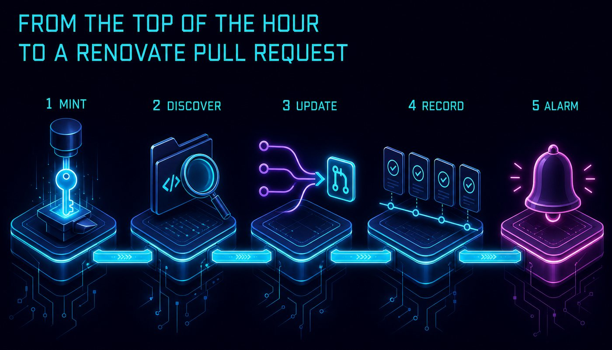
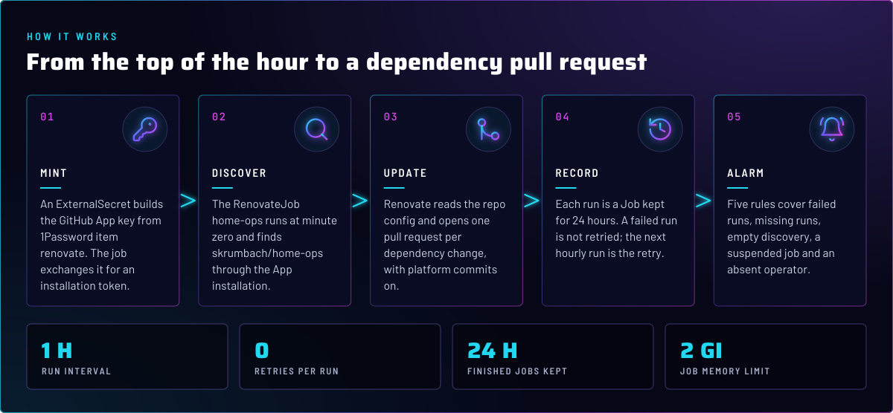
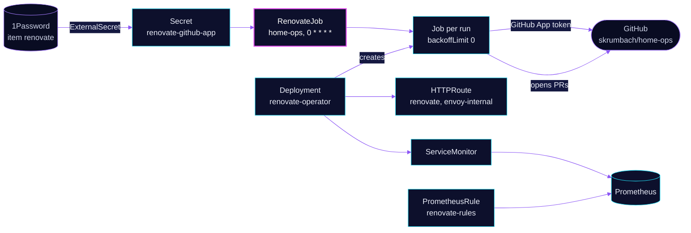

<p align="center">
  
</p>

> **One Renovate run an hour, one attempt each.** The mogenius operator starts a Job every hour for the `home-ops`
> RenovateJob. It authenticates as a GitHub App, so every run mints a short-lived token. A failed run waits for the next
> hour; five alerts cover failed, missing and empty runs. The namespace overview is in
> [`../README.md`](../README.md).

## At a glance

<!-- glance:start -->
<!-- Generated by `readme.py sync`; edit the manifests, not this table. -->
| | |
|---|---|
| **Namespace** | `renovate` |
| **Deployed by** | [`renovate-jobs`](../../../main/renovate/renovate-jobs.yaml), [`renovate-operator`](../../../main/renovate/renovate-operator.yaml) (Flux Kustomization) |
| **Helm chart** | `renovate-operator` from `oci://ghcr.io/mogenius/helm-charts/renovate-operator`, values in [`helmrelease.yaml`](app/helmrelease.yaml) |
| **Depends on** | `renovate/renovate-operator`, `security/onepassword-store` |
| **Needed by** | `renovate/renovate-jobs` |
| **Secret** | `renovate-github-app` from onepassword item `renovate` |
| **Health checks** | `Deployment/renovate-operator` |
| **Alerts** | 5: `RenovateRunFailed`, `RenovateRunMissing`, `RenovateDiscoveryEmpty`, `RenovateJobSuspended`, `RenovateOperatorAbsent` |
<!-- glance:end -->

## What it does

- **Runs** the `renovate-operator` chart: a Deployment in `renovate`, the operator's UI and API, and its CRDs.
- **Schedules** one `RenovateJob`, `home-ops`, at minute zero of every hour. It discovers `skrumbach/home-ops` and runs
  Renovate there with `parallelism: 1`.
- **Authenticates** as the GitHub App `mortyops`, the App skrumbach installed. The ExternalSecret `renovate-github-app`
  reads the App ID and private key from the 1Password item `renovate`, and the job uses the installation ID from Git.
- **Serves** the UI at `renovate.${SECRET_DOMAIN}` on `envoy-internal`, with no auth provider.
- **Reports** through a ServiceMonitor, a Grafana dashboard in the `Operators` folder, and the `renovate-rules`
  PrometheusRule.

## Why it is built this way

| Choice | Why |
|---|---|
| **`defaultJobBackoffLimit: 0`** | One attempt per run. The next hourly run is the retry, so a failing run does not retry within the hour. |
| **Jobs kept 24 hours** | `jobTTLSecondsAfterFinished: 86400`. A failed run's logs stay readable the next morning. |
| **A GitHub App, not a PAT** | The App mints a token per run, scoped to the installation. The key lives in 1Password, and the ExternalSecret wraps it in a PEM header, because the item stores the body only. |
| **Internal route, no auth** | Anyone on the internal network reaches the UI as admin. The operator has no auth provider in this chart setup, so the network boundary is the only control. |
| **`requireConfig: required`** | Renovate runs only when the repo has its own config file. |
| **`platformCommit: enabled`** | Renovate commits through the GitHub API, so the commits are signed by GitHub. |
| **`gitNoVerify: [commit, push]`** | Renovate's commits skip git hooks, because the repo's pre-commit setup is for local commits. |
| **Renovate's own image is a reviewed change** | The `image` in `renovatejob.yaml` is Renovate's version. Its bumps go through the `renovate` skill before merge. |

## How it works

<p align="center">
  
</p>

<p align="center">
  
</p>

<details>
<summary><b>Resource graph</b>: every object involved, by name</summary>



</details>

In more detail:

1. Flux applies the operator from [`app/`](app/) and the RenovateJob from [`jobs/`](jobs/) as two Kustomizations. The jobs
   Kustomization waits for the operator, because the `RenovateJob` CRD ships with the chart.
2. At minute zero the operator creates a Job. The Job reads the GitHub App key from the Secret, mints an installation
   token, and runs Renovate with the inline config.
3. Renovate reads the repo config, then opens or updates pull requests. Each run reports its state as metrics.
4. The Job finishes and is kept for 24 hours. A failure triggers `RenovateRunFailed` after two hourly runs fail.

## Settings that matter

Values are in [`app/helmrelease.yaml`](app/helmrelease.yaml) and [`jobs/renovatejob.yaml`](jobs/renovatejob.yaml). The
chart version is in [`app/ocirepository.yaml`](app/ocirepository.yaml).

| Setting | Value | Why |
|---|---|---|
| `config.defaultJobBackoffLimit` | `0` | See Why. |
| `config.jobTTLSecondsAfterFinished` | `86400` | Keeps a day of logs for each run. |
| `route.hostnames` | `renovate.${SECRET_DOMAIN}` on `envoy-internal` | Internal only, no auth. See Why. |
| `route` `gatus.home-operations.com/endpoint` | `[STATUS] == 200` | The UI must answer. Gatus lists it. |
| `metrics.serviceMonitor.enabled` / `dashboard.enabled` | `true` | Feeds the alerts and the Grafana dashboard in the `Operators` folder. |
| `RenovateJob.spec.schedule` | `0 * * * *` | Hourly, at minute zero. |
| `RenovateJob.spec.parallelism` | `1` | One repo, one worker. |
| `RenovateJob.spec.discoveryFilters` | `skrumbach/home-ops` | Only this repo. The `ai-k8s-sandbox` repo is not in the job. |
| `RenovateJob` `renovateConfig.inline` | `onboarding: false`, `requireConfig: required`, `platformCommit: enabled`, `binarySource: install`, `gitNoVerify: [commit, push]` | See Why. |
| `RenovateJob.spec.resources` | requests `100m` CPU and `512Mi`; memory limit `2Gi` | A Renovate run that parses many lockfiles needs the headroom. The operator itself is capped at `256Mi`. |

## Alerts

From [`app/prometheusrule.yaml`](app/prometheusrule.yaml). All five name the `home-ops` job by label.

| Alert | Severity | Fires when | First look |
|---|---|---|---|
| `RenovateRunFailed` | warning | the runs for `home-ops` have failed for 2 h | Open the UI, or the latest Job logs. |
| `RenovateRunMissing` | critical | no completed run in 8 h | The RenovateJob is not suspended; the `Homelab/renovate` item still resolves `BOT_APP_ID` and `BOT_APP_PRIVATE_KEY`. |
| `RenovateDiscoveryEmpty` | critical | discovery found no repository for 2 h | The App lost access to `skrumbach/home-ops`, or the token could not be minted. |
| `RenovateJobSuspended` | warning | the RenovateJob has been suspended for 12 h | Resume it, unless the suspension is the rollback. |
| `RenovateOperatorAbsent` | critical | no metrics for the RenovateJob for 1 h | The operator is down, the ServiceMonitor is not scraped, or Flux did not apply [`jobs/`](jobs/). |

## Operate it

```bash
flux -n renovate get ks renovate-operator
flux -n renovate get ks renovate-jobs
kubectl -n renovate get renovatejob home-ops
kubectl -n renovate get jobs --sort-by=.metadata.creationTimestamp | tail -5
```

The rollback steps (suspend the RenovateJob, then dispatch the workflow) are in
[`../README.md`](../README.md#rollback). The `renovate` skill covers the rest of the operations.

## Known gaps

- **`RenovateRunMissing` fires for a suspended job.** Its second clause, `sum(renovate_operator_renovatejob_suspended offset 8h) >= 0`,
  is true for every value, so it adds no condition. A suspension longer than eight hours therefore raises this critical
  alert in addition to `RenovateJobSuspended`. Found while writing; not fixed here.

## Files

| File | Holds |
|---|---|
| [`app/helmrelease.yaml`](app/helmrelease.yaml) | Chart values: backoff, TTL, UI route, metrics, operator resources |
| [`app/ocirepository.yaml`](app/ocirepository.yaml) | Chart source and version |
| [`app/prometheusrule.yaml`](app/prometheusrule.yaml) | Five operator alerts |
| [`jobs/renovatejob.yaml`](jobs/renovatejob.yaml) | The `home-ops` RenovateJob: schedule, App reference, inline config |
| [`jobs/externalsecret.yaml`](jobs/externalsecret.yaml) | `renovate-github-app` Secret from 1Password item `renovate` |
| [`../../../main/renovate/renovate-operator.yaml`](../../../main/renovate/renovate-operator.yaml) | Flux Kustomization for the operator |
| [`../../../main/renovate/renovate-jobs.yaml`](../../../main/renovate/renovate-jobs.yaml) | Flux Kustomization for the job |

Upstream: [renovate-operator docs](https://github.com/mogenius/renovate-operator) •
[Renovate docs](https://docs.renovatebot.com/)

<!-- branded-readme v1 sources=79983cdce0f1 -->
