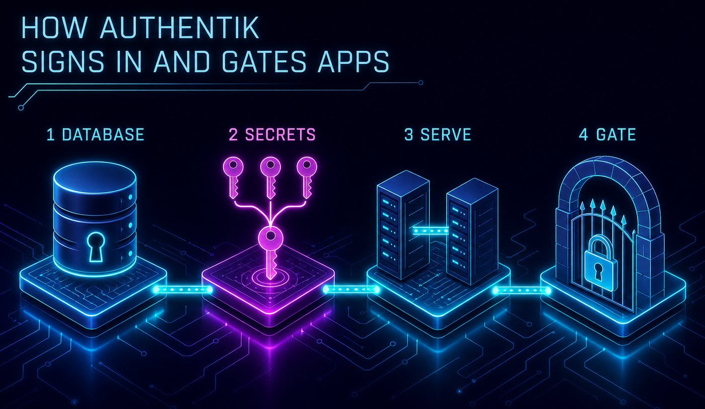
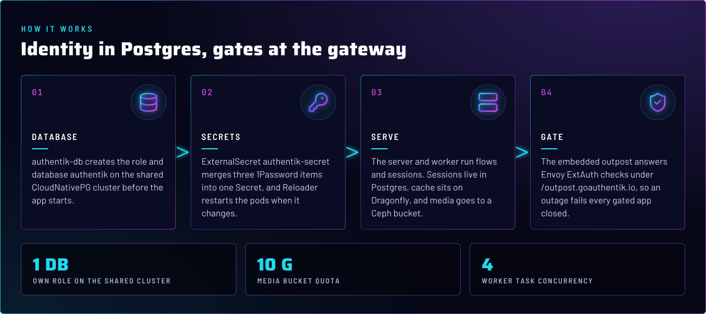
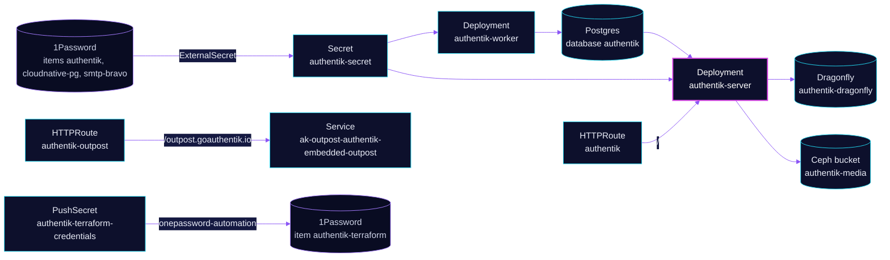

<p align="center">
  
</p>

> **One login for the lab, enforced at the gateway.** Authentik runs the identity provider. Its embedded outpost answers
> Envoy's ExtAuth checks, so an app behind a `SecurityPolicy` is signed in before a request reaches it. Terraform manages
> the applications and providers; see skill `authentik-terraform`.

## At a glance

<!-- glance:start -->
<!-- Generated by `readme.py sync`; edit the manifests, not this table. -->
| | |
|---|---|
| **Namespace** | `security` |
| **Deployed by** | [`authentik`](../../../main/security/authentik.yaml) (Flux Kustomization) |
| **Helm chart** | `authentik` from `oci://ghcr.io/goauthentik/helm-charts/authentik`, values in [`helmrelease.yaml`](app/helmrelease.yaml) |
| **Depends on** | `database/dragonfly-operator`, `security/authentik-db`, `security/onepassword-store` |
| **Route** | `authentik-outpost`: `auth.${SECRET_DOMAIN}` via `envoy-internal`, `envoy-external` (Gatus probed) |
| **Route** | `authentik`: `auth.${SECRET_DOMAIN}` via `envoy-internal`, `envoy-external` (Gatus probed) |
| **Secret** | `authentik-secret` from onepassword item `authentik`, `cloudnative-pg`, `smtp-bravo` |
| **Pushes to 1Password** | `authentik-terraform` |
<!-- glance:end -->

## What it does

- **Signs users in** with OIDC and proxy providers, and runs the flows, stages and sessions behind them.
- **Gates routes** through the embedded outpost. The `/outpost.goauthentik.io` path on `auth.${SECRET_DOMAIN}` is the
  ExtAuth backend for every protected app, in any namespace listed by the ReferenceGrant.
- **Stores** its data in the shared CloudNativePG cluster (own role and database), its cache on Dragonfly, and its media in
  a Ceph object bucket.

## Why it is built this way

| Choice | Why |
|---|---|
| **Sessions in Postgres** | `AUTHENTIK_SESSION_STORAGE: db`. The database is the durable store, so a Dragonfly restart does not sign everyone out. Dragonfly keeps the cache. |
| **Database role from a Kustomization** | `authentik-db` creates the role and database on `postgres-18`, before the app. It is `retain`: removing the Kustomization drops nothing. Skill `databases`. |
| **Database host pinned in Git** | `postgres-18-rw` is written in the ExternalSecret template, not read from 1Password. The address is not a secret, and a reviewer can see where traffic goes. |
| **Media in a bucket that Flux does not prune** | The ObjectBucketClaim is `prune: disabled`, and the `ceph-bucket` class deletes the bucket when the claim goes. Removing the manifest must not remove the media. |
| **Outpost route fails closed** | The outpost route is separate from the UI route. If the outpost goes down, every ExtAuth-gated app refuses requests instead of letting them through. |
| **Gatus checks the outpost ping** | The outpost route's Gatus check hits `/outpost.goauthentik.io/ping` (204), because the bare prefix returns 404 and would stay red. |
| **Terraform credentials pushed to Automation** | The `authentik-terraform-credentials` PushSecret writes from the `onepassword-automation` store, so its item lands in the Automation vault. |

## How it works

<p align="center">
  
</p>

<p align="center">
  
</p>

<details>
<summary><b>Resource graph</b>: every object involved, by name</summary>



</details>

In more detail:

1. `authentik-db` runs first. It creates the role and the `authentik` database on `postgres-18` and waits for both to apply.
2. The `authentik-secret` ExternalSecret merges items `authentik`, `cloudnative-pg` and `smtp-bravo`. The server's init
   container uses it to prepare the database before the server starts.
3. The HelmRelease runs the server and the worker. The worker has one replica and handles background tasks, with
   concurrency 4.
4. Envoy calls the embedded outpost for every ExtAuth-gated route. The outpost is reached on port 9000 of its Service.

## Settings that matter

All values are in [`app/helmrelease.yaml`](app/helmrelease.yaml) unless noted. The chart version is in
[`app/helmrelease.yaml`](app/helmrelease.yaml)'s OCIRepository and Renovate bumps it.

| Setting | Value | Why |
|---|---|---|
| `AUTHENTIK_STORAGE__MEDIA__BACKEND` | `s3`, endpoint `http://` the bucket host | Media in the Ceph bucket. Plain HTTP stays inside the cluster. |
| `AUTHENTIK_STORAGE__MEDIA__S3__USE_SSL` / `SECURE_URLS` | `false` / `false` | Matches the in-cluster HTTP endpoint. Changing the endpoint scheme means changing these two too. |
| `AUTHENTIK_DISABLE_UPDATE_CHECK` | `true` | No update check against upstream. |
| `AUTHENTIK_DISABLE_STARTUP_ANALYTICS` | `false` | Set explicitly, so startup analytics are sent. Review it when the next upgrade is planned. |
| `AUTHENTIK_ERROR_REPORTING__ENABLED` | `false` | No error reports are sent. |
| `worker.concurrency` | `4` | Background task parallelism. |
| `timeout` (HelmRelease, install and upgrade) | `20m` | The server runs database migrations on upgrade, which can take minutes. |
| `prometheus.rules.enabled` | `true` | Keep the chart rule bundle. Turning it off drops rules that do fire. |
| `init-db` initContainer image | `postgres-init` | Prepares the database role before the server starts. Pinned by Renovate's annotation. |
| `AUTHENTIK_REDIS__DB` | `1` | The Dragonfly database index Authentik uses. |

## Operate it

```bash
flux -n security get ks authentik authentik-db
kubectl -n security get helmrelease authentik
kubectl -n security get objectbucketclaim authentik-media
kubectl -n security logs deploy/authentik-server --tail=50
```

Authentik objects (applications, providers, flows) are in Terraform, not here. The skill `authentik-terraform` covers the
stack and its apply runbook. Do not run `tofu apply` without a current go-ahead.

## Alerts

`prometheus.rules.enabled: true` keeps the chart's PrometheusRule bundle, so the alerts are the chart's, not hand-written
here. The `alerts` component routes them. Skill `observability` covers which chart rules can fire and how to test them.

## Known gaps

- **The ReferenceGrant still lists `database`.** `allow-authentik-access` admits SecurityPolicies from the `database`
  namespace. Its only consumer, `falkordb-browser`, was retired (skill `authentik-terraform`, inventory). The entry is
  harmless but stale. Found while writing; not fixed here.
- **Route-level DNS targets on the outpost route are documentation.** `authentik-outpost` says `external` in its annotation
  but attaches to both Gateways. The Gateway decides the record (skill `networking`). Found while writing; not fixed here.

## Files

| File | Holds |
|---|---|
| [`app/helmrelease.yaml`](app/helmrelease.yaml) | OCIRepository and HelmRelease: server, worker, S3 media, Redis, metrics |
| [`app/externalsecret.yaml`](app/externalsecret.yaml) | Secret `authentik-secret` from three 1Password items |
| [`app/pushsecret.yaml`](app/pushsecret.yaml) | Terraform credentials to the Automation vault |
| [`app/bucketclaim.yaml`](app/bucketclaim.yaml) | Media bucket, 10 GB and 1000 objects |
| [`app/httproute.yaml`](app/httproute.yaml) | UI route on both Gateways, Gatus and homepage annotations |
| [`app/httproute-outpost.yaml`](app/httproute-outpost.yaml) | ExtAuth backend route for `/outpost.goauthentik.io` |
| [`app/referencegrant.yaml`](app/referencegrant.yaml) | Namespaces allowed to reference the embedded outpost |
| [`../../../main/security/authentik.yaml`](../../../main/security/authentik.yaml) | Flux Kustomizations `authentik` and `authentik-db` |

Upstream: [authentik docs](https://docs.goauthentik.io/) •
[Envoy Gateway ext auth](https://gateway.envoyproxy.io/docs/tasks/security/ext-auth/)

<!-- branded-readme v1 sources=6636c439293b -->
