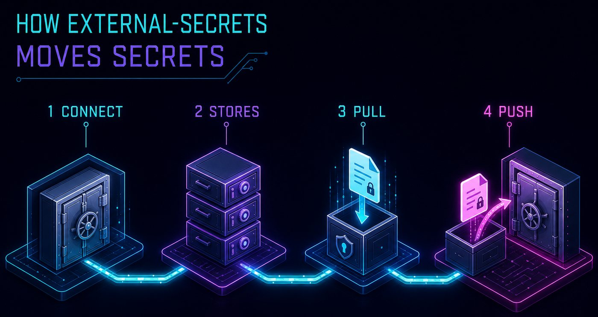
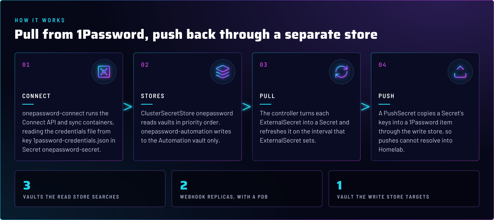
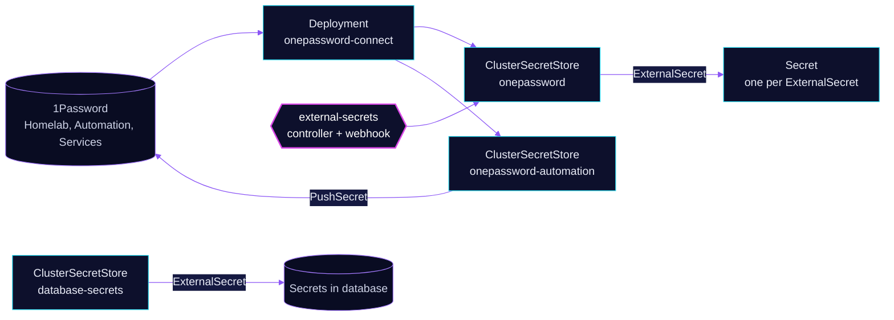

<p align="center">
  
</p>

> **Every app's secret starts in 1Password.** External Secrets Operator reads items through the in-cluster 1Password
> Connect server and writes them into Kubernetes Secrets. Pushes use a separate store that can only write to one vault.
> Nothing secret is committed to Git.

## At a glance

<!-- glance:start -->
<!-- Generated by `readme.py sync`; edit the manifests, not this table. -->
| | |
|---|---|
| **Namespace** | `security` |
| **Deployed by** | [`external-secrets`](../../../main/security/external-secrets.yaml), [`onepassword-store`](../../../main/security/external-secrets.yaml), [`database-secrets`](../../../main/security/external-secrets.yaml), [`onepassword-connect`](../../../main/security/external-secrets.yaml) (Flux Kustomization) |
| **Helm chart** | `app-template`, values in [`helmrelease.yaml`](api/onepassword-connect/helmrelease.yaml) |
| **Helm chart** | `external-secrets` from `oci://ghcr.io/external-secrets/charts/external-secrets`, values in [`helmrelease.yaml`](app/helmrelease.yaml) |
| **Images** | `docker.io/1password/connect-api`, `docker.io/1password/connect-sync` |
| **Depends on** | `security/external-secrets`, `security/onepassword-connect` |
| **Needed by** | `actions-runner-system/actions-runner-maintenance`, `actions-runner-system/gha-runner-scale-set-controller`, `ai/cliproxyapi`, `ai/hermes`, `ai/litellm`, `ai/litellm-db`, `ai/litellm-pgvector`, `ai/litellm-pgvector-db`, `ai/opencode`, `ai/repo-wiki`, `ai/samba`, `ai/searxng` and 58 more |
<!-- glance:end -->

## What it does

- **Runs** the External Secrets controller, its cert controller and webhook, with leader election on.
- **Runs** 1Password Connect (`onepassword-connect`), the API and sync containers that hold the 1Password session.
- **Defines** three ClusterSecretStores: `onepassword` for reads, `onepassword-automation` for writes, and `database-secrets`
  for reading Secrets that the database namespace creates.

## Why it is built this way

| Choice | Why |
|---|---|
| **Connect in the cluster** | The Connect server holds the session and serves the API over the cluster network. Apps never see the 1Password token. |
| **Read store lists three vaults in order** | `Homelab`, `Automation`, `Services`, by priority. Vaults are searched in that order. |
| **A separate write store, one vault** | A PushSecret that resolved by the read store's order could land in `Homelab`. The write store targets `Automation` only. |
| **Cluster-scoped stores** | A namespaced store can reference only a Secret in its own namespace, and the Connect token lives in `security`. |
| **Database store reads Secrets** | `database-secrets` reads Secrets in `database` through the `external-secrets` ServiceAccount. No ExternalSecret in Git uses it yet (see Known gaps). |
| **Chart signature verified** | The OCIRepository checks a cosign signature from the upstream release workflow before Flux installs the chart. |
| **Connect first, then the rest** | The controller HelmRelease and both 1Password stores depend on `onepassword-connect`, so nothing reads 1Password before the Connect server exists. |

## How it works

<p align="center">
  
</p>

<p align="center">
  
</p>

<details>
<summary><b>Resource graph</b>: every object involved, by name</summary>



</details>

In more detail:

1. `onepassword-connect` starts first. Its two containers share the Connect data directory and read the credentials file
   from key `1password-credentials.json` in `onepassword-secret`. The ClusterSecretStores read the separate `token` key
   to authenticate to Connect.
2. The three ClusterSecretStores point at Connect (`onepassword`, `onepassword-automation`) or at the Kubernetes API in
   `database` (`database-secrets`).
3. The controller reconciles each ExternalSecret into a Secret, on the refresh interval that ExternalSecret sets.
4. A PushSecret writes a Secret's keys to an item through `onepassword-automation`, which targets the Automation vault only.

## Settings that matter

All values are in [`app/helmrelease.yaml`](app/helmrelease.yaml) and [`api/onepassword-connect/helmrelease.yaml`](api/onepassword-connect/helmrelease.yaml) unless noted.

| Setting | Value | Why |
|---|---|---|
| `vaults` (`onepassword`) | `Homelab: 1`, `Automation: 2`, `Services: 3` | Priority order for reads. |
| `vaults` (`onepassword-automation`) | `Automation: 1` | The only vault a PushSecret can write to. |
| `connectHost` | in-cluster Connect Service, port 8080 | Plain HTTP inside the cluster, authenticated by the Connect token. |
| `leaderElect` | `true` | One active controller at a time. |
| `webhook.replicaCount` | `2`, with a PDB `minAvailable: 1` | The webhook serves admission for External Secrets resources. Two replicas and a PDB keep one up through a drain. |
| Connect `resources` (api and sync) | request `192M`, limit `256M` | One anchor serves both containers, sized for the larger one. Every ExternalSecret in the cluster depends on this pair, so the request is generous. |
| Connect `persistence.config` | `emptyDir` | The data directory is ephemeral. Nothing persists across a pod restart, and the session comes from `onepassword-secret` each time. |
| `verify` (OCIRepository) | cosign, OIDC identity from the upstream release workflow | Flux rejects a chart that was not signed by the upstream project's workflow. |

## Operate it

```bash
flux -n security get ks external-secrets onepassword-store onepassword-connect
kubectl get clustersecretstore onepassword onepassword-automation database-secrets
kubectl -n security get pods -l app.kubernetes.io/name=onepassword-connect -o wide
```

`SecretSynced` on an ExternalSecret does not mean the value is non-empty, and a `Home-Lab` item is invisible to Connect.
Skill `secrets-1password` covers both.

## Known gaps

- **An unused kustomize config file.** [`app/kustomizeconfig.yaml`](app/kustomizeconfig.yaml) is not listed in
  `app/kustomization.yaml` and is referenced nowhere. It names `valuesFrom` on a HelmRelease, and none of the HelmReleases
  here use `valuesFrom`. It does nothing. Found while writing; not fixed here.
- **The database store has no consumer in Git.** ClusterSecretStore `database-secrets` is reconciled, but no ExternalSecret
  in this repository names it, so it is dormant. Check before removing it: an ExternalSecret outside Git could use it.
  Found while writing; not fixed here.

## Files

| File | Holds |
|---|---|
| [`app/helmrelease.yaml`](app/helmrelease.yaml) | External Secrets chart values |
| [`app/ocirepository.yaml`](app/ocirepository.yaml) | Chart source, version and cosign verification |
| [`app/pdb.yaml`](app/pdb.yaml) | Webhook PDB |
| [`api/onepassword-connect/helmrelease.yaml`](api/onepassword-connect/helmrelease.yaml) | Connect API and sync containers |
| [`stores/onepassword/clustersecretstore.yaml`](stores/onepassword/clustersecretstore.yaml) | Read store, three vaults |
| [`stores/onepassword/clustersecretstore-automation.yaml`](stores/onepassword/clustersecretstore-automation.yaml) | Write store, Automation vault |
| [`stores/database-secrets/clustersecretstore.yaml`](stores/database-secrets/clustersecretstore.yaml) | Kubernetes store reading the `database` namespace |
| [`../../../main/security/external-secrets.yaml`](../../../main/security/external-secrets.yaml) | Flux Kustomizations: controller, stores, Connect |

Upstream: [External Secrets Operator](https://external-secrets.io/latest/) •
[1Password Connect](https://developer.1password.com/docs/connect/)

<!-- branded-readme v1 sources=acfca6b9d416 -->
