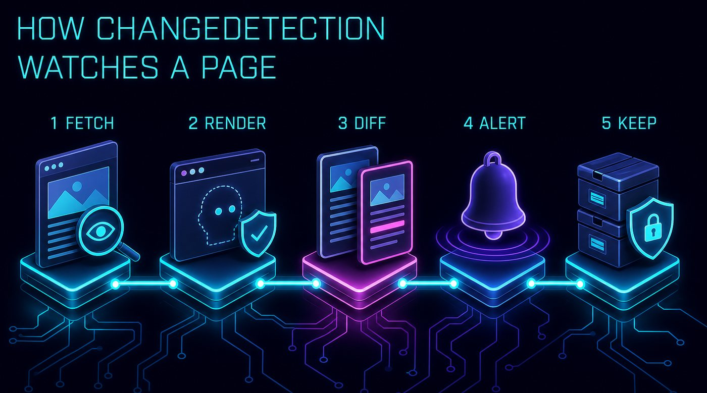
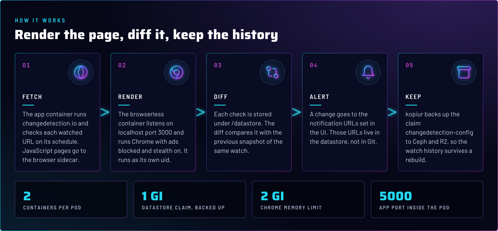
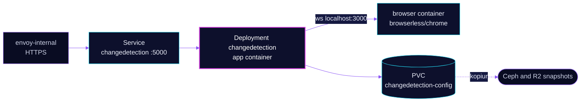

<p align="center">
  
</p>

> **One watch, one browser.** changedetection.io checks each watched page on a schedule, renders JavaScript pages in a
> Chrome sidecar in the same pod, and stores every snapshot on a claim that kopiur backs up. It is reachable on the
> internal gateway only.

## At a glance

<!-- glance:start -->
<!-- Generated by `readme.py sync`; edit the manifests, not this table. -->
| | |
|---|---|
| **Namespace** | `selfhosted` |
| **Deployed by** | [`changedetection`](../../../main/selfhosted/changedetection.yaml) (Flux Kustomization) |
| **Helm chart** | `app-template`, values in [`helmrelease.yaml`](app/helmrelease.yaml) |
| **Images** | `docker.io/browserless/chrome`, `ghcr.io/dgtlmoon/changedetection.io` |
| **Depends on** | `security/onepassword-store`, `system/kopiur-repository` |
| **Backup** | kopiur component on the overlay (skill `kopiur-backups`) |
<!-- glance:end -->

## What it does

- **Watches** the URLs you add in the UI. The schedule, filters and notification targets live in the datastore, not in Git.
- **Renders** JavaScript pages through the `browser` container, a `browserless/chrome` sidecar on `localhost:3000`
  (`PLAYWRIGHT_DRIVER_URL`). The app does not need a Service or NetworkPolicy to reach it.
- **Keeps history** under `/datastore`, which is the claim `changedetection-config`. Each check is a snapshot the diff runs against.
- **Backs up** that claim with kopiur to Ceph and to R2, daily on the R2 schedule.

## Why it is built this way

| Choice | Why |
|---|---|
| **Chrome as a sidecar, not a shared browser** | The browser shares the pod's network namespace, so the WebSocket stays on localhost. A shared browser would need its own Service, its own NetworkPolicy and a queue for other tenants. |
| **Browser runs as uid 999, app as 1000** | The browserless image's Chrome fails to launch at uid 1000 with a crashpad `--database` error, while the container still reports Ready. That silently breaks every browser-backed watch. The browser mounts no claim, so the backup identity is unaffected. |
| **Pod identity 1000:1000, fsGroup 1000** | The app's files under `/datastore` are already group 1000, and 1000 is the kopiur default. No `KOPIUR_PUID` override is needed. |
| **Claim named by `KOPIUR_CLAIM`** | The claim keeps the name `changedetection-config` rather than the app name, so the HelmRelease and the overlay agree on the claim. |

## How it works

<p align="center">
  
</p>

<p align="center">
  
</p>

<details>
<summary><b>Resource graph</b>: every object involved, by name</summary>



</details>

In more detail:

1. Flux applies the `changedetection` Kustomization, which includes the kopiur component and the `pvc` component. The
   pvc component creates the claim `changedetection-config`, and the Restore populator fills it on a rebuild.
2. The HelmRelease runs one pod with two containers. `main` serves the UI on port 5000. `browser` serves the DevTools
   WebSocket on port 3000 and starts Chrome before the first request (`PREBOOT_CHROME`).
3. A watch that needs JavaScript sends its page to `browser`. Other watches are plain HTTP fetches from `main`.
4. kopiur snapshots `/datastore` on its schedules. The backup identity is 1000:1000, the pod identity.

## Settings that matter

All values are in [`app/helmrelease.yaml`](app/helmrelease.yaml) and [`app/kustomization.yaml`](app/kustomization.yaml)
unless noted. The overlay sets the kopiur values.

| Setting | Value | Why |
|---|---|---|
| `defaultPodOptions.securityContext` | `1000:1000`, `fsGroup: 1000`, `OnRootMismatch` | Matches the files on the claim and the kopiur default identity. |
| `browser.securityContext` | `999:999` | Chrome's `blessuser`. Uid 1000 breaks Chrome (see Why). |
| `main.env.PLAYWRIGHT_DRIVER_URL` | `ws://localhost:3000/?stealth=1&...` | Points the app at the sidecar and asks for stealth. |
| `browser.env` `DEFAULT_BLOCK_ADS`, `DEFAULT_STEALTH` | `true` | Ad blocking and stealth mode apply to every render by default, so no watch has to opt in. |
| `browser.env` `MAX_CONCURRENT_SESSIONS` | `10` | Upper bound on parallel renders; each one is a Chrome page. |
| `browser.env` `CHROME_REFRESH_TIME` | `600000` (10 minutes) | Restarts Chrome on a timer, so a long-lived browser does not grow without bound. |
| `browser.resources` | request 512 MiB, limit 2 GiB | Chrome is the memory consumer. The app's own limit is 512 MiB. |
| `KOPIUR_CAPACITY` | `1Gi` | Inherited from the retired VolSync size. The component default of 5Gi would provision a rebuilt claim at five times the live size. |
| `KOPIUR_SCHEDULE_R2` | `H 14 * * *` | The daily R2 backup, hashed into the 14:00 hour. Namespace schedules are fixed; see skill `kopiur-backups`. |

## Operate it

```bash
flux -n selfhosted get ks changedetection                          # Flux view
kubectl -n selfhosted get pods -l app.kubernetes.io/name=changedetection -o wide
kubectl -n selfhosted logs deploy/changedetection -c browser --tail=50   # Chrome start-up errors
kubectl get snapshotpolicy,restore -A | grep changedetection       # kopiur state for the claim
```

Backup and restore rules are in skill `kopiur-backups`. Do not delete a `Snapshot` to free space: it deletes the kopia
data.

## Known gaps

- **No login in Git.** The internal route has no SecurityPolicy or ExtAuth, and no app password is set in the
  manifests. Access depends on the internal gateway alone.

## Files

| File | Holds |
|---|---|
| [`app/helmrelease.yaml`](app/helmrelease.yaml) | The app and browser containers, route, claim mount |
| [`app/kustomization.yaml`](app/kustomization.yaml) | The resource list for the base |
| [`../../../main/selfhosted/changedetection.yaml`](../../../main/selfhosted/changedetection.yaml) | Flux Kustomization, kopiur components and `KOPIUR_*` values |

Upstream: [changedetection.io](https://github.com/dgtlmoon/changedetection.io) •
[browserless Chrome docs](https://docs.browserless.io/)

<!-- branded-readme v1 sources=42b7d014c721 -->
