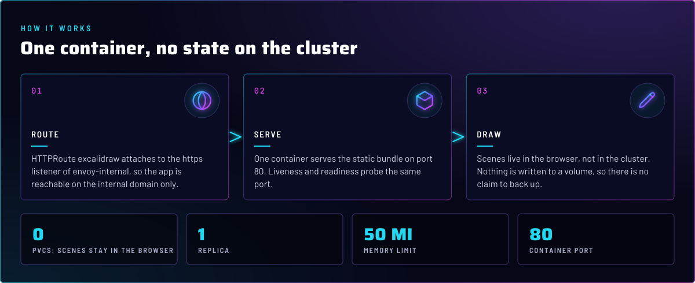

  

> **A whiteboard with no server state.** The app serves the Excalidraw static bundle from one container. Scenes stay in
> the browser, so the cluster holds no drawings and no claim needs backing up.

## At a glance

<!-- glance:start -->
<!-- Generated by `readme.py sync`; edit the manifests, not this table. -->
| | |
|---|---|
| **Namespace** | `selfhosted` |
| **Deployed by** | [`excalidraw`](../../../main/selfhosted/excalidraw.yaml) (Flux Kustomization) |
| **Helm chart** | `app-template`, values in [`helmrelease.yaml`](app/helmrelease.yaml) |
| **Images** | `docker.io/excalidraw/excalidraw` |
<!-- glance:end -->

## What it does

- **Serves** the Excalidraw web app on the internal domain through the `excalidraw` HTTPRoute on `envoy-internal`.
- **Stores nothing.** There is no PVC and no database. Drawings live in the browser.
- **Restarts on config change.** `reloader.stakater.com/auto` rolls the pod when a referenced ConfigMap or Secret changes.
  No ConfigMap or Secret is referenced today, so it is inert.

## Why it is built this way

| Choice | Why |
|---|---|
| **Stateless, no claim** | Nothing server-side needs backing up, so the app has no kopiur overlay. Losing the pod loses nothing. |
| **Image tag `latest`, pinned by digest** | Renovate bumps the digest, so the running version is not readable from Git. Check the image digest in the HelmRelease when debugging. |
| **Topology spread on the hostname** | One pod today. If the replica count rises, the rule spreads them across nodes. `nodeTaintsPolicy: Honor` filters only `NoSchedule` and `NoExecute` taints. talos-3's `PreferNoSchedule` taint does not filter it, so talos-3 stays a spread domain, and the TaintToleration score keeps the pod off it (skill `node-scheduling`). |
| **Internal route only** | The HTTPRoute attaches only to `envoy-internal`. The Gateway's `external-dns` target sets the DNS record; the route annotation does not. |

## How it works

  

In more detail:

1. Flux applies the `excalidraw` Kustomization. It has no components, so no kopiur, alerts or dependencies.
2. The HelmRelease creates one controller and one Service `excalidraw` on port 80. Liveness and readiness probe that port.
3. The HTTPRoute serves the internal hostname. Gatus checks the root URL and expects 200.

## Settings that matter

All values are in [`app/helmrelease.yaml`](app/helmrelease.yaml) unless noted.

| Setting | Value | Why |
|---|---|---|
| `controllers.excalidraw.containers.app.resources` | request 5m CPU, 10Mi; limit 50Mi | A static server. The limit is the whole budget. |
| `NODE_ENV` | `production` | Serves the production bundle. |
| `pod.topologySpreadConstraints` | `maxSkew: 1` on hostname, `nodeTaintsPolicy: Honor` | See Why. Keeps replicas apart if the count is raised. |

## Known gaps

- **Inert route annotation.** `external-dns.kubernetes.io/target: internal` on the HTTPRoute does nothing. The envoy-internal Gateway's target sets the DNS record, so the route annotation can be removed.

## Files

| File | Holds |
|---|---|
| [`app/helmrelease.yaml`](app/helmrelease.yaml) | Deployment, Service and HTTPRoute values |
| [`app/kustomization.yaml`](app/kustomization.yaml) | Resource list for the base |
| [`../../../main/selfhosted/excalidraw.yaml`](../../../main/selfhosted/excalidraw.yaml) | Flux Kustomization |

Upstream: [Excalidraw](https://github.com/excalidraw/excalidraw) •
[Excalidraw docs](https://docs.excalidraw.com/)

<!-- branded-readme v1 sources=0f4655cfcda6 -->
