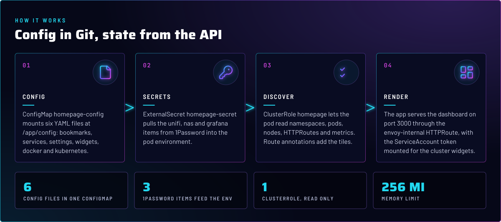
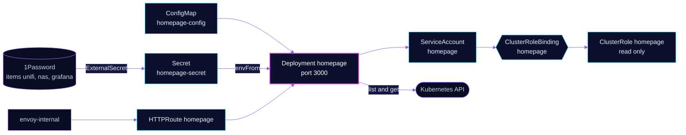

  

> **The start page is config, not a database.** Services, bookmarks and widget settings are YAML in a ConfigMap. Live
> cluster tiles come from the Kubernetes API with a read-only ClusterRole. Widget credentials come from 1Password.

## At a glance

<!-- glance:start -->
<!-- Generated by `readme.py sync`; edit the manifests, not this table. -->
| | |
|---|---|
| **Namespace** | `selfhosted` |
| **Deployed by** | [`homepage`](../../../main/selfhosted/homepage.yaml) (Flux Kustomization) |
| **Helm chart** | `app-template`, values in [`helmrelease.yaml`](app/helmrelease.yaml) |
| **Images** | `ghcr.io/gethomepage/homepage` |
| **Depends on** | `security/onepassword-store` |
| **Secret** | `homepage-secret` from onepassword item `grafana`, `nas`, `unifi` |
<!-- glance:end -->

## What it does

- **Lists services** in `services.yaml`: UniFi and TrueNAS in Infrastructure, and a calendar widget that reads Sonarr and Radarr.
- **Shows cluster state** through the `kubernetes` and `resources` widgets, which read nodes and pods with the pod's ServiceAccount token.
- **Discovers routes.** Any HTTPRoute with `gethomepage.dev/enabled: "true"` gets a tile, grouped by its `gethomepage.dev/group` annotation.
- **Holds bookmarks** in `bookmarks.yaml`, and layout in `settings.yaml`.

## Why it is built this way

| Choice | Why |
|---|---|
| **Config in a ConfigMap, mounted per file** | Each YAML file is a `subPath` mount at `/app/config`, so the image's own files are not replaced. The reloader annotation rolls the pod when the ConfigMap changes. |
| **Secrets through ExternalSecret, not the ConfigMap** | Widget keys live in 1Password and reach the pod as environment variables (`HOMEPAGE_VAR_*`). `services.yaml` refers to them by name, so no key is in Git. |
| **Read-only ClusterRole with a bound ServiceAccount** | The Kubernetes widget and tile status need get and list on pods, nodes, namespaces and HTTPRoutes. Nothing writes. |
| **`automountServiceAccountToken: true`** | app-template defaults this to false. The cluster widgets need the token, so the default is overridden on purpose. |
| **`HOMEPAGE_ALLOWED_HOSTS: "*"`** | Homepage refuses Host headers it does not list. The internal hostname is not listed anywhere, so the check is off. Access control is the internal gateway. |

## How it works

  

<b>Resource graph</b>: every object involved, by name

In more detail:

1. Flux applies the `homepage` Kustomization with a dependency on the 1Password store. It renders the ConfigMap, the
   ExternalSecret, the HelmRelease and the RBAC in one pass, with `CONFIG_TIMEZONE` substituted.
2. The ExternalSecret materializes `homepage-secret` from three 1Password items. The Deployment loads it with `envFrom`.
3. On start, the app reads the six YAML files from `/app/config`, then queries the API for the widgets that need it.
4. The HTTPRoute on `envoy-internal` serves the UI. Gatus probes `/api/healthcheck`, which the liveness and readiness probes use too.

## Settings that matter

All values are in [`app/helmrelease.yaml`](app/helmrelease.yaml) unless noted. The widget config is in
[`app/configmap.yaml`](app/configmap.yaml) and the secret mapping in [`app/externalsecret.yaml`](app/externalsecret.yaml).

| Setting | Value | Why |
|---|---|---|
| `defaultPodOptions.automountServiceAccountToken` | `true` | The Kubernetes widgets call the API with the pod's token. |
| `serviceAccount` (identifier `myServiceAccount`) | bound to `ClusterRole homepage` | Read-only grants in [`app/rbac.yaml`](app/rbac.yaml). The binding's subject is the ServiceAccount named `homepage`. |
| `HOMEPAGE_ALLOWED_HOSTS` | `*` | See Why. |
| `TZ` | `${CONFIG_TIMEZONE}`, `America/New_York` | Substituted by Flux from the overlay, so the clock and the datetime widget match. |
| probes | `/api/healthcheck` on 3000, `initialDelaySeconds: 0` | The app's own health endpoint, probed from the first second. Liveness, readiness and startup share one spec. |
| `resources` | request 10m CPU, 64Mi; limit 256Mi | Memory is capped. No CPU limit is set, so the pod is never CPU-throttled. |

## Known gaps

- **Grafana credentials reach the pod with no consumer.** ExternalSecret `homepage-secret` maps the `grafana` item into
  `HOMEPAGE_VAR_GRAFANA_USERNAME` and `HOMEPAGE_VAR_GRAFANA_PASSWORD`, but no widget in `services.yaml` reads them.
  The login is in the pod environment for nothing. Drop the mapping, or add the widget that needs it.
- **Unused RBAC rules.** The ClusterRole grants Traefik `IngressRoute` and the `extensions` ingress group. This cluster
  runs neither, so those rules grant nothing useful. Harmless, but they are noise in a read-only role.

## Files

| File | Holds |
|---|---|
| [`app/helmrelease.yaml`](app/helmrelease.yaml) | Deployment, route, mounts, ServiceAccount |
| [`app/configmap.yaml`](app/configmap.yaml) | Bookmarks, services, settings, widgets, Kubernetes mode |
| [`app/externalsecret.yaml`](app/externalsecret.yaml) | Widget keys from 1Password |
| [`app/rbac.yaml`](app/rbac.yaml) | Read-only ClusterRole and binding |
| [`../../../main/selfhosted/homepage.yaml`](../../../main/selfhosted/homepage.yaml) | Flux Kustomization |

Upstream: [homepage docs](https://gethomepage.dev/) •
[Kubernetes integration](https://gethomepage.dev/configs/kubernetes/) •
[service widgets](https://gethomepage.dev/configs/service-widgets/)

<!-- branded-readme v1 sources=2f5635a4aaf5 -->
