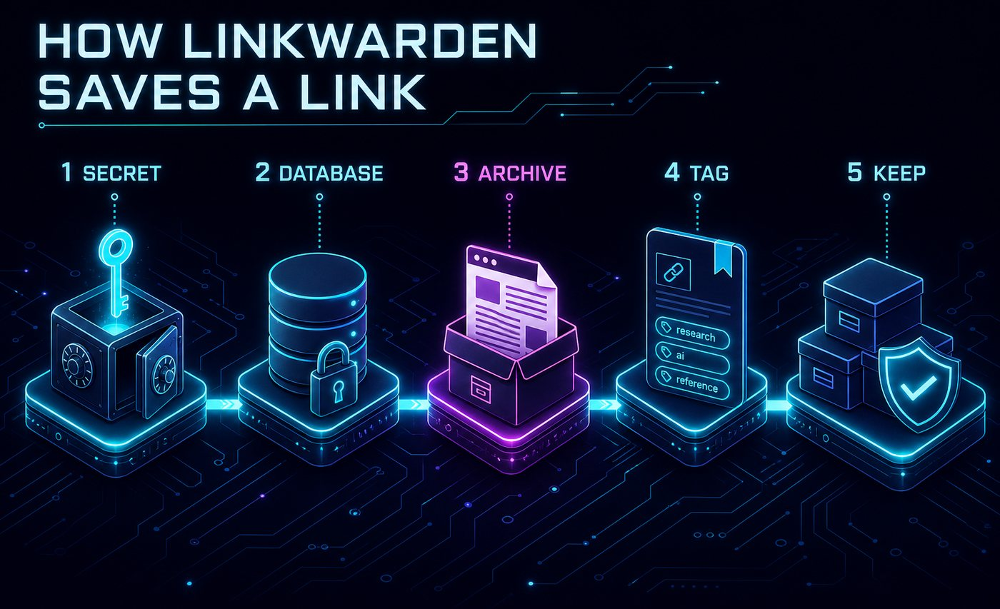
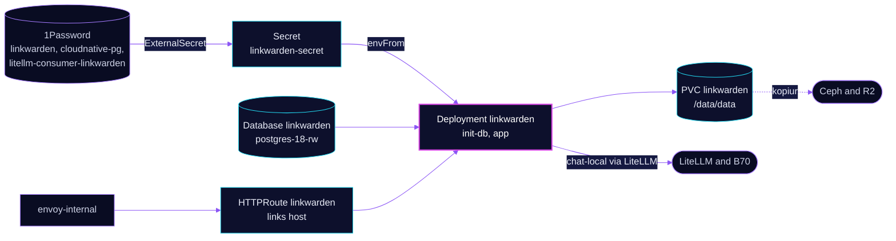

<p align="center">
  
</p>

> **Bookmarks with the page kept.** Linkwarden stores each link's rows in the shared Postgres cluster and archives the
> page itself to a backed-up claim. Auto-tagging runs on the local model through LiteLLM. Registration is closed, so an
> admin creates accounts.

## At a glance

<!-- glance:start -->
<!-- Generated by `readme.py sync`; edit the manifests, not this table. -->
| | |
|---|---|
| **Namespace** | `selfhosted` |
| **Deployed by** | [`linkwarden`](../../../main/selfhosted/linkwarden.yaml) (Flux Kustomization) |
| **Helm chart** | `app-template`, values in [`helmrelease.yaml`](app/helmrelease.yaml) |
| **Images** | `ghcr.io/home-operations/postgres-init`, `ghcr.io/linkwarden/linkwarden` |
| **Depends on** | `database/cloudnative-pg`, `security/onepassword-store`, `selfhosted/linkwarden-db`, `system/kopiur-repository` |
| **Secret** | `linkwarden-secret` from onepassword item `cloudnative-pg`, `linkwarden`, `litellm-consumer-linkwarden` |
| **Backup** | kopiur component on the overlay (skill `kopiur-backups`) |
<!-- glance:end -->

## What it does

- **Saves links** with a full-page archive written by Monolith into `/data/data`, which is the `data` claim.
- **Stores metadata** in the `linkwarden` database on the shared `postgres-18-rw` cluster.
- **Tags links** through LiteLLM. The app posts to `chat-local`, the B70 model, with Linkwarden's own virtual key. The
  key is a LiteLLM CR, so its limits and attribution live with the proxy (skill `litellm-proxy`).
- **Logs in with a password.** `NEXT_PUBLIC_CREDENTIALS_ENABLED` is on. Nothing in Git puts SSO in front of it.

## Why it is built this way

| Choice | Why |
|---|---|
| **Database as its own Flux Kustomization** | `linkwarden-db` creates the role and database through the `cnpg-database` component, in namespace `database`. Both CRs use `retain` reclaim policies, so deleting them does not drop the data. |
| **`init-db` init container** | A `postgres-init` image runs before the app, so the app does not start against a database that is not ready. |
| **Chat-local, not a cloud model** | Tagging stays on the B70 and has no cloud fallback. When the B70 is down, tagging fails and nothing else depends on it. |
| **`MONOLITH_MAX_BUFFER: 256`** | Monolith's default output buffer is 100 MB. One image-heavy page overflowed it and produced a partial archive. |
| **Next's build cache on an `emptyDir`** | The cache is disposable, so it stays off the claim and out of the backup. |
| **Registration disabled** | Accounts are created by hand. Public sign-up is not needed on the internal route. |

## How it works

<p align="center">
  
</p>

<p align="center">
  
</p>

<details>
<summary><b>Resource graph</b>: every object involved, by name</summary>



</details>

In more detail:

1. Flux applies `linkwarden-db` first. It waits for the `postgres-18` cluster, then creates the DatabaseRole and Database.
2. The `linkwarden` Kustomization waits on `linkwarden-db`, the 1Password store, the kopiur repository and `cloudnative-pg`,
   then renders the ExternalSecret, the HelmRelease and the claim.
3. The pod runs `init-db` until the database accepts connections, then starts the app on port 3000.
4. Each save writes an archive to `/data/data`. kopiur snapshots that claim on its schedules.

## Settings that matter

All values are in [`app/helmrelease.yaml`](app/helmrelease.yaml) unless noted. Secret mapping is in
[`app/externalsecret.yaml`](app/externalsecret.yaml). Overlay values are in
[`../../../main/selfhosted/linkwarden.yaml`](../../../main/selfhosted/linkwarden.yaml).

| Setting | Value | Why |
|---|---|---|
| `NEXT_PUBLIC_DISABLE_REGISTRATION` | `"true"` | Accounts are made by an admin. |
| `NEXT_PUBLIC_CREDENTIALS_ENABLED` | `"true"` | Password login is the only sign-in path in Git. |
| `NEXTAUTH_URL` | `https://links.${SECRET_DOMAIN}` | Must match the route, or sign-in callbacks fail. Flux substitutes the domain. |
| `MONOLITH_MAX_BUFFER` | `"256"` | See Why. |
| `CUSTOM_OPENAI_BASE_URL`, `OPENAI_MODEL` | LiteLLM in `ai`, `chat-local` | Tagging stays on the local model. |
| `OPENAI_API_KEY` (from the secret) | LiteLLM virtual key | Its rate limit and attribution are set on the LiteLLM side. |
| `persistence.next-cache` | `emptyDir` at `/data/apps/web/.next/cache` | The build cache is rebuilt on start, so it is kept off the claim. |
| `resources` | request 250m CPU, 512Mi; limit 2 CPU, 4Gi | The request is the scheduling floor. The limit caps the app and the Monolith process it spawns. |
| `securityContext` | `1000:1000`, `fsGroup: 1000`, `OnRootMismatch` | Matches the kopiur default identity for the claim. |
| `KOPIUR_CAPACITY` | `5Gi` | Create-time only; grow the bound claim with `kubectl patch`. |

## Operate it

```bash
flux -n selfhosted get ks linkwarden linkwarden-db                 # app and database Kustomizations
kubectl -n database get database,databaserole | grep linkwarden    # CNPG objects, namespace database
kubectl -n selfhosted get pods -l app.kubernetes.io/name=linkwarden -o wide
kubectl get snapshotpolicy,restore -A | grep linkwarden            # kopiur state for the data claim
```

No app-specific alert rules. The kopiur alerts cover the claim. Backup rules: skill `kopiur-backups`. Database health:
skill `databases`.

## Known gaps

- **The superuser password reaches the app container.** `linkwarden-secret` carries `INIT_POSTGRES_SUPER_PASS`, and the
  app container loads the whole secret with `envFrom`, not only `init-db`. Only the init container should need it.
  Check whether `init-db` still uses the superuser now that `cnpg-database` creates the role and database. If not, drop
  the key from the secret.

## Files

| File | Holds |
|---|---|
| [`app/helmrelease.yaml`](app/helmrelease.yaml) | Deployment, init container, route, claim mount |
| [`app/externalsecret.yaml`](app/externalsecret.yaml) | Secret keys from 1Password items |
| [`../../../main/selfhosted/linkwarden.yaml`](../../../main/selfhosted/linkwarden.yaml) | Flux Kustomizations (app and `linkwarden-db`), kopiur values |

Upstream: [Linkwarden docs](https://docs.linkwarden.app/) •
[environment variables](https://docs.linkwarden.app/self-hosting/environment-variables)

<!-- branded-readme v1 sources=12b000ec5099 -->
