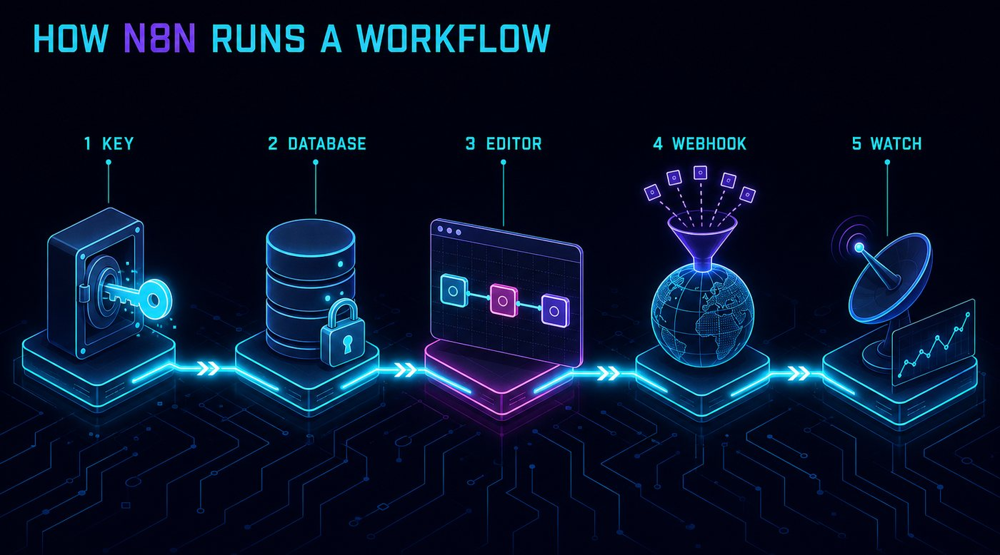
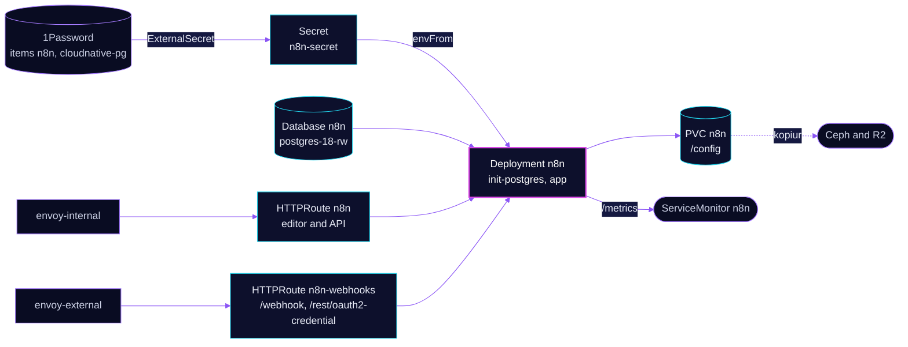

<p align="center">
  
</p>

> **The editor stays inside, the webhooks do not.** n8n runs on the `postgres-18` cluster with its config on a backed-up
> claim. The editor and REST API sit on `envoy-internal`. Only the webhook paths sit on `envoy-external`, so outside
> callers reach the workflows that need them and nothing else.

## At a glance

<!-- glance:start -->
<!-- Generated by `readme.py sync`; edit the manifests, not this table. -->
| | |
|---|---|
| **Namespace** | `selfhosted` |
| **Deployed by** | [`n8n`](../../../main/selfhosted/n8n.yaml) (Flux Kustomization) |
| **Helm chart** | `app-template`, values in [`helmrelease.yaml`](app/helmrelease.yaml) |
| **Images** | `ghcr.io/home-operations/postgres-init`, `ghcr.io/n8n-io/n8n` |
| **Depends on** | `security/onepassword-store`, `selfhosted/n8n-db`, `system/kopiur-repository` |
| **Secret** | `n8n-secret` from onepassword item `cloudnative-pg`, `n8n` |
| **Backup** | kopiur component on the overlay (skill `kopiur-backups`) |
<!-- glance:end -->

## What it does

- **Runs workflows.** The editor, the REST API and the Code nodes run in one container. Workflow definitions and execution
  rows live in the `n8n` database.
- **Receives webhooks** on `n8n-webhook.${SECRET_DOMAIN}`, routed only for `/webhook` and `/rest/oauth2-credential`.
- **Exports metrics** through a ServiceMonitor on `/metrics`, with `N8N_METRICS` on.
- **Keeps config** on the claim `n8n` at `/config` (`N8N_USER_FOLDER`), which kopiur backs up.

## Why it is built this way

| Choice | Why |
|---|---|
| **Postgres, not the SQLite default** | `DB_TYPE: postgresdb` points at the shared cluster, so the data is in CloudNativePG's barman backups, not only in a file on the claim. |
| **Two routes, two gateways** | The editor is internal. Only the two webhook path prefixes are public, so the rest of the app is never reachable from outside. |
| **Liveness on `/healthz`, readiness on `/healthz/readiness`** | `/healthz` is an unconditional 200 upstream, so it stays green through a database outage. Readiness tests the database and is what Gatus checks. |
| **Encryption key from 1Password** | `N8N_ENCRYPTION_KEY` encrypts stored credentials. Rotating it or losing it makes every saved credential unreadable. |
| **Execution pruning on** | `EXECUTIONS_DATA_PRUNE` with a row cap keeps the execution table from growing without bound. |

## How it works

<p align="center">
  
</p>

<p align="center">
  
</p>

<details>
<summary><b>Resource graph</b>: every object involved, by name</summary>



</details>

In more detail:

1. Flux applies `n8n-db` first, which creates the `n8n` role and database on `postgres-18`. The `n8n` Kustomization waits for it.
2. The pod starts `init-postgres` until the database answers, then starts the app on port 80 (`N8N_PORT`).
3. The app's first start runs its own migrations against the database. The claim at `/config` holds the user folder.
4. Public traffic reaches only the two webhook prefixes through `envoy-external`. Everything else goes through `envoy-internal`.

## Settings that matter

All values are in [`app/helmrelease.yaml`](app/helmrelease.yaml) unless noted. Secret mapping is in
[`app/externalsecret.yaml`](app/externalsecret.yaml), and the scrape in [`app/servicemonitor.yaml`](app/servicemonitor.yaml).

| Setting | Value | Why |
|---|---|---|
| `DB_TYPE`, `DB_POSTGRESDB_*` | `postgresdb` on `postgres-18-rw` | The shared CloudNativePG cluster holds the data (see Why). |
| `N8N_HOST`, `N8N_PROTOCOL` | `n8n.${SECRET_DOMAIN}`, `https` | Generates links and cookies for the internal name. |
| `WEBHOOK_URL` | `https://n8n-webhook.${SECRET_DOMAIN}/` | Webhook URLs shown in the editor use the external name. |
| `N8N_PROXY_HOPS` | `1` | One proxy (Envoy) sits in front, so client IPs and secure cookies work. |
| `N8N_USER_MANAGEMENT_DISABLED` | `true` | Set in Git. Its effect is unverified; see Known gaps. |
| `NODE_FUNCTION_ALLOW_BUILTIN` | `"*"` | Code nodes may load any Node built-in. Needed by the workflows here. Anyone who can edit a workflow can run code in the pod. |
| `EXECUTIONS_DATA_PRUNE`, `EXECUTIONS_DATA_PRUNE_MAX_COUNT` | `true`, `50000` | Caps the execution table by row count. The age setting is in Known gaps. |
| `N8N_PUBLIC_API_DISABLED` | `false` | The REST API is on, and it is reachable only on the internal route. |
| `N8N_PUBLIC_API_SWAGGERUI_DISABLED` | `true` | No Swagger UI in production. |
| `N8N_ENCRYPTION_KEY` | from 1Password `n8n` | Encrypts stored credentials. Never rotate it without re-entering every credential. |
| `N8N_METRICS` | `true` | Enables `/metrics` for the ServiceMonitor. |
| `persistence.config` | claim `n8n`, `/config` (`N8N_USER_FOLDER`) | The user folder. kopiur backs it up. |
| `resources` | request 100m CPU, 200Mi; limit 1000Mi | No CPU limit. Memory is capped. |

## Operate it

```bash
flux -n selfhosted get ks n8n n8n-db                                # app and database Kustomizations
kubectl -n selfhosted get pods -l app.kubernetes.io/name=n8n -o wide
kubectl -n selfhosted get httproute                                  # the editor and webhook routes
curl -s https://n8n.<your-domain>/healthz/readiness                  # readiness, which tests the database
kubectl get snapshotpolicy,restore -A | grep n8n                     # kopiur state for the config claim
```

No app-specific alert rules. Backup rules: skill `kopiur-backups`. Database health: skill `databases`. Probe and
endpoint rules: skill `observability`.

## Known gaps

- **Execution age is in hours.** `EXECUTIONS_DATA_MAX_AGE` is `7`, and n8n reads that value in hours. The prune keeps
  seven hours of execution data, not seven days. If seven days was meant, the value is `168`. The prune is live, so
  change it deliberately.
- **Telemetry stays on.** `N8N_DIAGONISTICS_ENABLED` is misspelled, so the intended `false` never applies and telemetry
  stays at the upstream default. The correct name is `N8N_DIAGNOSTICS_ENABLED`.
- **Dead SQLite setting.** `DB_SQLITE_VACUUM_ON_STARTUP` applies only to SQLite. The database here is Postgres, so it
  does nothing.
- **Sign-in is unverified.** `N8N_USER_MANAGEMENT_DISABLED` is set, but the variable is not in the current n8n config
  (`packages/@n8n/config/src/configs/user-management.config.ts`), so its effect is unverified. Do not assume the editor
  is open without sign-in. The internal gateway is the only gate that is known to exist in Git.
- **The superuser password reaches the app container.** `n8n-secret` carries `INIT_POSTGRES_SUPER_PASS`, and the app
  container loads the whole secret with `envFrom`. Only `init-postgres` needs the superuser, if it needs it at all now
  that `cnpg-database` creates the role and database.

## Files

| File | Holds |
|---|---|
| [`app/helmrelease.yaml`](app/helmrelease.yaml) | Deployment, init container, both routes, claim mount |
| [`app/externalsecret.yaml`](app/externalsecret.yaml) | Encryption key and database login from 1Password |
| [`app/servicemonitor.yaml`](app/servicemonitor.yaml) | Metrics scrape on `/metrics` |
| [`../../../main/selfhosted/n8n.yaml`](../../../main/selfhosted/n8n.yaml) | Flux Kustomizations (app and `n8n-db`), kopiur values |

Upstream: [n8n environment variables](https://docs.n8n.io/hosting/configuration/environment-variables/) •
[webhook URLs](https://docs.n8n.io/hosting/configuration/configuration-examples/webhook-url/)

<!-- branded-readme v1 sources=b08362331441 -->
