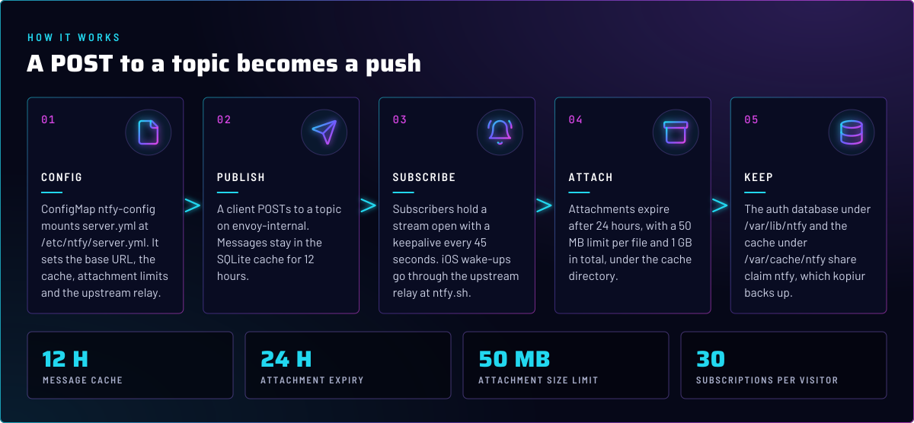
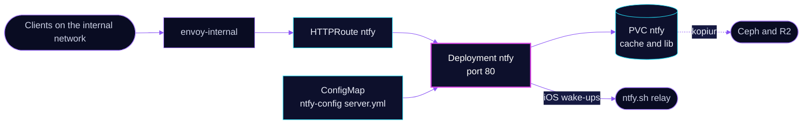

<p align="center">
  
</p>

> **HTTP in, push out.** ntfy takes a POST to a topic and delivers it to every subscriber's phone or browser. The server
> keeps a short message cache, attachments and its auth database on one backed-up claim. It runs on the internal gateway
> only, and it is open to anyone on that network by default.

## At a glance

<!-- glance:start -->
<!-- Generated by `readme.py sync`; edit the manifests, not this table. -->
| | |
|---|---|
| **Namespace** | `selfhosted` |
| **Deployed by** | [`ntfy`](../../../main/selfhosted/ntfy.yaml) (Flux Kustomization) |
| **Helm chart** | `app-template`, values in [`helmrelease.yaml`](app/helmrelease.yaml) |
| **Images** | `docker.io/binwiederhier/ntfy` |
| **Depends on** | `system/kopiur-repository` |
| **Backup** | kopiur component on the overlay (skill `kopiur-backups`) |
<!-- glance:end -->

## What it does

- **Publishes** messages to topics over HTTP at `ntfy.${SECRET_DOMAIN}` through `envoy-internal`.
- **Delivers** them to subscribers over a held-open stream, and relays iOS wake-ups through the upstream at `ntfy.sh`.
- **Caches** messages for 12 hours in `/var/cache/ntfy/cache.db`, and holds attachments up to 50 MB each for 24 hours.
- **Keeps its auth database** at `/var/lib/ntfy/auth.db`. The access rules live there, not in Git.

## Why it is built this way

| Choice | Why |
|---|---|
| **`auth-default-access: read-write`** | Any client on the internal network can publish and subscribe without an account. The route is internal only, so the network is the access control. Named accounts and per-topic ACLs are the change to make if that stops being true. |
| **`behind-proxy: true`** | Envoy sits in front, so ntfy reads the client address from the forwarded headers for its rate limits. |
| **`upstream-base-url: https://ntfy.sh`** | Without it, iOS notifications still arrive, but can be delayed by hours. The public relay at ntfy.sh is the fast path for iOS push. |
| **`keepalive-interval: 45s`** | Keeps subscriber streams from being closed as idle by the proxy. |
| **Two paths on one claim** | The cache and the auth database share claim `ntfy`, under `cache` and `lib` subPaths. One kopiur include covers both. |

## How it works

<p align="center">
  
</p>

<details>
<summary><b>Resource graph</b>: every object involved, by name</summary>



</details>

In more detail:

1. Flux applies the `ntfy` Kustomization after the kopiur repository. The claim `ntfy` and its backup come from the components.
2. The HelmRelease mounts `server.yml` read-only at `/etc/ntfy/server.yml`. ntfy reads that path by default.
3. Clients publish and subscribe on port 80. The liveness probe calls `/v1/health`.
4. kopiur snapshots the whole claim, so the message cache and the attachments come back with the auth database on a restore.

## Settings that matter

All values are in [`app/configmap.yaml`](app/configmap.yaml) (the server config) and [`app/helmrelease.yaml`](app/helmrelease.yaml)
(the pod). The claim size is in [`../../../main/selfhosted/ntfy.yaml`](../../../main/selfhosted/ntfy.yaml).

| Setting | Value | Why |
|---|---|---|
| `base-url` | `https://ntfy.${SECRET_DOMAIN}` | Used in generated links and attachment URLs. |
| `cache-duration` | `12h` | How long a delivered message stays replayable to a reconnecting client. |
| `attachment-file-size-limit`, `attachment-total-size-limit` | `50M`, `1G` | Bounds the attachment directory on a 2 GiB claim. |
| `attachment-expiry-duration` | `24h` | Attachments are short-lived. |
| `visitor-subscription-limit` | `30` | Caps the streams one client can hold open. |
| `resources` | request 50m CPU, 64Mi; limit 200m CPU, 256Mi | Small server; the limits are the ceiling. |
| `securityContext` | `1000:1000`, `fsGroup: 1000`, `OnRootMismatch` | Matches the kopiur default identity. |
| `KOPIUR_CAPACITY` | `2Gi` | Create-time only; the cache and attachments share it. |

## Operate it

```bash
flux -n selfhosted get ks ntfy                                    # Flux view
kubectl -n selfhosted get pods -l app.kubernetes.io/name=ntfy -o wide
kubectl -n selfhosted logs deploy/ntfy --tail=50                 # recent server log
kubectl get snapshotpolicy,restore -A | grep ntfy                 # kopiur state for the claim
```

No app-specific alerts and no Gatus check. The route has no `gatus.home-operations.com/endpoint` annotation, so an
outage does not appear on the status page. Backup rules: skill `kopiur-backups`.

## Known gaps

- **Anonymous read-write on a shared network.** `auth-default-access: read-write` lets any client on the internal
  network publish to, and read from, any topic. No login and no ACLs are configured in Git. The internal gateway is the
  only gate. Set the default to `deny-all` and create users if the network stops being trusted.
- **No health check on the status page.** The route carries no Gatus annotation, so ntfy is not monitored by Gatus.
  Add the annotation the other apps use, if an outage should page.

## Files

| File | Holds |
|---|---|
| [`app/helmrelease.yaml`](app/helmrelease.yaml) | Deployment, claim and config mounts, route |
| [`app/configmap.yaml`](app/configmap.yaml) | `server.yml`: base URL, caches, limits, upstream relay |
| [`../../../main/selfhosted/ntfy.yaml`](../../../main/selfhosted/ntfy.yaml) | Flux Kustomization, kopiur components and values |

Upstream: [ntfy configuration](https://docs.ntfy.sh/config/) •
[access control](https://docs.ntfy.sh/config/#access-control)

<!-- branded-readme v1 sources=38512e0e2fab -->
