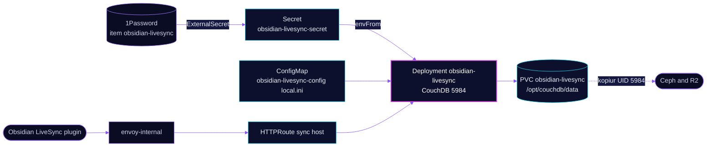

<p align="center">
  
</p>

> **Vaults sync through one CouchDB.** The Self-hosted LiveSync plugin in Obsidian writes note changes to a CouchDB
> database on the cluster and reads them back on other devices. CouchDB requires a login on every request, and the data
> sits on a backed-up claim.

## At a glance

<!-- glance:start -->
<!-- Generated by `readme.py sync`; edit the manifests, not this table. -->
| | |
|---|---|
| **Namespace** | `selfhosted` |
| **Deployed by** | [`obsidian-livesync`](../../../main/selfhosted/obsidian-livesync.yaml) (Flux Kustomization) |
| **Helm chart** | `app-template`, values in [`helmrelease.yaml`](app/helmrelease.yaml) |
| **Images** | `docker.io/library/couchdb` |
| **Depends on** | `security/onepassword-store`, `system/kopiur-repository` |
| **Secret** | `obsidian-livesync-secret` from onepassword item `obsidian-livesync` |
| **Backup** | kopiur component on the overlay (skill `kopiur-backups`) |
<!-- glance:end -->

## What it does

- **Stores vaults** as CouchDB documents under `/opt/couchdb/data`, on the claim `obsidian-livesync`.
- **Requires a login.** `chttpd_auth.require_valid_user` is on, so every request needs a login except the welcome page.
- **Accepts Obsidian's origins.** CORS allows `app://obsidian.md` and the Capacitor origin used by the mobile app.
- **Compacts** databases and views once fragmentation passes 70% and 60%, from `local.ini`.
- **Serves** on `sync.${SECRET_DOMAIN}` through `envoy-internal` only.

## Why it is built this way

| Choice | Why |
|---|---|
| **CouchDB, single node** | The LiveSync plugin speaks CouchDB's replication protocol. `single_node = true` drops clustering, which this lab does not need. |
| **Identity 5984:5984** | The UID and GID are measured from the files under `/opt/couchdb/data`. The kopiur overlay pins the same values, because a mismatch fails the backup closed rather than silently. |
| **`local.ini` mounted over the image default** | Only the `local.d/local.ini` file is replaced, so the image's other defaults stay. The reloader annotation rolls the pod when it changes. |
| **Document and request sizes raised** | `max_document_size = 50000000` (50 MB) and `max_http_request_size` at 4 GiB let the plugin send large chunks and bulk requests. No comment in Git records the exact sizing, so change it only with a test sync. |

## How it works

<p align="center">
  
</p>

<details>
<summary><b>Resource graph</b>: every object involved, by name</summary>



</details>

In more detail:

1. Flux applies the `obsidian-livesync` Kustomization after 1Password and the kopiur repository. It renders the ConfigMap,
   the ExternalSecret, the HelmRelease and the claim.
2. The container starts CouchDB as UID 5984 with `fsGroup` 5984, reads `local.ini`, and listens on 5984.
3. The plugin authenticates with the user from 1Password, then replicates documents in chunks.
4. kopiur snapshots the claim to Ceph and R2 on the schedules. The identity it checks is 5984:5984.

## Settings that matter

All values are in [`app/helmrelease.yaml`](app/helmrelease.yaml) unless noted. The CouchDB settings are in
[`app/configmap.yaml`](app/configmap.yaml) and the secret mapping in [`app/externalsecret.yaml`](app/externalsecret.yaml).

| Setting | Value | Why |
|---|---|---|
| `[chttpd_auth] require_valid_user` | `true` | Every request needs a login, except the welcome page. |
| `[httpd] WWW-Authenticate` | `Basic realm="couchdb"` | Clients get a standard Basic challenge. |
| `[cors] origins` | `app://obsidian.md`, `capacitor://localhost`, `http://localhost` | The desktop app, the mobile app and local development. |
| `[cors] credentials` | `true` | Lets the plugin's authenticated requests work cross-origin from the app. |
| `[couchdb] single_node` | `true` | No cluster membership; one node. |
| `[compactions] _default` | database fragmentation 70%, view fragmentation 60% | Compacts before the file grows much past its live data. |
| `COUCHDB_USER`, `COUCHDB_PASSWORD`, `COUCHDB_SECRET` | from 1Password `obsidian-livesync` | Login and cookie secret. Never in Git. |
| `TZ` | `America/New_York` | Log timestamps. |
| `securityContext` | `5984:5984`, `fsGroup: 5984`, `OnRootMismatch` | The identity the claim is written with. See Why. |
| `resources` | request 250m CPU, 256Mi; limit 500m CPU, 512Mi | CouchDB is the only process. |
| `KOPIUR_CAPACITY` | `2Gi` | Create-time only. |

## Operate it

```bash
flux -n selfhosted get ks obsidian-livesync                           # Flux view
kubectl -n selfhosted get pods -l app.kubernetes.io/name=obsidian-livesync -o wide
kubectl -n selfhosted logs deploy/obsidian-livesync --tail=50        # CouchDB log
kubectl get snapshotpolicy,restore -A | grep obsidian-livesync       # kopiur state for the claim
```

No app-specific alerts. The Gatus check on `sync` expects 200 from the root welcome page. Backup rules: skill
`kopiur-backups`.

## Known gaps

- **Hard-coded Erlang cookie in Git.** The HelmRelease sets `COUCHDB_ERLANG_FLAGS` with a literal `-setcookie` value
  instead of a 1Password key. Distribution is not exposed on a single node, so the literal is not a live exposure, but
  it is a credential-shaped value in plaintext. Not checked whether it is reused anywhere, so treat the literal as a live credential until it is. Move it into the ExternalSecret.
- **Probes hit the root.** Liveness and readiness both call `GET /` on 5984. That answers without a login, so it proves
  the HTTP listener is up, not that the databases open. A database fault can still return 200 here.

## Files

| File | Holds |
|---|---|
| [`app/helmrelease.yaml`](app/helmrelease.yaml) | Deployment, probes, claim and config mounts, route |
| [`app/configmap.yaml`](app/configmap.yaml) | `local.ini`: auth, CORS, sizes, compaction |
| [`app/externalsecret.yaml`](app/externalsecret.yaml) | CouchDB login and cookie secret from 1Password |
| [`../../../main/selfhosted/obsidian-livesync.yaml`](../../../main/selfhosted/obsidian-livesync.yaml) | Flux Kustomization, kopiur values including `KOPIUR_PUID` and `KOPIUR_PGID` |

Upstream: [Self-hosted LiveSync](https://github.com/vrtmrz/obsidian-livesync) •
[CouchDB configuration](https://docs.couchdb.org/en/stable/config/)

<!-- branded-readme v1 sources=f061a71ca2d6 -->
