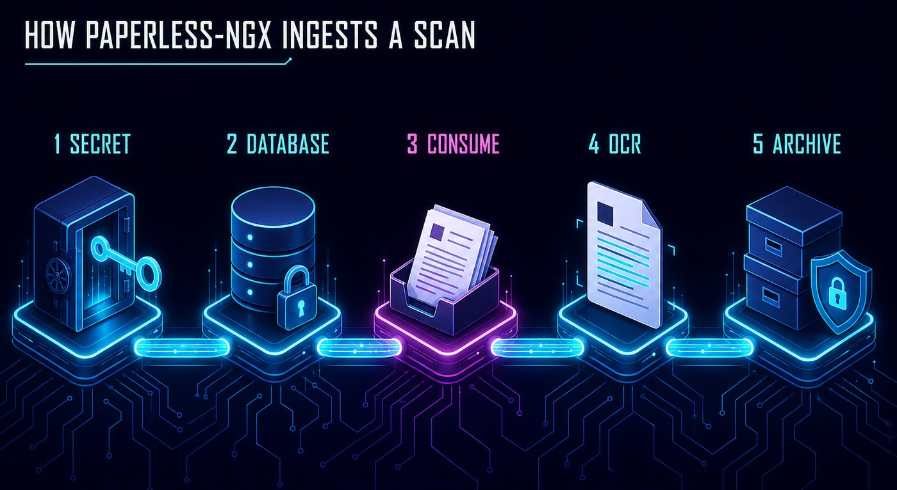
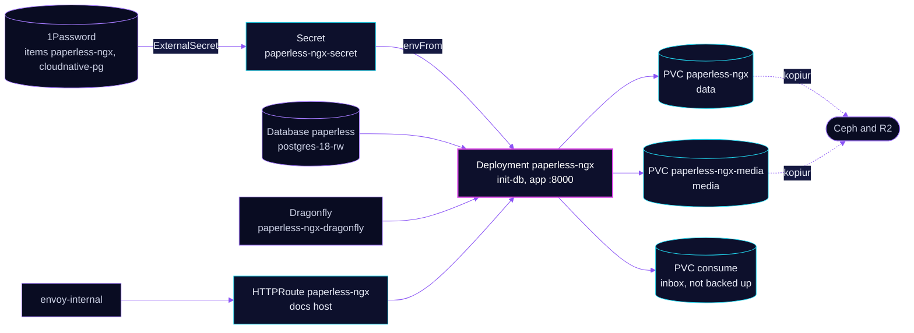

<p align="center">
  
</p>

> **Scans in, searchable archive out, originals kept.** Paperless-ngx watches an inbox claim, OCRs each file into its
> database, and stores the originals and archived PDFs on a media claim. The database is on the shared CloudNativePG
> cluster, the task queue is a Dragonfly cache, and the media claim is backed up by kopiur.

## At a glance

<!-- glance:start -->
<!-- Generated by `readme.py sync`; edit the manifests, not this table. -->
| | |
|---|---|
| **Namespace** | `selfhosted` |
| **Deployed by** | [`paperless-ngx`](../../../main/selfhosted/paperless-ngx.yaml) (Flux Kustomization) |
| **Helm chart** | `app-template`, values in [`helmrelease.yaml`](app/helmrelease.yaml) |
| **Images** | `ghcr.io/home-operations/postgres-init`, `ghcr.io/paperless-ngx/paperless-ngx` |
| **Depends on** | `database/cloudnative-pg`, `database/dragonfly-operator`, `security/onepassword-store`, `selfhosted/paperless-ngx-db`, `system/kopiur-repository` |
| **Needed by** | `selfhosted/paperless-ngx-media-kopiur` |
| **Secret** | `paperless-ngx-secret` from onepassword item `cloudnative-pg`, `paperless-ngx` |
| **Backup** | kopiur component on the overlay (skill `kopiur-backups`) |
<!-- glance:end -->

## What it does

- **Consumes** files from the `consume` claim, polled every 60 seconds, recursively. Subfolder names become tags.
- **OCRs** each file in English with two task workers, and writes the text to the database.
- **Archives** the originals and archived PDFs to the `media` claim, mounted at `/usr/src/paperless/media`.
- **Keeps app state** (the search index, thumbnails and config) on the `data` claim, backed up by kopiur.
- **Caches tasks** in `paperless-ngx-dragonfly`, the Redis-protocol queue the workers read from.

## Why it is built this way

| Choice | Why |
|---|---|
| **Polling, not inotify** | `PAPERLESS_CONSUMER_POLLING: "60"`. The manifest comment says Ceph has no inotify support, so the consumer polls. |
| **Dragonfly as a cache** | The task queue lives in a cache-only Dragonfly, so a restart drops queued tasks. The next poll picks up anything still in the inbox. Skill `databases`. |
| **`consume` is not backed up** | Paperless deletes a file from the inbox once it is ingested into `media`. The inbox holds only what has not been ingested yet, so the media claim is the record that matters. |
| **Media on its own claim and backup** | The originals cannot be rebuilt from the database. `paperless-ngx-media` is a second kopiur Kustomization, because one component include protects one volume. |
| **Time zone `Pacific/Auckland`** | Paperless uses it to read dates in documents. This differs from the fleet's `America/New_York`; see Known gaps. |
| **Data claim moved from VolSync** | This was the last app on VolSync; its data claim now belongs to kopiur. |

## How it works

<p align="center">
  
</p>

<p align="center">
  
</p>

<details>
<summary><b>Resource graph</b>: every object involved, by name</summary>



</details>

In more detail:

1. Flux applies `paperless-ngx-db` first, then the `paperless-ngx` Kustomization, which waits for the 1Password store,
   the kopiur repository, `cloudnative-pg` and `dragonfly-operator`. The HelmRelease also waits for `rook-ceph-cluster`.
2. The Dragonfly component creates `paperless-ngx-dragonfly`, and the HelmRelease sets `PAPERLESS_REDIS` to its service.
3. The pod runs `init-db` until the database answers, then starts the app on port 8000. The liveness probe checks `/`.
4. `paperless-ngx-media-kopiur` starts after the app. It backs up the `paperless-ngx-media` claim, which the HelmRelease creates.

## Settings that matter

All values are in [`app/helmrelease.yaml`](app/helmrelease.yaml) unless noted. Secret mapping is in
[`app/externalsecret.yaml`](app/externalsecret.yaml). The overlay holds the kopiur values and the second backup.

| Setting | Value | Why |
|---|---|---|
| `PAPERLESS_CONSUMER_POLLING` | `"60"` | Polling, not inotify. See Why. |
| `PAPERLESS_CONSUMER_RECURSIVE`, `PAPERLESS_CONSUMER_SUBDIRS_AS_TAGS` | `"true"` | Scanner folders become a tree; subfolder names become tags. |
| `PAPERLESS_TASK_WORKERS`, `PAPERLESS_WEBSERVER_WORKERS` | `"2"`, `"2"` | Set explicitly. The manifest does not record why two. |
| `PAPERLESS_OCR_LANGUAGE` | `eng` | English only. Another language needs its own entry here. |
| `PAPERLESS_REDIS` | `redis://paperless-ngx-dragonfly.selfhosted.svc.cluster.local:6379` | The Dragonfly service from the component. |
| `PAPERLESS_DBHOST` | `postgres-18-rw.database.svc.cluster.local` | Pinned in the ExternalSecret template, not in 1Password. |
| `PAPERLESS_ADMIN_USER`, `PAPERLESS_ADMIN_PASSWORD` | from 1Password `paperless-ngx` | Creates the first admin. Never in Git. |
| `PAPERLESS_TIME_ZONE` | `Pacific/Auckland` | See Known gaps. |
| `media` claim | `ceph-block`, 50Gi, RWO | Created by the HelmRelease, so `KOPIUR_CAPACITY` does not size it. |
| `resources` | request 250m CPU, 1Gi; limit 2 CPU, 2Gi | The request sets scheduling. The limit caps the app and its workers. |
| `KOPIUR_CAPACITY`, `KOPIUR_CACHE_CAPACITY` | `10Gi`, `10Gi` | The data claim, and its restore cache. |

## Operate it

```bash
flux -n selfhosted get ks paperless-ngx paperless-ngx-media-kopiur paperless-ngx-db
kubectl -n selfhosted get pods -l app.kubernetes.io/name=paperless-ngx -o wide
kubectl -n selfhosted get dragonfly paperless-ngx-dragonfly                 # status should be ready
kubectl get snapshotpolicy,restore -A | grep paperless-ngx                  # both claims
```

Two claims are backed up, and the names overlap. The retired VolSync restic repositories use the path segment
`paperless-ngx/`, and `paperless-ngx` is a string prefix of `paperless-ngx-media`. A prefix match selects the media
repository. Read skill `kopiur-backups` before touching any retired repository. Its expiry is not in force.

No app-specific alert rules. Database health: skill `databases`. Backup rules: skill `kopiur-backups`.

## Known gaps

- **The superuser password reaches the app container.** `paperless-ngx-secret` carries `INIT_POSTGRES_SUPER_PASS`, and
  the app container loads the whole secret with `envFrom`. Only `init-db` should need it. Check whether it still does
  now that `cnpg-database` creates the role and database.
- **Time zone differs from the rest of the fleet.** `PAPERLESS_TIME_ZONE` is `Pacific/Auckland`. Every other app here
  uses `America/New_York`. Confirm the intent. It changes how documents with dates are read, not just the log time.

## Files

| File | Holds |
|---|---|
| [`app/helmrelease.yaml`](app/helmrelease.yaml) | Deployment, init container, env, claims, route |
| [`app/externalsecret.yaml`](app/externalsecret.yaml) | Admin login, secret key, database login |
| [`../../../main/selfhosted/paperless-ngx.yaml`](../../../main/selfhosted/paperless-ngx.yaml) | Flux Kustomizations: the app, `paperless-ngx-db`, and `paperless-ngx-media-kopiur` |

Upstream: [paperless-ngx configuration](https://docs.paperless-ngx.com/configuration/) •
[consumption](https://docs.paperless-ngx.com/usage/#consumption)

<!-- branded-readme v1 sources=738057f7271f -->
