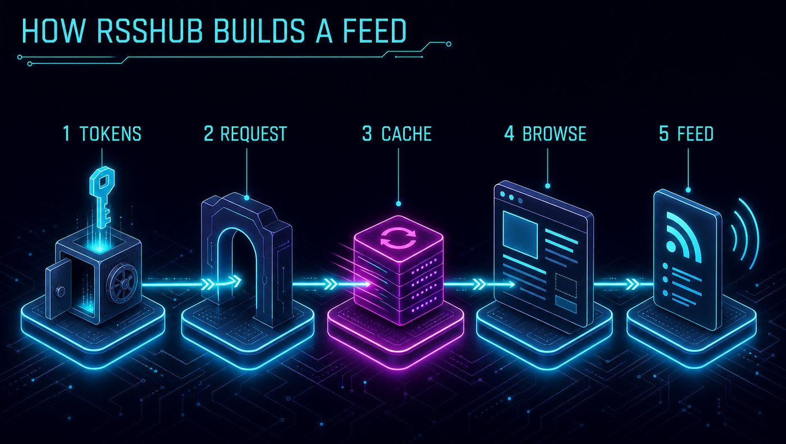
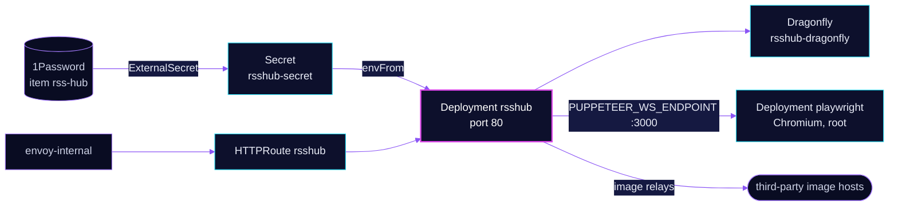

<p align="center">
  
</p>

> **Feeds for sites that have none.** RSSHub builds RSS, Atom and JSON feeds from web pages and APIs. It caches each
> result in a Dragonfly instance and sends pages that need JavaScript to a Playwright Chromium in its own pod. Both pods
> are stateless: there is no claim and nothing to back up.

## At a glance

<!-- glance:start -->
<!-- Generated by `readme.py sync`; edit the manifests, not this table. -->
| | |
|---|---|
| **Namespace** | `selfhosted` |
| **Deployed by** | [`rsshub`](../../../main/selfhosted/rsshub.yaml), [`rsshub-playwright`](../../../main/selfhosted/rsshub.yaml) (Flux Kustomization) |
| **Helm chart** | `app-template`, values in [`helmrelease.yaml`](app/helmrelease.yaml) |
| **Helm chart** | `app-template`, values in [`helmrelease.yaml`](playwright/helmrelease.yaml) |
| **Images** | `ghcr.io/browserless/chromium`, `ghcr.io/diygod/rsshub` |
| **Depends on** | `database/dragonfly-operator`, `security/onepassword-store`, `selfhosted/rsshub-playwright` |
| **Needed by** | `selfhosted/rsshub` |
| **Secret** | `rsshub-secret` from onepassword item `rss-hub` |
<!-- glance:end -->

## What it does

- **Builds feeds** for the routes it supports, served on `rsshub.${SECRET_DOMAIN}` through `envoy-internal`.
- **Caches** results in Redis, pointed at `rsshub-dragonfly`, a cache-only Dragonfly from the `dragonfly` component.
- **Renders pages** that need a browser through the `playwright` service at `ws://playwright...:3000` (`PUPPETEER_WS_ENDPOINT`).
- **Uses source logins** for the routes that need them: a GitHub token, a Pixiv refresh token, and Twitter credentials.
  They are meant to come from 1Password item `rss-hub`; see Known gaps.
- **Proxies images** for Pixiv and hotlink-protected sites through third-party relays set in the environment.

## Why it is built this way

| Choice | Why |
|---|---|
| **Playwright in its own pod** | Chromium is the heavy process. A separate pod gives it its own memory limit and lets it restart without touching the feed server. |
| **Dragonfly as the cache** | Cache entries are disposable. The `dragonfly` component is cache-only by design, so a restart simply refills the cache from upstream. |
| **No claim on either pod** | Nothing the app writes is needed after a restart, so there is no kopiur overlay and nothing to restore. |
| **`Recreate` strategy on the app** | The manifest does not record why. Recreate stops the old pod before the new one starts, so each rollout has a short gap in service. |
| **Hotlink and image relays** | `PIXIV_IMG_PROXY` and `HOTLINK_TEMPLATE` route images through hosts outside the cluster. Without them, Pixiv and hotlink-protected images usually fail to load in a reader. The trade is that image requests reach those third-party hosts. |

## How it works

<p align="center">
  
</p>

<p align="center">
  
</p>

<details>
<summary><b>Resource graph</b>: every object involved, by name</summary>



</details>

In more detail:

1. Flux applies `rsshub-playwright` first, then `rsshub`. The app waits for the Playwright Kustomization, the 1Password
   store and `dragonfly-operator`. The `dragonfly` component creates `rsshub-dragonfly` in the same namespace.
2. The ExternalSecret writes `rsshub-secret` from item `rss-hub`, but its template replaces the merge (see Known gaps). The app loads the Secret with `envFrom`.
3. A request for a browser-backed route is sent by the app over WebSocket to `playwright` on port 3000.
4. Results are cached in Dragonfly, so a repeat request is served from Redis until the cache expires.

## Settings that matter

All values are in [`app/helmrelease.yaml`](app/helmrelease.yaml) and [`playwright/helmrelease.yaml`](playwright/helmrelease.yaml)
unless noted. The secret mapping is in [`app/es.yaml`](app/es.yaml).

| Setting | Value | Why |
|---|---|---|
| `CACHE_TYPE`, `REDIS_URL` | `redis`, `redis://rsshub-dragonfly:6379` | Cache in Dragonfly. The component is cache-only (see Why). |
| `PUPPETEER_WS_ENDPOINT` | `ws://playwright.selfhosted.svc.cluster.local:3000` | Browser-backed routes go to the Playwright pod. |
| `LOG_LEVEL`, `NO_LOGFILES`, `SENTRY` | `warning`, `true`, `false` | Logs go to stdout only. Sentry is off. |
| `PIXIV_IMG_PROXY`, `HOTLINK_TEMPLATE` | third-party relay hosts | Images for Pixiv and hotlink-protected sites are fetched through them. See Why. |
| `strategy` | `Recreate` | See Why. |
| `resources` (app) | request 10m CPU, 512Mi; limit 2048Mi | Memory is capped. No CPU limit. |
| `playwright` `securityContext` | root (`runAsUser: 0`), `SYS_ADMIN` added, `drop: ALL` first | The manifest does not record why root and `SYS_ADMIN` are needed. Test before dropping either. |
| `playwright` `resources.limits` | `gpu.intel.com/xe: 1`, memory 2Gi | See Known gaps. |
| `playwright` `dev-shm` | `emptyDir`, memory, 1Gi | Chromium's shared memory. |
| `playwright` `route` | `playwright` host, internal | Reachable by any client on the internal network. See Known gaps. |

## Operate it

```bash
flux -n selfhosted get ks rsshub rsshub-playwright                    # app and browser Kustomizations
kubectl -n selfhosted get pods -l app.kubernetes.io/name=rsshub -o wide
kubectl -n selfhosted get dragonfly rsshub-dragonfly                  # status should be ready
kubectl -n selfhosted logs deploy/playwright --tail=50                # Chromium start-up errors
```

No claim, no kopiur, no alerts in Git. Dragonfly rules: skill `databases`. The GPU resource: skill `intel-gpu`.

## Known gaps

- **The live Secret is expected to hold only placeholders.** `es.yaml` sets four keys in its template to literal strings
  (`XXXXX`, `XXXXXXS`) and extracts item `rss-hub` with `dataFrom`. ESO's template default `mergePolicy` is `Replace`
  ([templating guide](https://external-secrets.io/latest/guides/templating/)), and `es.yaml` does not set it. So the
  expected live result is that `rsshub-secret` holds only the four placeholder keys, and none of the `rss-hub` item
  fields. The GitHub, Pixiv and Twitter routes would then run with placeholder credentials. Unverified live: read-only
  credentials cannot read Secrets. Check the key names with an admin session, and do not print values.
- **The browser is an open endpoint on the internal network.** `ALLOW_GET` is set, and no token is set in Git. The
  `playwright` route on `envoy-internal` lets any client on that network drive a root Chromium with `SYS_ADMIN`.
- **The GPU resource is not explained.** `playwright` requests `gpu.intel.com/xe: 1`, which is the iGPU plugin's resource,
  and no GPU flag is set on Chromium. If the browser does not use the GPU, the request takes a GPU slot for no benefit.

## Files

| File | Holds |
|---|---|
| [`app/helmrelease.yaml`](app/helmrelease.yaml) | The feed server: env, probes, route, `envFrom` |
| [`app/es.yaml`](app/es.yaml) | ExternalSecret for `rsshub-secret` |
| [`playwright/helmrelease.yaml`](playwright/helmrelease.yaml) | The Chromium pod, its emptyDir mounts and route |
| [`../../../main/selfhosted/rsshub.yaml`](../../../main/selfhosted/rsshub.yaml) | Flux Kustomizations: `rsshub` and `rsshub-playwright` |

Upstream: [RSSHub docs](https://docs.rsshub.app/) •
[deployment configuration](https://docs.rsshub.app/deploy/config)

<!-- branded-readme v1 sources=b6096e0ca329 -->
