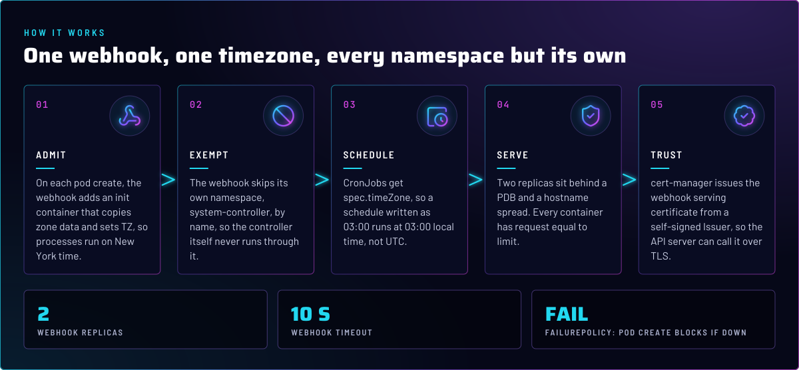
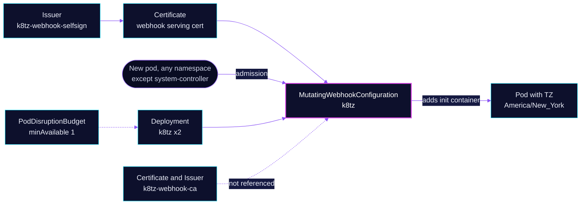

<p align="center">
  
</p>

> **One timezone for every pod.** The k8tz webhook adds the zone to each new pod, outside its own namespace, and gives
> CronJobs their timezone too. A cron written as `03:00` runs at 03:00 New York time, and logs read in the same zone.
> The webhook fails closed, so pod creation depends on it being up.

## At a glance

<!-- glance:start -->
<!-- Generated by `readme.py sync`; edit the manifests, not this table. -->
| | |
|---|---|
| **Namespace** | `system-controller` |
| **Deployed by** | [`k8tz`](../../../main/system-controller/k8tz.yaml) (Flux Kustomization) |
| **Helm chart** | `k8tz` from `k8tz`, values in [`helmrelease.yaml`](app/helmrelease.yaml) |
| **Depends on** | `cert-manager/cert-manager` |
<!-- glance:end -->

## What it does

- **Injects** the zone into every pod the webhook covers. The chart's default strategy adds an init container that copies
  zone data and sets `TZ`, so processes see `America/New_York`.
- **Skips** its own namespace, `system-controller`, by name. The chart always prepends the release namespace to the
  webhook's ignored list, so this exclusion cannot be turned off by values.
- **Sets** `spec.timeZone` on CronJobs (`cronJobTimeZone: true`), so a schedule means local time, not UTC.
- **Issues** the webhook's serving certificate from a self-signed cert-manager Issuer, `k8tz-webhook-selfsign`.

## Why it is built this way

| Choice | Why |
|---|---|
| **A webhook, not a per-app `TZ`** | Every app, including ones added later, gets the zone without its manifest changing. The webhook is the one place the zone is set. |
| **Init-container strategy, not `imageVolume`** | The `imageVolume` strategy cannot mount `/etc/localtime`, so containers would resolve that path as UTC. The init container is the one the chart recommends for this case. |
| **`failurePolicy: Fail`** | If the webhook is down, pods are not created, rather than created in UTC. That is the trade: a short outage blocks scheduling in the namespaces it covers. |
| **Two replicas, a PDB and a `DoNotSchedule` spread** | A preferred anti-affinity alone can put both replicas on one node. The spread and PDB keep one up through a drain. The spread honors node taints, but the current taint on talos-3 is `PreferNoSchedule`, which it does not see (skill `node-scheduling`). |
| **Request equals limit on every container** | The webhook, the cert-watcher sidecar and the init container are all Guaranteed. A limit raised alone would demote the pod to Burstable. Talos's OOM controller skips Guaranteed cgroups under pressure and kills Burstable ones. |
| **Own namespace excluded** | The controller must not run through its own webhook, or a restart could deadlock on itself. |

## How it works

<p align="center">
  
</p>

<details>
<summary><b>Resource graph</b>: every object involved, by name</summary>



</details>

In more detail:

1. Flux applies the chart from its HelmRepository, after cert-manager is ready, since the webhook needs its serving
   certificate. The chart renders the Deployment, Service and webhook configuration.
2. A pod is created in a covered namespace. The API server calls the webhook over TLS and waits up to 10 seconds.
3. The webhook returns a patch with the init container and `TZ`. The pod starts in New York time.
4. The cert-watcher sidecar watches the serving certificate files.

## Settings that matter

Values are in [`app/helmrelease.yaml`](app/helmrelease.yaml). The chart is pinned there and comes from the HelmRepository
in [`app/helmrepository.yaml`](app/helmrepository.yaml).

| Setting | Value | Why |
|---|---|---|
| `namespace` | `system-controller` | The release namespace, which the webhook skips by name. |
| `timezone` | `America/New_York` | The one zone in the cluster. |
| `cronJobTimeZone` | `true` | CronJobs run in the same zone as pods. |
| `replicaCount` | `2` | Pod creation survives one replica going down. |
| `webhook.certManager.issuerRef` | `k8tz-webhook-selfsign`, kind `Issuer` | The serving certificate's issuer. See Known gaps for the second issuer. |
| `initContainerResources` | requests equal limits, `100m` CPU and `128Mi` | Keeps an otherwise Guaranteed pod Guaranteed. |
| `resources` (webhook) | requests equal limits, `250m` CPU and `64Mi` | The webhook runs on the pod-create path. A limit raised alone would demote it to Burstable. |
| cert-watcher patch | requests equal limits, `50m` CPU and `64Mi` | The chart's `resources` do not cover this sidecar, so a postRenderer does. |
| `affinity` | preferred anti-affinity on `kubernetes.io/hostname` | A soft spread, the first of two. |
| `topologySpreadConstraints` | `DoNotSchedule`, `maxSkew: 1`, `nodeTaintsPolicy: Honor` | The hard spread. Honor does not see the `PreferNoSchedule` taint on talos-3. |
| Namespace postRenderer | removes the `Namespace` object from the chart's output (matched as `not-used`) | Keeps the namespace under the overlay's control, not the chart's. |
| [`app/pdb.yaml`](app/pdb.yaml) | `minAvailable: 1` | One replica stays up through a drain. |

## Operate it

```bash
flux -n system-controller get ks k8tz
kubectl -n system-controller get pods -l app.kubernetes.io/name=k8tz
kubectl get mutatingwebhookconfiguration k8tz
kubectl -n system-controller get certificate,issuer
```

Skill `system-namespaces` covers the webhook move and why the namespaces stay split. Its `references/webhook-drift.md`
covers repairing a pod that missed the stamp.

## Known gaps

- **The CA chain in `pki.yaml` is not referenced.** [`app/pki.yaml`](app/pki.yaml) defines a Certificate
  `k8tz-webhook-ca` and an Issuer `k8tz-webhook-ca` that signs with it. The HelmRelease's `certManager.issuerRef` names
  `k8tz-webhook-selfsign` instead, and nothing else in the repo refers to the CA Issuer. Confirm the chart does not read
  it before removing it. Found while writing; not fixed here.

## Files

| File | Holds |
|---|---|
| [`app/helmrelease.yaml`](app/helmrelease.yaml) | Chart values: zone, replicas, resources, spread, postRenderers |
| [`app/helmrepository.yaml`](app/helmrepository.yaml) | Chart repository |
| [`app/pki.yaml`](app/pki.yaml) | Self-signed Issuer, and the CA chain (see Known gaps) |
| [`app/pdb.yaml`](app/pdb.yaml) | PodDisruptionBudget |
| [`../../../main/system-controller/k8tz.yaml`](../../../main/system-controller/k8tz.yaml) | Flux Kustomization, dependencies |

Upstream: [k8tz docs](https://github.com/k8tz/k8tz) •
[cert-manager](https://cert-manager.io/docs/)

<!-- branded-readme v1 sources=334fa0c37af2 -->
