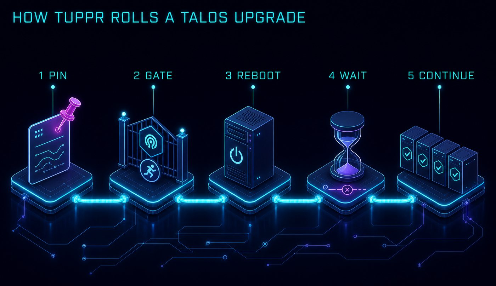
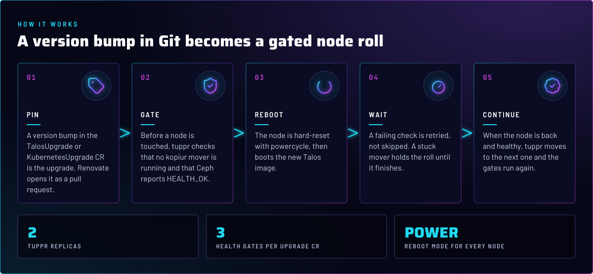
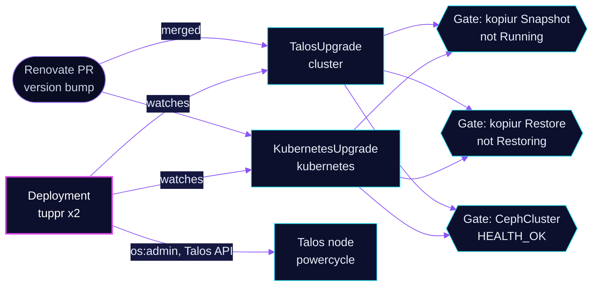

<p align="center">
  
</p>

> **A merged version bump is a node roll.** tuppr reads the `TalosUpgrade` and `KubernetesUpgrade` objects in this
> directory and upgrades each node in turn. Before a node is touched, it checks that no kopiur mover is running and that
> Ceph reports `HEALTH_OK`. A check that keeps failing holds the roll; tuppr does not skip it. Treat every merged bump
> as a live upgrade.

## At a glance

<!-- glance:start -->
<!-- Generated by `readme.py sync`; edit the manifests, not this table. -->
| | |
|---|---|
| **Namespace** | `system-upgrade` |
| **Deployed by** | [`tuppr`](../../../main/system-upgrade/tuppr.yaml), [`tuppr-upgrades`](../../../main/system-upgrade/tuppr.yaml) (Flux Kustomization) |
| **Helm chart** | `tuppr` from `oci://ghcr.io/home-operations/charts/tuppr`, values in [`helmrelease.yaml`](app/helmrelease.yaml) |
| **Depends on** | `system-upgrade/tuppr` |
| **Health checks** | `Deployment/tuppr` |
<!-- glance:end -->

## What it does

- **Upgrades** Talos through the `TalosUpgrade` object named `cluster`, and Kubernetes through the `KubernetesUpgrade`
  object named `kubernetes`. Each pins its version in the CR, with a Renovate annotation above the line.
- **Reboots** each node with `policy.rebootMode: powercycle`, a hard reset.
- **Gates** both upgrades on three health checks: no kopiur `Snapshot` in phase `Running`, no `Restore` in phase
  `Restoring`, and `CephCluster` `status.ceph.health` `HEALTH_OK`.
- **Exposes** metrics: a ServiceMonitor, the chart's PrometheusRule and its dashboards, all enabled from the chart.
- **Talks** to the Talos API through the Talos ServiceAccount that tuppr uses, which has `os:admin`. The machine config allows that access for two namespaces only: `system-upgrade` and `actions-runner-system`.namespace only.

## Why it is built this way

| Choice | Why |
|---|---|
| **The version bump is the upgrade** | No script, no button. Renovate opens the PR, and merging it starts the roll. The reviewed diff is the change log. |
| **Powercycle, not graceful reboot** | `rebootMode: powercycle` is the mode the repo's own `just talos` recipes use for upgrades. A hard reset does not wait on a stuck shutdown. The cost is that nothing runs an orderly stop first. |
| **Gates on kopiur and Ceph** | A node reboot during a backup mover or with a degraded Ceph cluster turns a planned roll into a recovery. The gates hold the roll until both are clean. |
| **Zero-object rule** | tuppr evaluates each check per object and requires all to pass, and zero objects pass. So finished Snapshots and Restores, which accumulate, never block a roll. Only an active mover does. |
| **Two Kustomizations** | `tuppr` installs the chart and its CRDs. `tuppr-upgrades` waits for it (`dependsOn`), so the CRs apply only after the CRDs exist. |
| **Upgrade CRs in their own directory** | The upgrade objects can be reviewed as a diff without the chart noise. |
| **Namespace `system-upgrade`** | Kept separate from `system`. The Talos API allow-list names this namespace, so moving tuppr would need a machine-config apply on every node first (skill `system-namespaces`). |

## How it works

<p align="center">
  
</p>

<p align="center">
  
</p>

<details>
<summary><b>Resource graph</b>: every object involved, by name</summary>



</details>

In more detail:

1. Flux applies the chart, then the upgrade CRs. The Talos version is in `talosupgrade.yaml` and the kubelet version is in
   `kubernetesupgrade.yaml`, both annotated for Renovate.
2. tuppr picks the next node. It runs the three gates against every object of each kind. A gate with no objects passes.
3. When the gates pass, tuppr hard-resets the node into the new image and waits for it to come back.
4. A failing gate is polled every 10 seconds until a 10-minute check timeout. Then tuppr waits a minute and tries again, indefinitely, so a mover stuck in `Running` holds the roll until it finishes or the owner intervenes. Skill `talos-nodes` has the tripwire.intervenes.

## Settings that matter

Values are in [`app/helmrelease.yaml`](app/helmrelease.yaml) and [`upgrades/`](upgrades/). The chart is in
[`app/ocirepository.yaml`](app/ocirepository.yaml).

| Setting | Value | Why |
|---|---|---|
| `replicaCount` | `2` | Keeps the controller up through a node drain. |
| `monitoring.serviceMonitor`, `prometheusRule`, `dashboards` | enabled | The chart owns the alert rules. See Alerts. |
| `TalosUpgrade.spec.talos.version` | pinned, Renovate-annotated | The Talos version every node rolls to. |
| `KubernetesUpgrade.spec.kubernetes.version` | pinned, Renovate-annotated | The kubelet version every node rolls to. |
| `TalosUpgrade.spec.policy.rebootMode` | `powercycle` | A hard reset, matching the `just talos upgrade-node` recipe. |
| `healthChecks` (both CRs) | kopiur `Snapshot` and `Restore` phase checks, `CephCluster` `HEALTH_OK` | See How it works. The Ceph gate holds the roll on HEALTH_WARN. |
| `dependsOn` on `tuppr-upgrades` | `tuppr` in `system-upgrade` | The CRs need the CRDs the chart installs. |

## Alerts

The alert rules come from the chart (`prometheusRule.enabled: true`), not from this directory, so they are not listed here.
Look them up in the chart's `PrometheusRule` object in `system-upgrade`.

## Operate it

```bash
flux -n system-upgrade get ks tuppr
flux -n system-upgrade get ks tuppr-upgrades
kubectl get talosupgrade,kubernetesupgrade                  # the CRs and their status
kubectl get nodes -o wide                                   # check versions before a bump lands
kubectl -n system-upgrade get pods -o wide
```

A merged bump to `talosupgrade.yaml` is an unattended node roll. Read skill `talos-nodes` before merging one, and
`references/talos-3-b70-reboot.md` if talos-3 is in the roll.

## Known gaps

- **tuppr has no step for the talos-3 GPU dock.** The B70 sits on an OCuLink dock with its own PSU. A host powercycle does
  not cycle the dock, and a card can fail to train after a reboot. tuppr reboots talos-3 without a dock step, so a roll
  through talos-3 can leave the B70 missing until someone powers the dock first. Runbook: skill `talos-nodes`,
  `references/talos-3-b70-reboot.md`. Found while writing; not fixed here.
- **The machine-config version pins are a second copy.** `talos/machineconfig.yaml.j2` carries six Talos version pins.
  Applying that template to a node that tuppr has already moved can downgrade it. Check `kubectl get nodes -o wide`
  before any `just talos apply-node`.

## Files

| File | Holds |
|---|---|
| [`app/helmrelease.yaml`](app/helmrelease.yaml) | Chart values: replicas and monitoring |
| [`app/ocirepository.yaml`](app/ocirepository.yaml) | Chart source and version |
| [`upgrades/talosupgrade.yaml`](upgrades/talosupgrade.yaml) | The Talos upgrade, its reboot mode and gates |
| [`upgrades/kubernetesupgrade.yaml`](upgrades/kubernetesupgrade.yaml) | The kubelet upgrade and its gates |
| [`../../../main/system-upgrade/tuppr.yaml`](../../../main/system-upgrade/tuppr.yaml) | Flux Kustomizations `tuppr` and `tuppr-upgrades` |

Upstream: [tuppr](https://github.com/home-operations/tuppr) •
[Talos upgrades](https://www.talos.dev/latest/talos-guides/upgrading-talos/)

<!-- branded-readme v1 sources=85b93932a65b -->
