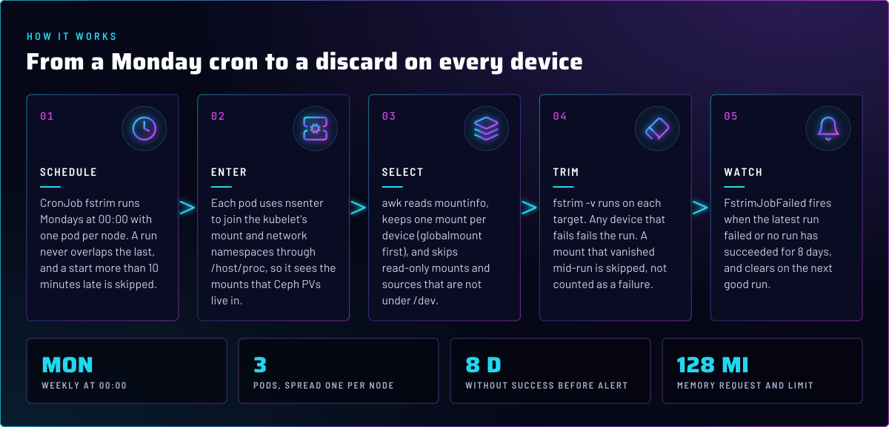

<p align="center">
  
</p>

> **Thin volumes stay thin.** fstrim runs once a week on every node and discards the blocks a filesystem has freed on
> the devices the kubelet mounts. Ceph RBD images then release that space back to the pool. Without it, a deleted file
> still occupies Ceph storage.

## At a glance

<!-- glance:start -->
<!-- Generated by `readme.py sync`; edit the manifests, not this table. -->
| | |
|---|---|
| **Namespace** | `system` |
| **Deployed by** | [`fstrim`](../../../main/system/fstrim.yaml) (Flux Kustomization) |
| **Helm chart** | `app-template`, values in [`helmrelease.yaml`](app/helmrelease.yaml) |
| **Images** | `docker.io/library/alpine` |
| **Alerts** | 1: `FstrimJobFailed` |
<!-- glance:end -->

## What it does

- **Runs** the CronJob `fstrim` in `system` every Monday at 00:00, one pod per node. The pods are spread across nodes
  by a topology constraint, and a run never overlaps the one before it.
- **Enters** the kubelet's mount and network namespaces through `/host/proc/<kubelet pid>/ns`. Ceph PVs are mounted
  under `/var/lib/kubelet`, so the trim has to run in the namespace where those mounts exist.
- **Selects** one mount per block device: the globalmount when there is one, otherwise the whole filesystem, otherwise
  a bind mount. Read-only mounts and sources that are not under `/dev` are skipped.
- **Alerts** through `FstrimJobFailed` when the latest run failed, or when no run has succeeded for 8 days.

## Why it is built this way

| Choice | Why |
|---|---|
| **Work in the kubelet's mount namespace** | A host-side trim sees the host's mounts, not the PV mounts under `/var/lib/kubelet`. Filtering kubelet mounts out (`grep -v kubelet`) trims nothing that matters (skill `system-namespaces`). |
| **One mount per device** | A device appears in `mountinfo` once per globalmount and once per bind into a pod. The awk pass keys on major:minor and keeps the best-ranked mount, so each device is trimmed once. |
| **Alert on timestamps, not on failed Jobs** | A failed Job stays in the CronJob's history until it is pruned, so `kube_job_status_failed > 0` would stay firing after the cause is gone. Comparing the last schedule with the last success clears on the next good run. |
| **`concurrencyPolicy: Forbid`** | A run can outlast its window when many blocks were never discarded. Two overlapping runs would trim the same devices twice. |
| **`privileged`, `hostPID` and `hostNetwork`** | `nsenter` into the kubelet's namespaces needs privilege and the host's process table. No probes either: a trim is one long command with no endpoint to answer. |
| **`nodeTaintsPolicy: Honor` in the spread** | `Honor` makes the constraint ignore `PreferNoSchedule` taints, so a later hard taint cannot make `DoNotSchedule` refuse the pod (skill `node-scheduling`). |

## How it works

<p align="center">
  
</p>

<details>
<summary><b>Resource graph</b>: every object involved, by name</summary>


</details>

In more detail:

1. Flux applies the `fstrim` Kustomization: an app-template HelmRelease that creates the CronJob, and the PrometheusRule
   `fstrim-rules` in [`app/prometheusrule.yaml`](app/prometheusrule.yaml).
2. At the schedule the CronJob starts a Job with up to three pods. Each pod reads the kubelet's PID with `pidof`, and
   builds the `nsenter` arguments from it.
3. The awk pass runs under `nsenter`, so `/proc/self/mountinfo` is the kubelet's view. Its output is written to a file
   in the container, sorted, and read back one target at a time.
4. For each target the script checks the path still exists in that namespace, then runs `fstrim -v`. A device that fails
   makes the pod exit non-zero. A mount that vanished since discovery is skipped, not counted as a failure.

## Settings that matter

All values are in [`app/helmrelease.yaml`](app/helmrelease.yaml).

| Setting | Value | Why |
|---|---|---|
| `cronjob.schedule` | `0 0 * * 1` | Weekly, Monday midnight. The alert's 8-day window allows one missed week before it fires. |
| `cronjob.concurrencyPolicy` | `Forbid` | A run that outlasts the week must not overlap the next (see above). |
| `cronjob.startingDeadlineSeconds` | `600` | A start more than 10 minutes late is skipped, not run at an unplanned time. |
| `cronjob.parallelism` | `3` | One pod per node, so each node trims its own mounts. |
| `cronjob.backoffLimit` | `0` | A failed trim is not retried into the same error. The alert reports it, and the next run is the retry. |
| `pod.hostNetwork`, `pod.hostPID`, `containers.app.securityContext.privileged` | `true` | Needed for `nsenter` into the kubelet's namespaces. Without them the script sees only the host's mounts. |
| `pod.topologySpreadConstraints` | `DoNotSchedule`, `nodeTaintsPolicy: Honor` | Spread across hostnames. `Honor` keeps a future hard taint from blocking the pod. |
| `resources` | 25m CPU request; 128Mi memory request and limit | Every limit has a request (skill `node-scheduling`). |
| `probes` | all disabled | A trim has no endpoint to probe, and a liveness restart would interrupt it. |

## Alerts

From [`app/prometheusrule.yaml`](app/prometheusrule.yaml), routed by the `alerts` component.

| Alert | Fires when | First look |
|---|---|---|
| `FstrimJobFailed` | The latest scheduled run is more than 60 s ahead of the last success, or no success for 8 days; sustained for 3 h | `kubectl -n system logs -l app.kubernetes.io/name=fstrim --tail=100`. The per-device lines show which target failed. |

The alert reads kube-state-metrics CronJob timestamps. It clears by itself after the next successful run.

## Operate it

```bash
flux -n system get ks fstrim
kubectl -n system get cronjob fstrim
kubectl -n system get jobs -l app.kubernetes.io/name=fstrim
kubectl -n system logs -l app.kubernetes.io/name=fstrim --tail=100
```

A manual run creates a Job, which is a write. It needs the admin kubeconfig and the owner's approval:
`kubectl -n system create job --from=cronjob/fstrim fstrim-manual`.

## Files

| File | Holds |
|---|---|
| [`app/helmrelease.yaml`](app/helmrelease.yaml) | CronJob, the trim script, pod security and spread |
| [`app/prometheusrule.yaml`](app/prometheusrule.yaml) | `FstrimJobFailed` |
| [`app/kustomization.yaml`](app/kustomization.yaml) | Resource list for the Kustomization |
| [`../../../main/system/fstrim.yaml`](../../../main/system/fstrim.yaml) | Flux Kustomization, `alerts` and `common` components |
| [`../../../../../scripts/ci/fstrim-pv-selection-test.py`](../../../../../scripts/ci/fstrim-pv-selection-test.py) | Gate for the mount selection |
| [`../../../../../scripts/ci/fstrim-failed-alert-test.py`](../../../../../scripts/ci/fstrim-failed-alert-test.py) | Gate for the alert expression |

Upstream: [fstrim(8)](https://man7.org/linux/man-pages/man8/fstrim.8.html) •
[nsenter(1)](https://man7.org/linux/man-pages/man1/nsenter.1.html) •
[Kubernetes CronJob](https://kubernetes.io/docs/concepts/workloads/controllers/cron-jobs/)

<!-- branded-readme v1 sources=a4e966be3f4d -->
