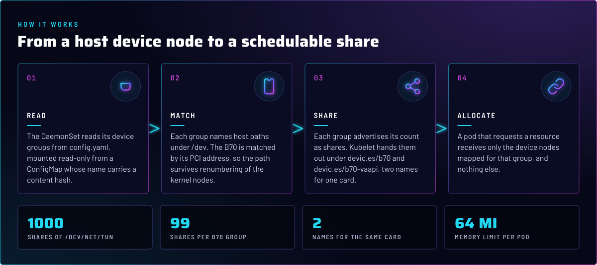
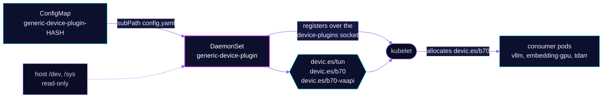

<p align="center">
  
</p>

> **Devices are scheduled, not mounted.** generic-device-plugin lists host device nodes as Kubernetes resources. A pod
> asks for `devic.es/b70: 1`, the scheduler counts it, and kubelet hands over only the device nodes for that group. No
> consumer needs a `privileged` pod to reach `/dev` itself.

## At a glance

<!-- glance:start -->
<!-- Generated by `readme.py sync`; edit the manifests, not this table. -->
| | |
|---|---|
| **Namespace** | `system` |
| **Deployed by** | [`generic-device-plugin`](../../../main/system/generic-device-plugin.yaml) (Flux Kustomization) |
| **Helm chart** | `app-template`, values in [`helmrelease.yaml`](app/helmrelease.yaml) |
| **Images** | `ghcr.io/squat/generic-device-plugin` |
<!-- glance:end -->

## What it does

- **Advertises** the device groups in [`app/config/config.yaml`](app/config/config.yaml) as `devic.es/<group>` resources:
  `tun` (1000 shares of `/dev/net/tun`), `b70` and `b70-vaapi` (99 shares each, for the Intel B70 Arc card).
- **Runs** one DaemonSet on every node. The B70 paths exist only on talos-3, so only that node advertises the two B70
  groups. The `talos-3` allocatable count is what the `B70GpuLost` alert watches (see `monitoring/kube-prometheus-stack`).
- **Maps** the host device nodes into the container at the paths the group declares, when kubelet allocates a share.
- **Reloads** on a config change, because the ConfigMap name carries a content hash. Changing the file rolls the DaemonSet.

## Why it is built this way

| Choice | Why |
|---|---|
| **A device plugin, not privileged pods** | The scheduler sees a countable resource, so a pod that needs the GPU lands only where one is free. A privileged pod per consumer would give the scheduler no count and expose all of `/dev`. |
| **Device paths keyed by PCI address** | `/dev/dri/by-path/pci-0000:03:00.0-*` names the B70 by its bus address, which stays fixed when the kernel renumbers card nodes. |
| **Two resource names for one card** | `devic.es/b70` gives Level Zero the names its config expects. `devic.es/b70-vaapi` keeps the kernel's own names, because VA-API reopens the device by its kernel name. A VA-API consumer must request `b70-vaapi`. The `mountPath` values are the contract: do not change them. See skill `intel-gpu`. |
| **Config hash in the ConfigMap name** | The config is mounted with `subPath`, and kubelet never refreshes a `subPath` mount. A static name would make a config edit inert until someone restarted the DaemonSet by hand. |
| **`--domain=devic.es`** | The pinned image defaults to another domain. Forcing `devic.es` matches the names consumers request. |
| **`system-node-critical`** | The plugin is the only thing that hands out these devices. Under node pressure it is evicted last. |
| **`PreferNoSchedule` toleration** | Hygiene only. `PreferNoSchedule` does not filter nodes. talos-3 is the only node with the B70 (skill `node-scheduling`). |

## How it works

<p align="center">
  
</p>

<details>
<summary><b>Resource graph</b>: every object involved, by name</summary>



</details>

In more detail:

1. Flux applies the Kustomization, which generates the ConfigMap `generic-device-plugin-<hash>` from
   [`app/config/config.yaml`](app/config/config.yaml). The name rewrite into the HelmRelease is done by
   [`app/kustomizeconfig.yaml`](app/kustomizeconfig.yaml).
2. The DaemonSet mounts the config read-only at `/config/config.yaml` and reads `/dev` and `/sys` from the host.
3. The plugin registers each group with kubelet over `/var/lib/kubelet/device-plugins`. Only groups whose host paths
   exist on the node advertise anything.
4. A pod that requests `devic.es/b70` or `devic.es/b70-vaapi` gets the mapped device nodes. Workloads that use the
   B70 are in `ai/vllm`, `ai/embedding-gpu` and `media/tdarr`.

## Settings that matter

All values are in [`app/helmrelease.yaml`](app/helmrelease.yaml) and [`app/config/config.yaml`](app/config/config.yaml).

| Setting | Value | Why |
|---|---|---|
| `args --domain` | `devic.es` | Consumers request `devic.es/...`. The image's default domain would advertise under a different name. |
| ConfigMap name hash | enabled, in [`app/kustomization.yaml`](app/kustomization.yaml) | `subPath` never refreshes, so the hash is what makes a config change take effect. Do not disable it. |
| `driftDetection.mode` | `enabled` | Flux reverts a hand edit to the DaemonSet on the next reconcile, so a live patch does not outlive it. |
| `defaultPodOptions.priorityClassName` | `system-node-critical` | Last to be evicted under node pressure. |
| `groups[].count` (`tun`, `b70`, `b70-vaapi`) | `1000`, `99`, `99` | Shares per group. The B70 count is per node; a pod requests one. |
| `groups[].paths[].mountPath` (`b70`, `b70-vaapi`) | see `config.yaml` | Fixed contract for Level Zero and VA-API. Changing one breaks the consumers silently (skill `intel-gpu`). |
| `resources` | 10m CPU and 32Mi memory request; 64Mi memory limit | Every limit has a request (skill `node-scheduling`). |
| `securityContext` | no escalation, read-only root filesystem, all capabilities dropped | The plugin needs `/dev`, `/sys` and the device-plugins socket directory, and nothing else. |

## Operate it

```bash
flux -n system get ks generic-device-plugin
kubectl -n system get ds generic-device-plugin -o wide
kubectl describe node talos-3 | grep 'devic.es/'     # allocatable per resource
```

Run the VA-API check in skill `intel-gpu` (`references/vaapi-check.md`) after any change here. Allocatable
`devic.es/b70` shows only the Level Zero path, and it does not prove VA-API works.

## Files

| File | Holds |
|---|---|
| [`app/helmrelease.yaml`](app/helmrelease.yaml) | DaemonSet, arguments, mounts, security context |
| [`app/config/config.yaml`](app/config/config.yaml) | Device groups: `tun`, `b70`, `b70-vaapi` |
| [`app/kustomization.yaml`](app/kustomization.yaml) | ConfigMap generator with the hash enabled |
| [`app/kustomizeconfig.yaml`](app/kustomizeconfig.yaml) | Rewrites the HelmRelease's ConfigMap reference |
| [`../../../main/system/generic-device-plugin.yaml`](../../../main/system/generic-device-plugin.yaml) | Flux Kustomization, `alerts` and `common` components |
| [`../../../../../scripts/ci/b70-vaapi-tdarr-test.py`](../../../../../scripts/ci/b70-vaapi-tdarr-test.py) | Gate: pins both B70 mountPaths and tdarr's `b70-vaapi` request |

Upstream: [generic-device-plugin](https://github.com/squat/generic-device-plugin) •
[Kubernetes device plugins](https://kubernetes.io/docs/concepts/extend-kubernetes/compute-storage-net/device-plugins/)

<!-- branded-readme v1 sources=3dd35c9092ad -->
