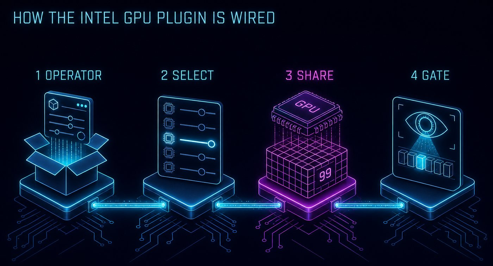
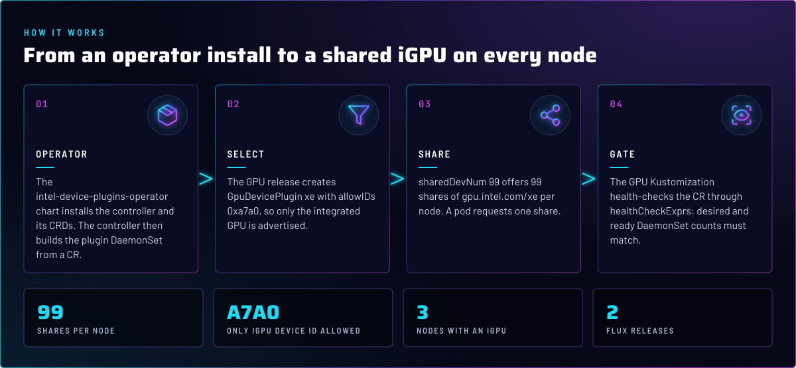
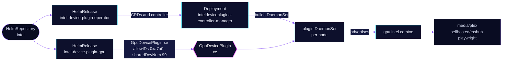

<p align="center">
  
</p>

> **One integrated GPU, shared 99 ways per node.** Intel's operator and GPU plugin advertise the integrated Xe GPU on
> each node as `gpu.intel.com/xe`. Plex and the rsshub playwright pod request a share, instead of opening `/dev/dri`
> themselves. The B70 is not in this pool; its consumers request `devic.es/b70` (skill `intel-gpu`).

## At a glance

<!-- glance:start -->
<!-- Generated by `readme.py sync`; edit the manifests, not this table. -->
| | |
|---|---|
| **Namespace** | `system` |
| **Deployed by** | [`intel-device-plugin-operator`](../../../main/system/intel-device-plugin-operator.yaml), [`intel-device-plugin-gpu`](../../../main/system/intel-device-plugin-operator.yaml) (Flux Kustomization) |
| **Helm chart** | `intel-device-plugins-operator` from `intel`, values in [`helmrelease.yaml`](app/helmrelease.yaml) |
| **Helm chart** | `intel-device-plugins-gpu` from `intel`, values in [`helmrelease.yaml`](gpu/helmrelease.yaml) |
| **Depends on** | `system/intel-device-plugin-operator` |
| **Needed by** | `media/plex`, `media/tdarr`, `system/intel-device-plugin-gpu` |
| **Health checks** | `Deployment/inteldeviceplugins-controller-manager`, `GpuDevicePlugin/xe` |
<!-- glance:end -->

## What it does

- **Installs** the operator chart `intel-device-plugins-operator` from Intel's Helm repository, into `system`. Its
  controller manager builds the plugin DaemonSet from a custom resource.
- **Declares** a `GpuDevicePlugin` named `xe` (chart `intel-device-plugins-gpu`), limited to device ID `0xa7a0`, the
  Raptor Lake iGPU, and shared 99 ways per node.
- **Gates** the GPU release on the DaemonSet's desired and ready counts, because the DaemonSet is generated and a
  plain health check on the CR would pass too early.
- **Serves** `gpu.intel.com/xe` to Plex (`media/plex`) and the rsshub playwright pod (`selfhosted`).
  Flux dependency is one step removed: only `intel-device-plugin-gpu` depends on the operator directly. `media/plex` and
  `media/tdarr` depend on the GPU Kustomization. tdarr requests `devic.es/b70-vaapi`, not `gpu.intel.com/xe`.

## Why it is built this way

| Choice | Why |
|---|---|
| **Two releases, operator first** | The GPU release `dependsOn` the operator Kustomization, so the `GpuDevicePlugin` CRD exists before its CR is applied. |
| **`allowIDs: "0xa7a0"`** | The B70 is also an `xe` device. Without the filter it would be advertised as `gpu.intel.com/xe`, and a consumer meant for the iGPU could land on the B70 (skill `intel-gpu`, tripwire 6). |
| **`sharedDevNum: 99`** | Shares, not exclusive use. Many pods can hold one, so a transcode and a playback do not compete for a whole device. |
| **`nodeFeatureRule: false`** | Git has no Node Feature Discovery deployment, so the chart's NodeFeatureRule would have nothing to read. |
| **Health through `healthCheckExprs`** | The `GpuDevicePlugin` is cluster-scoped and its DaemonSet is generated. The CR's own rollout counts are the real signal, so the Kustomization compares desired with ready. |
| **Unlimited install retries, three upgrade retries** | A first install can wait on CRDs and the controller. A failing upgrade is retried three times, then rolled back. |

## How it works

<p align="center">
  
</p>

<p align="center">
  
</p>

<details>
<summary><b>Resource graph</b>: every object involved, by name</summary>



</details>

In more detail:

1. Flux applies the operator Kustomization first. It installs the `intel` HelmRepository and the operator release, and
   health-checks `Deployment/inteldeviceplugins-controller-manager`.
2. The GPU Kustomization waits for the operator. It applies the GPU release, which creates the `GpuDevicePlugin` named
   `xe`.
3. The controller creates the plugin DaemonSet on each node. Only the iGPU, matched by `allowIDs`, is registered as
   `gpu.intel.com/xe`.
4. Consumers request `gpu.intel.com/xe: 1`. The health check passes when the DaemonSet's desired and ready counts match.

## Settings that matter

All values are in [`app/helmrelease.yaml`](app/helmrelease.yaml) and [`gpu/helmrelease.yaml`](gpu/helmrelease.yaml).
Chart versions are pinned in those files and Renovate bumps them.

| Setting | Value | Why |
|---|---|---|
| `manager.devices.gpu` (operator) | `true` | Enables the GPU device type in the operator. Without it no `GpuDevicePlugin` is reconciled. |
| `name` (GPU) | `xe` | Sets the resource name `gpu.intel.com/xe`. The health check and the alert refer to it. |
| `allowIDs` (GPU) | `"0xa7a0"` | Scopes the pool to the iGPU. Do not drop it while the B70 is also an `xe` device. |
| `sharedDevNum` (GPU) | `99` | Shares per node. A pod requests one. |
| `nodeFeatureRule` (GPU) | `false` | No Node Feature Discovery in Git (see above). |
| `tolerations` (GPU) | `home-operations.com/dedicated`, `PreferNoSchedule` | Hygiene only (skill `node-scheduling`). |
| `install.remediation.retries` | `-1` (operator and GPU) | Keeps retrying a first install until the controller and CRDs are up. |
| `upgrade.remediation.retries`, `upgrade.cleanupOnFail` | `3`, `true` | Three retries before the upgrade is rolled back. `cleanupOnFail` removes what a failed upgrade created. |

## Alerts

This directory defines none. The node-level alert for a lost iGPU is in
[`monitoring/kube-prometheus-stack`](../../monitoring/kube-prometheus-stack/app/alerts/gpu-loss.yaml) as `XeGpuLost`:
the allocatable `gpu.intel.com/xe` on a node has been 0 for a sustained period.

## Operate it

```bash
flux -n system get ks intel-device-plugin-operator intel-device-plugin-gpu
kubectl get gpudeviceplugins.deviceplugin.intel.com xe
kubectl describe nodes | grep 'gpu.intel.com/xe'     # allocatable per node
```

## Files

| File | Holds |
|---|---|
| [`app/helmrelease.yaml`](app/helmrelease.yaml) | `intel` HelmRepository and the operator HelmRelease |
| [`gpu/helmrelease.yaml`](gpu/helmrelease.yaml) | The `GpuDevicePlugin` values: `xe`, `allowIDs`, `sharedDevNum` |
| [`../../../main/system/intel-device-plugin-operator.yaml`](../../../main/system/intel-device-plugin-operator.yaml) | Two Flux Kustomizations: `intel-device-plugin-operator` and `intel-device-plugin-gpu` (depends on it) |

Upstream: [Intel device plugins for Kubernetes](https://github.com/intel/intel-device-plugins-for-kubernetes) •
[GPU plugin README](https://github.com/intel/intel-device-plugins-for-kubernetes/blob/main/cmd/gpu_plugin/README.md)

<!-- branded-readme v1 sources=3e48efc99f3d -->
