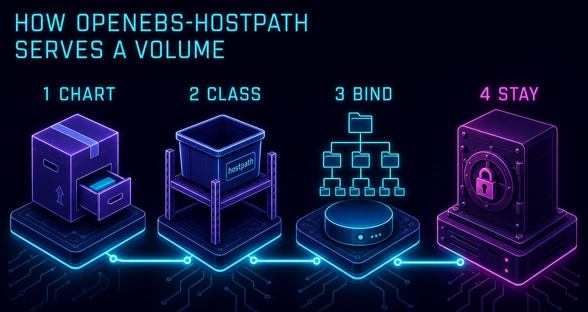
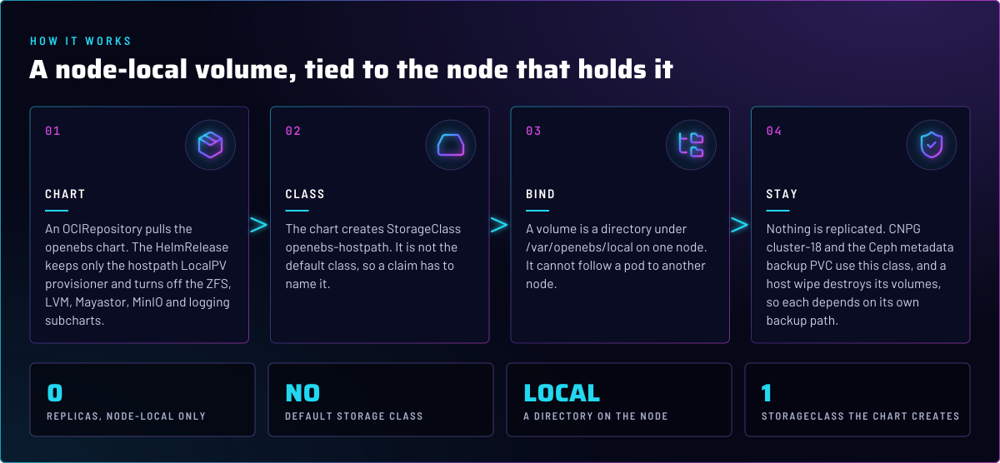
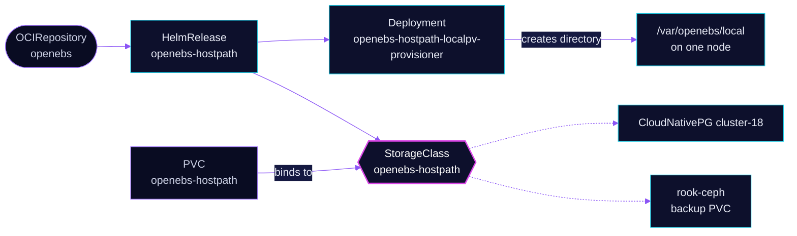

<p align="center">
  
</p>

> **Local disk, no replicas.** The OpenEBS LocalPV hostpath provisioner serves each volume as a directory on the disk of
> the node that runs its pod. Use it only for data that the application or a backup already protects, because losing
> the node loses the volume. Everything else belongs on Ceph (skill `rook-ceph`).

## At a glance

<!-- glance:start -->
<!-- Generated by `readme.py sync`; edit the manifests, not this table. -->
| | |
|---|---|
| **Namespace** | `system` |
| **Deployed by** | [`openebs-hostpath`](../../../main/system/openebs-hostpath.yaml) (Flux Kustomization) |
| **Helm chart** | `openebs` from `oci://ghcr.io/openebs/charts/openebs`, values in [`helmrelease.yaml`](app/helmrelease.yaml) |
| **Health checks** | `Deployment/openebs-hostpath-localpv-provisioner` |
<!-- glance:end -->

## What it does

- **Provisions** `openebs-hostpath` volumes through the `localpv-provisioner` Deployment. Each volume is a directory
  under `/var/openebs/local` on the node that schedules the consumer.
- **Installs** the `openebs` chart from an OCIRepository, with only the hostpath LocalPV engine turned on. ZFS, LVM,
  Mayastor, MinIO, Loki and Alloy are disabled.
- **Serves** the CloudNativePG `cluster-18` instances and the Ceph metadata backup PVC in `rook-ceph`, both of which
  claim `openebs-hostpath` by name.

## Why it is built this way

| Choice | Why |
|---|---|
| **Hostpath engine only** | The other engines need LVM or ZFS pools, or replicated storage, that this cluster does not run. They are off in values, so the chart renders nothing for them. |
| **Not the default class** | `isDefaultClass: false`. A claim without an explicit `storageClassName` does not land on one node's disk by accident. |
| **One base path for two keys** | A YAML anchor sets `localpv.basePath` and `hostpathClass.basePath` to `/var/openebs/local`. The provisioner writes where the class says it does. |
| **Chart from an OCIRepository tag** | The chart source and its tag are in Git. Renovate moves the tag, and the chart is never pulled from a floating reference. |

## How it works

<p align="center">
  
</p>

<p align="center">
  
</p>

<details>
<summary><b>Resource graph</b>: every object involved, by name</summary>



</details>

In more detail:

1. Flux applies the `openebs-hostpath` Kustomization. It creates the `openebs` OCIRepository and the HelmRelease with
   chart hooks disabled, and health-checks the provisioner Deployment.
2. The chart creates the StorageClass `openebs-hostpath`. Git does not hold it, so its binding mode and reclaim policy
   come from the cluster (see Operate it).
3. A claim against the class is served by the provisioner on the node that runs the consumer. The volume stays on that
   node's disk.
4. Nothing is replicated. The data is safe only as far as the consumer's own backups go: CNPG has its barman path, and
   the Ceph metadata backup has [`RECOVERY-PROCEDURES.md`](../../rook-ceph/rook-ceph/backup/RECOVERY-PROCEDURES.md).

## Settings that matter

All values are in [`app/helmrelease.yaml`](app/helmrelease.yaml).

| Setting | Value | Why |
|---|---|---|
| `localpv-provisioner.localpv.basePath`, `hostpathClass.basePath` | `/var/openebs/local`, one anchor | The directory the provisioner writes and the path the class reports cannot drift apart. |
| `localpv-provisioner.hostpathClass.isDefaultClass` | `false` | Keeps node-local storage opt-in. |
| `localpv-provisioner.hostpathClass.name` | `openebs-hostpath` | The name every consumer in Git uses. |
| `openebs-crds.csi.volumeSnapshots.enabled` | `false` | Snapshot CRDs are not installed. Nothing in Git snapshots this class. |
| `zfs-localpv`, `lvm-localpv`, `mayastor`, `engines.*`, `loki`, `alloy`, `minio` | `enabled: false` | Not used by this cluster. |
| `install.disableHooks`, `upgrade.disableHooks` | `true` | See Known gaps: no reason is recorded in Git. |

## Operate it

```bash
flux -n system get ks openebs-hostpath
kubectl -n system get deploy openebs-hostpath-localpv-provisioner
kubectl get storageclass openebs-hostpath -o yaml     # binding mode and reclaim policy, as the chart set them
kubectl get pvc -A -o wide | grep openebs-hostpath   # which claims live on node-local disk
```

## Known gaps

- **Two settings have no recorded reason.** `install.disableHooks` and `upgrade.disableHooks` are `true`, and
  `localpv.image.registry` is `quay.io/`. Git has no comment on either. Check the chart before changing them.
  Found while writing; not changed here.

## Files

| File | Holds |
|---|---|
| [`app/helmrelease.yaml`](app/helmrelease.yaml) | OCIRepository for the chart, and the HelmRelease values |
| [`app/kustomization.yaml`](app/kustomization.yaml) | Resource list for the Kustomization |
| [`../../../main/system/openebs-hostpath.yaml`](../../../main/system/openebs-hostpath.yaml) | Flux Kustomization, health check, `alerts` and `common` components |
| [`../../database/cloudnative-pg/cluster-18/cluster-18.yaml`](../../database/cloudnative-pg/cluster-18/cluster-18.yaml) | A consumer: `storageClass: openebs-hostpath` |
| [`../../rook-ceph/rook-ceph/backup/backup-system.yaml`](../../rook-ceph/rook-ceph/backup/backup-system.yaml) | A consumer: the Ceph metadata backup PVC |

Upstream: [OpenEBS docs](https://openebs.io/docs/) •
[Dynamic LocalPV provisioner](https://github.com/openebs/dynamic-localpv-provisioner)

<!-- branded-readme v1 sources=a196081ce0f1 -->
