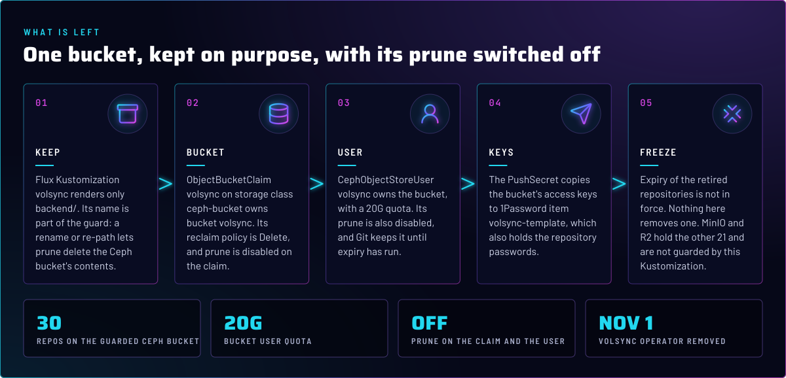
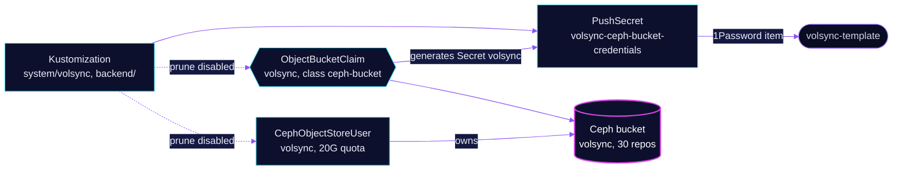

<p align="center">
  
</p>

> **The bucket stays, the operator goes.** The VolSync operator was removed on 2026-11-01. This Flux Kustomization keeps
> the Ceph bucket and user that hold 30 of the 51 retired restic repositories, with prune switched off on both, so a Git
> change cannot delete their data. The other 21 sit in MinIO and R2, which this Kustomization does not manage. Expiry of
> all 51 is **not in force**.

## At a glance

<!-- glance:start -->
<!-- Generated by `readme.py sync`; edit the manifests, not this table. -->
| | |
|---|---|
| **Namespace** | `system` |
| **Deployed by** | [`volsync`](../../../main/system/volsync.yaml) (Flux Kustomization) |
| **Pushes to 1Password** | `volsync-template` |
<!-- glance:end -->

## What it does

What Git holds now, and nothing else:

- **Keeps** the Flux Kustomization `system/volsync` under its original name. It renders only
  [`backend/`](backend/). No VolSync operator, HelmRelease or restore workload remains in Git.
- **Declares** ObjectBucketClaim `volsync` (bucket `volsync`, storage class `ceph-bucket`) and CephObjectStoreUser
  `volsync` on `ceph-objectstore` in `rook-ceph`, with a 20G quota. Both are `prune: disabled`.
- **Pushes** the bucket's access keys from the Secret the claim generates, also named `volsync`, to 1Password item
  `volsync-template` through PushSecret `volsync-ceph-bucket-credentials`. No key is in Git.
- **Covers only the Ceph bucket.** The 51 retired repositories span three destinations: 30 on Ceph, which this
  Kustomization guards, and the rest on MinIO and R2, which it does not touch. Nothing here expires, restores or deletes anything. Expiry is a separate workflow in `scripts/volsync-retired-expiry/`,
  and it is not in force. Reading one retired repository is covered in skill `kopiur-backups`.

## Why it is built this way

| Choice | Why |
|---|---|
| **Keep the Kustomization name and path** | Renaming or re-pathing it lets Flux prune the objects it no longer owns, which here means every retired repository in the bucket (skill `kopiur-backups`). |
| **`prune: disabled` on the claim and the user** | Flux will not delete them when they leave Git. It does not stop `kubectl delete` or a namespace delete, so the bucket still needs care. |
| **ObjectBucketClaim reclaim policy `Delete`** | The `ceph-bucket` class sets it, in [rook-ceph's cluster HelmRelease](../../rook-ceph/rook-ceph/cluster/helmrelease.yaml). Deleting the claim deletes the bucket and every object in it. That is why the prune annotation is on it. |
| **Keep the user until expiry has run** | The user owns the bucket. The comment in `ceph-user.yaml` says removal comes in its own PR, after `radosgw-admin bucket stats --bucket=volsync` shows another owner. |
| **Keys in 1Password, not Git** | `volsync-template` also holds the retired repositories' only passwords, so it is never deleted or rotated (skill `kopiur-backups`). |

## How it works

<p align="center">
  
</p>

<details>
<summary><b>Resource graph</b>: every object involved, by name</summary>



</details>

In more detail:

1. Flux applies the Kustomization with `alerts` and `common` components. The `backend/` resources are the only ones in its
   inventory.
2. The ObjectBucketClaim asks the `ceph-bucket` class for bucket `volsync`. The class creates it and a Secret with the
   same name, holding the bucket's access keys.
3. The PushSecret copies the two access-key fields from that Secret into 1Password item `volsync-template`.
4. The Ceph bucket holds 30 of the 51 retired restic repositories. The other 21 are on MinIO and R2, outside this Kustomization. Nothing in Git reads or writes any of them.

## Settings that matter

All values are in the files under [`backend/`](backend/).

| Setting | Value | Why |
|---|---|---|
| `metadata.annotations["kustomize.toolkit.fluxcd.io/prune"]` (ObjectBucketClaim, CephObjectStoreUser) | `disabled` | The retirement guard. Without it, removing these files from Git would delete the bucket. |
| `spec.quotas.maxSize` | `20G` | A cap on the user, not a measure of what the 30 Ceph repositories use. Git does not record current usage. |
| `spec.capabilities` | `user: "*"`, `bucket: "*"` | Broad for a user that now holds only retired data. Git gives no reason. See Known gaps. |
| `spec.storageClassName` (ObjectBucketClaim) | `ceph-bucket` | Defined in [rook-ceph's cluster HelmRelease](../../rook-ceph/rook-ceph/cluster/helmrelease.yaml), reclaim policy `Delete`. |

## Operate it

Read-only checks:

```bash
flux -n system get ks volsync                       # Ready, and the path is ./kubernetes/apps/base/system/volsync/backend
kubectl -n system get objectbucketclaim volsync
kubectl -n system get cephobjectstoreuser volsync
```

Do not delete or edit these objects with `kubectl`. A Flux change to them is a reviewed PR, and any removal waits on the
expiry decision in skill `kopiur-backups`.

## Known gaps

- **Unused substitution.** The overlay sets `postBuild.substitute.APP: volsync`, and no file under `backend/` uses
  `${APP}`. It does no harm, but it looks like a template variable that something consumes. Found while writing; not
  changed here.
- **Broad user capabilities with no reason recorded.** `capabilities` is `*` for both user and bucket. Git has no
  comment on why, and the user now holds only retired data. Review it with the removal PR.

## Files

| File | Holds |
|---|---|
| [`backend/ceph-bucket.yaml`](backend/ceph-bucket.yaml) | ObjectBucketClaim `volsync`, prune disabled |
| [`backend/ceph-user.yaml`](backend/ceph-user.yaml) | CephObjectStoreUser `volsync`, prune disabled, removal condition |
| [`backend/pushsecret.yaml`](backend/pushsecret.yaml) | Copies the bucket keys to 1Password item `volsync-template` |
| [`backend/kustomization.yaml`](backend/kustomization.yaml) | The three resources above |
| [`../../../main/system/volsync.yaml`](../../../main/system/volsync.yaml) | Flux Kustomization `volsync` (name kept on purpose) |

Upstream: [Rook object bucket claims](https://rook.io/docs/rook/latest-release/) (the bucket side) •
[VolSync](https://volsync.readthedocs.io/) (the retired operator)

<!-- branded-readme v1 sources=29cbfc27cfa6 -->
