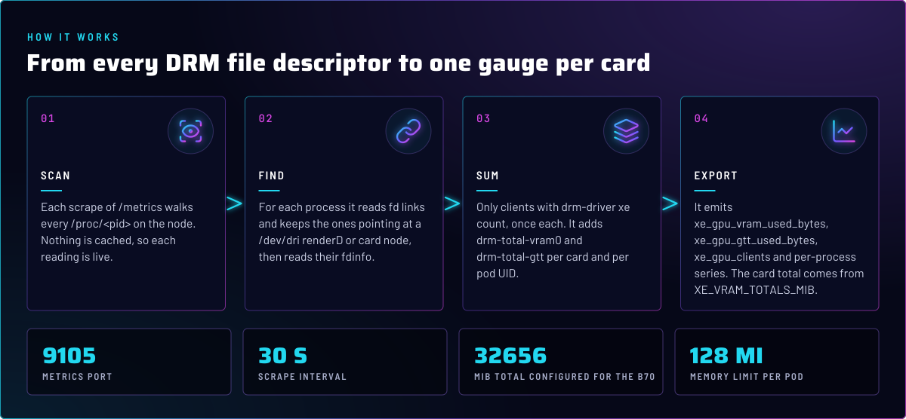
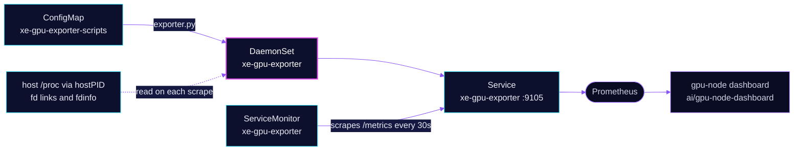

<p align="center">
  
</p>

> **VRAM for a driver that publishes none.** The xe driver exposes no VRAM counters in sysfs. This exporter reads the DRM
> `fdinfo` of every process that holds a GPU node, on each scrape, and reports VRAM and GTT use per card and per pod. The
> gpu-node dashboard reads its VRAM gauge from here.

## At a glance

<!-- glance:start -->
<!-- Generated by `readme.py sync`; edit the manifests, not this table. -->
| | |
|---|---|
| **Namespace** | `system` |
| **Deployed by** | [`xe-gpu-exporter`](../../../main/system/xe-gpu-exporter.yaml) (Flux Kustomization) |
| **Helm chart** | `app-template`, values in [`helmrelease.yaml`](app/helmrelease.yaml) |
| **Images** | `docker.io/library/python` |
| **Depends on** | `monitoring/kube-prometheus-stack` |
<!-- glance:end -->

## What it does

- **Serves** `/metrics` and `/healthz` on port 9105, from a Python 3 script that runs in a DaemonSet on every node. The
  pod tolerates the dedicated taint with `PreferNoSchedule`.
- **Reports** `xe_gpu_vram_used_bytes`, `xe_gpu_gtt_used_bytes` and `xe_gpu_clients` per card, `xe_gpu_vram_total_bytes`
  from configuration, and per-process `xe_gpu_process_vram_bytes` and `xe_gpu_process_gtt_bytes` labelled with pod UID
  and command name. `xe_gpu_exporter_up` says whether the last scan completed.
- **Scrapes** through the ServiceMonitor `xe-gpu-exporter` every 30 seconds, with a 10-second timeout.
- **Feeds** the gpu-node dashboard in [`ai/gpu-node-dashboard`](../../ai/gpu-node-dashboard/app/gpu-node.json).

## Why it is built this way

| Choice | Why |
|---|---|
| **Read `fdinfo`, not sysfs** | Each DRM client publishes `drm-total-vram0` and `drm-total-gtt` in its own `fdinfo`. Summing those is the only per-card VRAM figure the driver offers. |
| **`hostPID` and `SYS_PTRACE` as root** | Reading another pod's `/proc/<pid>/fd` links needs `ptrace` rights across pod boundaries. Everything else is locked down: read-only root filesystem, all capabilities dropped but `SYS_PTRACE`, no privilege escalation. |
| **No host mounts** | `/proc` comes from the host through `hostPID`. The pod mounts nothing from the host filesystem. |
| **Capacity from configuration** | xe reports no VRAM total. `XE_VRAM_TOTALS_MIB` carries the Level Zero figure for the B70 (32656 MiB). The BAR size is not the capacity: it is 256 MiB without Resizable BAR. |
| **Idle cards report 0** | A configured card with no DRM clients is exported as 0 used, not dropped, so its series never disappears from a graph. |
| **Script in a ConfigMap, name not hashed, Reloader on** | The name stays fixed. Python loads the script once, so the `reloader.stakater.com/auto` annotation restarts the pods when the script changes. |
| **No API token** | The exporter calls no Kubernetes API, so `automountServiceAccountToken` is `false`. |

## How it works

<p align="center">
  
</p>

<details>
<summary><b>Resource graph</b>: every object involved, by name</summary>



</details>

In more detail:

1. Flux applies the HelmRelease, which runs the DaemonSet, the Service, the ServiceMonitor, and mounts the script
   ConfigMap at `/scripts`. The ConfigMap is generated from [`app/resources/exporter.py`](app/resources/exporter.py).
2. On each scrape, the script lists `/proc/<pid>` for every numeric PID. It keeps the fd links that point at a `renderD`
   or `card` node, and only for drivers named `xe`. Each DRM client counts once, by `drm-client-id`.
3. The card's VRAM comes from `drm-total-vram0` and its GTT from `drm-total-gtt`. Processes are grouped by pod UID and
   command name, parsed from the cgroup path.
4. `/healthz` answers without a scan, so the probes stay cheap. A failed scan still returns HTTP 200, with
   `xe_gpu_exporter_up 0`. Read that series, not the target's `up`.

## Settings that matter

All values are in [`app/helmrelease.yaml`](app/helmrelease.yaml).

| Setting | Value | Why |
|---|---|---|
| `defaultPodOptions.hostPID` | `true` | Needed to see other pods' processes at all. |
| `containers.app.securityContext.runAsUser` | `0` | Reading another user's fd links needs root plus `SYS_PTRACE`. |
| `capabilities` | drop `ALL`, add `SYS_PTRACE` | Smallest set that lets `readlink` cross pod boundaries. |
| `readOnlyRootFilesystem`, `allowPrivilegeEscalation` | `true`, `false` | The script writes nothing. |
| `env.XE_VRAM_TOTALS_MIB` | `"0000:03:00.0=32656"` | Capacity per PCI address, in MiB. Add a second card here when one exists (skill `intel-gpu`, `references/second-card.md`). |
| `probes` | `/healthz` on 9105, every 30 s, 5 s timeout | Liveness and readiness share one custom spec. |
| `resources` | 10m CPU and 32Mi memory request; 128Mi memory limit | Every limit has a request (skill `node-scheduling`). |
| `serviceMonitor.endpoints` | `/metrics`, 30 s interval, 10 s timeout | Scrape cadence for the dashboard. |
| `image` | pinned by digest | Renovate moves it. The digest keeps the script's runtime fixed between Renovate runs. |

## Operate it

```bash
flux -n system get hr xe-gpu-exporter                    # HelmRelease status
kubectl -n system get ds xe-gpu-exporter -o wide
kubectl -n system logs -l app.kubernetes.io/name=xe-gpu-exporter --tail=50
kubectl get --raw /api/v1/namespaces/system/services/xe-gpu-exporter:9105/proxy/metrics | grep '^xe_gpu_exporter_up'
```

`xe_gpu_exporter_up 0` means the last `/proc` scan raised an `OSError`. The pod stays Ready, so check the series.

## Known gaps

- **The contract test is missing.** The docstring in [`app/resources/exporter.py`](app/resources/exporter.py) names
  `scripts/ci/xe-gpu-exporter-test.py` as the contract. No file of that name exists in `scripts/ci/`, so CI does not
  check the output format. Found while writing; not changed here.

## Files

| File | Holds |
|---|---|
| [`app/helmrelease.yaml`](app/helmrelease.yaml) | DaemonSet, Service, ServiceMonitor, security context, the B70 capacity |
| [`app/resources/exporter.py`](app/resources/exporter.py) | The exporter: fdinfo scan, text exposition, `/healthz` |
| [`app/kustomization.yaml`](app/kustomization.yaml) | ConfigMap generator for the script, name not hashed |
| [`../../../main/system/xe-gpu-exporter.yaml`](../../../main/system/xe-gpu-exporter.yaml) | Flux Kustomization, depends on `monitoring/kube-prometheus-stack` |

Upstream: [DRM usage statistics (fdinfo)](https://docs.kernel.org/gpu/drm-usage-stats.html) •
[Prometheus exposition format](https://prometheus.io/docs/instrumenting/exposition_formats/)

<!-- branded-readme v1 sources=b5dedc3be342 -->
